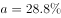
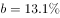

# 两期比重升降比较（比重变化定性判断）

考点：[[20-考点/资料分析/比重/两期比重升降比较（比重变化定性判断）|比重 / 两期比重升降比较（比重变化定性判断）]]
材料：[[15-材料/资料分析/270497 2019年江苏省保险业运行情况（保费|270497 2019年江苏省保险业运行情况（保费]]

**问法模型**：'××险种保费收入占总保费收入比重同比增加'→两期比重比较模型：部分增速a＞整体增速g⟺比重上升，只需比增速、无需算比重值

## 推理链
1. 第1步：题干出现'保费收入占总保费收入比重同比增加的险种'，判定为两期比重升降比较问题；整体=2019年总保费收入3750.2亿元，部分=四个险种（财产险940.9、寿险2215.3、健康险508.8、意外伤害险85.2，合计恰为3750.2）
2. 第2步：规则——部分增速a＞整体增速g⟺现期比重＞基期比重，即'比重同比增加'；a＜g则比重下降
3. 第3步：从文字材料定位总保费收入增速g与四个险种各自的收入增速（本档案文本中增速数值空缺、仅见'增长'方向，比较结论取自官方解析）
4. 第4步：逐一比较：财产险、寿险、意外伤害险的增速均低于总保费增速g，四个险种中仅健康险增速高于g
5. 第5步：故比重同比增加的险种只有健康险，与选项对照选C

**最快解法**：⚡ 两期比重结论法（秒杀）：见'比重同比增加/上升'不列比重公式，直接口算比较部分增速与整体增速——仅当险种增速＞总保费增速（3750.2对应的增速）时比重才上升；四个险种中只有健康险胜出，直接锁定C，全程无需除法

## 易错点
- ⚠ 把'现期规模大'当'比重上升'：寿险现期2215.3亿元规模最大，但占比升降只看增速相对大小，寿险增速＜总保费增速，比重反而下降
- ⚠ 收入端/赔付端口径混淆：比的是保费收入端（总量3750.2与四险种940.9/2215.3/508.8/85.2），不可误取赔付端数据（998.6、534.5、寿险赔付294.3'下降'等），寿险赔付下降与寿险收入增速无关
- ⚠ 方向记反：部分增速＞整体增速⟹比重上升，判断基准是'部分vs整体'；若反向用'整体增速大于部分增速'来定'比重增加'会选错

## 母题抽象
> 🧩 当题干出现'部分占整体的比重同比上升/下降（增加/减少）'且只问是哪个部分时，用两期比重结论：直接比较部分增速a与整体增速g，a＞g⟹比重上升、a＜g⟹比重下降，无需计算基期比重；只有要求量化'比重变化几个百分点'时才用公式Δ=现期比重×(a−g)/(1+g)

**同类特征**：占……比重同比增加、两期比重比较、部分增速与整体增速对比、比重升降定性判断、分项中找唯一胜出者、只比较不计算

## 相关题
- [[10-真题/资料分析/综合/10204448 综合分析-逐项判断（历史极值确认、两期比重比较、多期累计求和、基期比重）|10204448]]（广东 2024，相关度1）
- [[10-真题/资料分析/比重/17097813 两期比重比较（比重差计算）|17097813]]（山西 2024，相关度1）
- [[10-真题/资料分析/比重/1746802 两期比重变化比较（增速比较法，连续两年判断）|1746802]]（国考 2016，相关度1）
- [[10-真题/资料分析/比重/2136660 两期比重变化比较（比重上升判断）|2136660]]（河南 2017，相关度1）
- [[10-真题/资料分析/比重/2281002 两期比重比较（比重升降-高于上年判断）|2281002]]（四川 2018，相关度1）

---

### 题干
2019年保费收入占江苏省总保费收入比重同比增加的险种是：

### 选项
- A. 寿险
- B. 财产险
- C. 健康险　✅
- D. 意外伤害

### 官方解析

根据题干“······占······比重同比增加的险种是”，可判定本题为两期比重比较问题。根据两期比重比较结论：当部分增长率（）整体增长率（）时，比重上升。定位文字材料可得：（2019年江苏省）全年保费收入比上年增长；其中，财产险收入增长；寿险收入增长；健康险收入增长；意外伤害险收入增长。其中只有健康险的同比增速（）江苏省总保费收入的同比增速（），即比重同比增加。

故正确答案为C。

### 给定材料

        2019年江苏省金融信贷规模扩大，保险行业发展较快。全年保费收入3750.2亿元，比上年增长。其中，财产险收入940.9亿元，增长；寿险收入2215.3亿元，增长；健康险收入508.8亿元，增长；意外伤害险收入85.2亿元，增长。全年保险赔付998.6亿元，比上年增长。其中，财产险赔付534.5亿元，增长；寿险赔付294.3亿元，下降，健康险赔付144.8亿元，增长；意外伤害险赔付25.0亿元，增长。年末金融机构人民币存贷款情况见下表。

