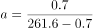
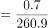
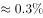
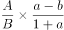
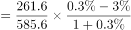
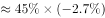
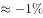

# 两期比重差计算（现期比重与基期比重比较变化多少个百分点）

考点：[[20-考点/资料分析/比重/两期比重差计算（现期比重与基期比重比较变化多少个百分点）|比重 / 两期比重差计算（现期比重与基期比重比较变化多少个百分点）]]
材料：[[15-材料/资料分析/270540 以2018年中国茶叶产销概况（产量、|270540 以2018年中国茶叶产销概况（产量、]]

**问法模型**：题干问'2018年占全球比重与2017年相比上升/下降几个百分点' → 两期比重差模型：分别求现期、基期比重作差，或用公式 A/B×(a−b)/(1+b) 一式定大小

## 推理链
1. 第1步：由题干定位两期比重问题，提取现期数据：2018年中国茶叶产量261.6万吨、全球产量585.6万吨；中国产量'同比增长0.7万吨'是增长量，故2017年中国产量=261.6−0.7=260.9万吨。
2. 第2步：分母（全球产量）增速为材料挖空呈现项，原题完整材料此处给出'同比增长约3%'（见疑点），据此求基期：2017年全球产量=585.6/(1+3%)≈568.5万吨。
3. 第3步：现期比重=261.6/585.6≈44.7%；基期比重=260.9/568.5≈45.9%。
4. 第4步：比重差=44.7%−45.9%≈−1.2个百分点，即下降约1个百分点。
5. 第5步：方向复核：分子增速a=0.7/260.9≈0.27%＜分母增速b≈3%，比重必下降，排除A、B；量级上44.7%×(3%−0.27%)/1.03≈1.2个百分点，远小于10个百分点，排除D。
6. 第6步：与选项对照，'下降了约1个百分点'对应C，与官方答案一致。

**最快解法**：⚡ 两期比重差公式法+定性排除：先算a=0.7/260.9≈0.3%、b≈3%，a＜b⇒比重下降，秒杀排除A、B；再代入 A/B×(a−b)/(1+b)=44.7%×(−2.7%)/1.03≈−1.2个百分点，即下降约1个百分点，锁定C（全程可用截位心算）。

## 易错点
- ⚠ '同比增长0.7万吨'是增长量不是增长率：2017年中国产量须用261.6−0.7=260.9万吨倒推，误按增长率处理会算错基期比重。
- ⚠ 方向判断：分子（中国产量）虽在增长，但增速0.27%远低于全球约3%，比重是下降的——不能见'增长'就选'上升'。
- ⚠ 量级与单位：结果单位是'个百分点'且仅约1.2个，'10个百分点'选项是量级陷阱；另外本版材料全球增速被挖空，若漏用该增速无法定量，易凭感觉误选D。

## 母题抽象
> 🧩 当题干出现'现期A占B的比重与上年相比上升/下降几个百分点'时，先比较部分增速a与整体增速b定性升降（a<b则下降），再用两期比重差公式 A/B×(a−b)/(1+b) 估量级，且结果必小于|a−b|个百分点的绝对差。

**同类特征**：占…的比重与（基期年份）相比、两期比重变化、上升/下降…个百分点、部分量与整体量的增速比较、需要倒推基期量（增长量条件）

## 相关题
- [[10-真题/资料分析/比重/15419181 两期比重变化（比重差计算与升降判断）|15419181]]（湖北 2025，相关度1）
- [[10-真题/资料分析/比重/19283734 两期比重差计算（比重升降及变化幅度）|19283734]]（国考 2025，相关度1）
- [[10-真题/资料分析/综合/2049736 综合分析（混合增长率+两期比重变化判定）|2049736]]（山东 2017，相关度1）

---

### 题干
2018年中国茶叶产量占全球茶叶产量的比重与2017年相比：

### 选项
- A. 上升了约1个百分点
- B. 上升了约10个百分点
- C. 下降了约1个百分点　✅
- D. 下降了约10个百分点

### 官方解析

根据题干“2018年······占······的比重与2017年相比”，可判定本题为两期比重计算问题。定位文字材料可得，2018年全球茶叶产量585.6万吨（），同比增长约（），中国茶叶产量261.6万吨（），同比增长0.7万吨。则2018年中国茶叶产量同比增速，2018年与2017年相比，中国茶叶产量占全球茶叶产量的比重差为，即下降了约1个百分点。

故正确答案为C。

### 给定材料

        2018年全球茶叶产量585.6万吨，同比增长约，中国茶叶产量261.6万吨，同比增长0.7万吨。2018年，中国茶叶国内销售量为191万吨，同比增长，国内销售总额为2661亿元，出口量为36.5万吨，同比增长，出口总额为17.89亿美元（合人民币120亿元），同比增长（？）。

> [!warning] 疑点（官方解析可能有误，待人工复核）
> 本版材料将'2018年全球茶叶产量同比增长约（）'处数值挖空，官方解析中该数据同样以缺空括号呈现，但两期比重定量计算必须用到该增速（原题完整材料此处应为'同比增长约3%'）。按该口径计算：44.7%−45.9%=−1.2个百分点，与官方答案C'下降约1个百分点'一致；若严格按本版挖空材料，仅能凭a=0.27%远小于个位数整体增速定性判断'下降'，无法独立复现'约1个百分点'的量级，考生须以原题完整数据为准。
