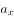
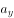
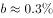
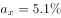
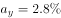

# 两期比值（比重）升降比较——分子增速与分母增速比较法

考点：[[20-考点/资料分析/比重/两期比值（比重）升降比较——分子增速与分母增速比较法|比重 / 两期比值（比重）升降比较——分子增速与分母增速比较法]]
材料：[[15-材料/资料分析/270540 以2018年中国茶叶产销概况（产量、|270540 以2018年中国茶叶产销概况（产量、]]

**问法模型**：'2018年的两个比值（销售量/产量、出口量/产量）与2017年相比升降'→ 两期比值比较模型：分子增速＞分母增速则比值上升，无需算比值本身，只需分别比较销售量、出口量增速与产量增速（≈0.27%）

## 推理链
1. 第1步：从文字提取：2018年中国茶叶产量261.6万吨、同比增加0.7万吨（是增长量），国内销售量191万吨（增速被挖空），出口量36.5万吨（增速被挖空）
2. 第2步：倒推基期并复用题1结论：2017年产量=261.6−0.7=260.9万吨，产量（分母）增速=0.7/260.9≈0.27%
3. 第3步：从统计图读取基期：2017年出口量35.5万吨，出口量（分子之一）增速=(36.5−35.5)/35.5=1/35.5≈2.8%
4. 第4步：引用规则（两期比重结论）：当分子增速＞分母增速时，比值上升；反之下降
5. 第5步：判定出口比值：出口量增速2.8%＞产量增速0.27%，故'出口量/产量'比值2018年较2017年上升
6. 第6步：判定销售比值：国内销售量同比增速（原题给定值，高于0.27%）＞产量增速0.27%，故'销售量/产量'比值同样上升
7. 第7步：两个比值均上升，对照选项得B（两者均上升）

**最快解法**：⚡ 两期比值结论法（定性增速比较）：只算两个增速——产量增速0.7/260.9≈0.27%（截位直除），出口量增速1/35.5≈2.8%，二者均远大于0.27%（销售量增速原题给定亦大于0.27%），直接锁定'两者均上升'，完全不计算2018年与2017年比值本身

## 易错点
- ⚠ '同比增长0.7万吨'是增长量不是增长率：须先求基期261.6−0.7=260.9万吨再算增速≈0.27%，误把0.7当成'0.7%'则基期与增速全错
- ⚠ 2017年出口量基期值35.5万吨只能从柱状图读取，勿误用2018年36.5万吨作分母（基期现期颠倒）或漏看图而断定'数据不足'
- ⚠ 文字段中国内销售量增速、出口量增速均被故意挖空，勿因'找不到增速'而误判无法比较或乱选；应复用兄弟题推得的产量增速≈0.27%作基准，直接定性比较，切勿去硬算两年各自的比值

## 母题抽象
> 🧩 当题干出现'两期比值/比重/平均数升降比较'且基期量需倒推或读图时，不算比值本身，用'分子增速＞分母增速→上升'定性判断：先由增长量求基期（261.6−0.7=260.9）、由图取基期（35.5），再逐一比较增速与分母增速（≈0.27%）

**同类特征**：2018年的…值与2017年相比、两个比值（销售量/产量、出口量/产量）同题比较、同比增长0.7万吨（增长量口径）、同比增速在原文被挖空、需读图取2017年出口量35.5万吨、两期比值升降定性判断

## 相关题
（暂无）

---

### 题干

设中国茶叶国内销售量和出口量与当年中国茶叶产量的比值分别为和，则2018年的和值与2017年分别相比：

### 选项
- A. 
两者均下降

- B. 
两者均上升
　✅
- C. 
只有值上升

- D. 
只有值上升

### 官方解析

根据题干“设······与······的比值分别为和，则2018年的和值与2017年分别相比”，可判定本题为比值比较问题。定位文字材料可得，2018年中国茶叶产量261.6万吨，同比增长0.7万，中国茶叶国内销售量为191万吨，同比增长（），出口量为36.5万吨，同比增长（）。根据本篇材料第1题的计算结果可知，2018年中国茶叶产量同比增速，根据两期比重结论，当时，比重上升，2018年茶叶国内销售量增速（）和出口量增速（）均高于茶叶产量增速（），可知2018年中国茶叶国内销售量和出口量与当年中国茶叶产量的比值均高于上年同期，即2018年的、值与2017年相比均有所上升。

故正确答案为B。

### 给定材料

        2018年全球茶叶产量585.6万吨，同比增长约，中国茶叶产量261.6万吨，同比增长0.7万吨。2018年，中国茶叶国内销售量为191万吨，同比增长，国内销售总额为2661亿元，出口量为36.5万吨，同比增长，出口总额为17.89亿美元（合人民币120亿元），同比增长（？）。

> [!warning] 疑点（官方解析可能有误，待人工复核）
> 材料文字段中'国内销售量同比增速'被挖空，所给材料无法独立验证其高于产量增速≈0.27%，官方解析依据原题给定增速（大于0.27%）判定该比值上升；出口量增速可由图中35.5→36.5验证为≈2.8%＞0.27%。此为材料挖空导致的验证局限，非解析错误，不影响官方答案B（两者均上升）的结论

<!-- CODEX-ANSWER-REVIEW:BEGIN -->
### 本次独立复核

**复核状态：** `resolved`（答案与解析已核定）

**计分答案：** B（可计分）

**复核解析：**

2018产量261.6万吨，较2017增加0.7，国内销量191万吨增长5.1%，出口36.5万吨增长2.8%。基期产量260.9、国内销量约181.7、出口约35.5；国内销量/产量由约69.6%升至73.0%，出口/产量由约13.6%升至14.0%，两比值均上升，B。

**相关信息：**

两期比重变化常用公式：现期比重×(部分增长率−整体增长率)/(1+部分增长率)；部分增速高于整体时比重上升。

**题源依据：** [固定版本原题](https://github.com/Mentat-Uran/kaogongzhentizhengliu/blob/84ab93d4b64b61d897bece8a1c0a5bab06b4feb2/10-%E7%9C%9F%E9%A2%98/%E8%B5%84%E6%96%99%E5%88%86%E6%9E%90/%E6%AF%94%E9%87%8D/2742308%20%E4%B8%A4%E6%9C%9F%E6%AF%94%E5%80%BC%EF%BC%88%E6%AF%94%E9%87%8D%EF%BC%89%E5%8D%87%E9%99%8D%E6%AF%94%E8%BE%83%E2%80%94%E2%80%94%E5%88%86%E5%AD%90%E5%A2%9E%E9%80%9F%E4%B8%8E%E5%88%86%E6%AF%8D%E5%A2%9E%E9%80%9F%E6%AF%94%E8%BE%83%E6%B3%95.md)；固定内容 commit `84ab93d4b64b61d897bece8a1c0a5bab06b4feb2`，Markdown blob `b30d884fa1ff36442da621bd4dbbecf9996f1b0a`。
<!-- CODEX-ANSWER-REVIEW:END -->
