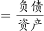
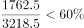
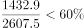
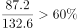

# 比重类比值比较计数（资产负债率与‘四上’整体资产负债率比较）

考点：[[20-考点/资料分析/比重/比重类比值比较计数（资产负债率与‘四上’整体资产负债率比较）|比重 / 比重类比值比较计数（资产负债率与‘四上’整体资产负债率比较）]]
材料：[[15-材料/资料分析/272113 2015年S省“四上”企业（6个一级|272113 2015年S省“四上”企业（6个一级]]

**问法模型**：题干为‘服务业10个子行业中，资产负债率高于（“四上”企业整体）水平的有几个’的比值比较计数题 → 先用‘负债合计÷资产合计’算出基准资产负债率，再对各子行业‘负债÷资产’截位直除，与基准比较后计数

## 推理链
1. 第1步：由注释取公式‘资产负债率=负债/资产’，先算比较基准——‘四上’6个一级分类合计：资产107061.7+16566.2+46749.1+17536.8+1211.0+46939.4=236064.2亿元，负债56888.8+9846.8+35200.6+12584.6+888.9+26358.9=141768.6亿元
2. 第2步：基准资产负债率=141768.6/236064.2≈60.1%
3. 第3步：对10个服务业子行业逐个‘负债÷资产’截位直除取首两位：交通运输5651.2/9600.7≈58.9%、信息传输1762.5/3218.5≈54.8%、租赁商务15029.8/27332.3≈55.0%、科研1432.9/2607.5≈55.0%、水利环境1221.4/2120.4≈57.6%、居民服务87.2/132.6≈65.8%、教育68.4/138.8≈49.3%、卫生179.1/270.7≈66.2%、文化体育568.0/994.4≈57.1%、房地产服务358.3/523.5≈68.4%
4. 第4步：与基准60.1%逐一对照，高于60.1%的只有居民服务(65.8%)、卫生和社会工作(66.2%)、房地产服务业(68.4%)，交通运输58.9%为最接近但未超
5. 第5步：计数得3个，与选项A(3)对照，故选A

**最快解法**：⚡ 基准锚定+截位直除：先算‘四上’整体资产负债率141768.6/236064.2≈60.1%定锚；再对10个子行业只除到首两位与60%比：87.2/132.6→65%+、179.1/270.7→66%+、358.3/523.5→68%+三个超60%，交通运输58.9%、水利57.6%、文化57.1%、信息54.8%、租赁55.0%、科研55.0%、教育49.3%均不足，直接数出3个，选A

## 易错点
- ⚠ 比较基准误判：基准是‘四上’企业整体资产负债率(≈60.1%)而非服务业整体(26358.9/46939.4≈56.2%)；若误用后者，会把交通运输(58.9%)、水利环境(57.6%)、文化体育(57.1%)也计入而错选D(6个)
- ⚠ 口径混淆：‘房地产开发企业’(35200.6/46749.1≈75.3%)是6个一级分类之一，不属于服务业子行业，误纳入会计成4个；‘房地产服务业’(358.3/523.5)才是子行业
- ⚠ 计算策略与漏项：10个子行业逐个精算太慢，应先算基准再逐个截位直除比首两位；勿漏掉数值很小的居民服务(132.6/87.2)，也勿错用‘资产−负债’（所有者权益公式）作比较

## 母题抽象
> 🧩 当题干出现‘某大类各子项中，比值型指标（资产负债率/利润率等）高于整体（或某基准）的有几个’时，先用‘分子合计÷分母合计’求出基准值，再对各子项‘分子÷分母’截位直除只比首两位即可计数，无需算出每个精确比值

**同类特征**：资产负债率高于……的行业有几个、规模以上服务业企业（10个子行业）逐项比较、比值比较计数型问法、比较基准为‘四上’企业整体资产负债率、注释给出资产负债率=负债/资产、选项为连续个数3/4/5/6

## 相关题
（暂无）

---

### 题干

2015年S省规模以上服务业企业中，资产负债率高于的行业有几个？

### 选项
- A. 3　✅
- B. 4
- C. 5
- D. 6

### 官方解析

根据题干“2015年······资产负债率高于的行业有几个”，可判定本题为比值比较问题。根据注释“资产负债率”，定位表格材料可得，规模以上各服务业企业资产负债率分别为：交通运输、仓储和邮政业：；信息传输、软件和信息技术服务业：；租赁和商务服务业：；科学研究和技术服务业：；水利、环境和公共设施管理业：；居民服务、修理和其他服务业：；教育：；卫生和社会工作：；文化、体育和娱乐业：；房地产服务业：。故有居民服务、修理和其他服务业，卫生和社会工作，房地产服务业共3个行业资产负债率高于。

故正确答案为A。

### 给定材料

> [!warning] 疑点（官方解析可能有误，待人工复核）
> 给定题干省略了比较对象（‘高于’后无宾语），按官方答案‘3个’（居民服务、卫生和社会工作、房地产服务业）反推，基准应为‘四上’企业整体资产负债率（141768.6/236064.2≈60.1%），该口径下官方答案无误；若以服务业整体资产负债率（≈56.2%）为基准则应为6个，与答案不符，属基准口径敏感题，官方解析原文中各行业比值公式缺失但不影响结论

<!-- CODEX-ANSWER-REVIEW:BEGIN -->
### 本次独立复核

**复核状态：** `resolved`（答案与解析已核定）

**计分答案：** A（可计分）

**复核解析：**

公式图给出的整体“四上”企业资产负债率基准为60%。逐行业按负债/资产比较，超过60%的仅三项：居民服务179.1/270.7、卫生和社会工作358.3/523.5、房地产服务业87.2/132.6；其余所列比值低于60%。因此有3个，选A。题干阈值图明确为60%，疑点所称缺失比较对象可从题意与解析明确补足为60%。

**相关信息：**

资产负债率=负债总额÷资产总额；比较时使用同一60%阈值。

**题源依据：** [固定版本原题](https://github.com/Mentat-Uran/kaogongzhentizhengliu/blob/84ab93d4b64b61d897bece8a1c0a5bab06b4feb2/10-%E7%9C%9F%E9%A2%98/%E8%B5%84%E6%96%99%E5%88%86%E6%9E%90/%E6%AF%94%E9%87%8D/2776076%20%E6%AF%94%E9%87%8D%E7%B1%BB%E6%AF%94%E5%80%BC%E6%AF%94%E8%BE%83%E8%AE%A1%E6%95%B0%EF%BC%88%E8%B5%84%E4%BA%A7%E8%B4%9F%E5%80%BA%E7%8E%87%E4%B8%8E%E2%80%98%E5%9B%9B%E4%B8%8A%E2%80%99%E6%95%B4%E4%BD%93%E8%B5%84%E4%BA%A7%E8%B4%9F%E5%80%BA%E7%8E%87%E6%AF%94%E8%BE%83%EF%BC%89.md)；固定内容 commit `84ab93d4b64b61d897bece8a1c0a5bab06b4feb2`，Markdown blob `2ce45c6edb95c02ef9983ea3c057b0bab1d8eeae`。
<!-- CODEX-ANSWER-REVIEW:END -->
