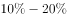
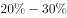
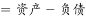
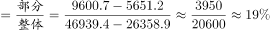

# 现期比重计算（所有者权益=资产−负债的间接求值型）

考点：[[20-考点/资料分析/比重/现期比重计算（所有者权益=资产−负债的间接求值型）|比重 / 现期比重计算（所有者权益=资产−负债的间接求值型）]]
材料：[[15-材料/资料分析/272113 2015年S省“四上”企业（6个一级|272113 2015年S省“四上”企业（6个一级]]

**问法模型**：题干问'某子行业所有者权益占某总体所有者权益的比重在哪个范围内' → 分子分母均需先用'资产−负债'换算成所有者权益，再作商落区间

## 推理链
1. 第1步：从表中提取2015年交通运输、仓储和邮政业资产总计9600.7亿元、负债总计5651.2亿元；规模以上服务业企业资产总计46939.4亿元、负债总计26358.9亿元
2. 第2步：按表下注释公式，所有者权益=资产总计−负债总计
3. 第3步：分子=9600.7−5651.2=3949.5亿元；分母=46939.4−26358.9=20580.5亿元
4. 第4步：比重=3949.5÷20580.5≈19.2%（截位直除395÷2058≈19.2%）
5. 第5步：19.2%落在15%~20%区间内，与B项范围吻合，故选B

**最快解法**：⚡ 截位直除+区间排除：先做两次减法得权益3949.5与20580.5，再截前三位直除395÷2058≈19.2%，无需精确计算即可锁定B项区间

## 易错点
- ⚠ 跳过注释公式直接用负债/资产（5651.2÷46939.4≈12%）或资产占比（9600.7÷46939.4≈20.5%）作比重，口径错误致误选A或C；比重两侧必须都是'所有者权益'口径
- ⚠ 分子分母口径不一致：如分子用权益、分母直接用负债或资产，或分母误取'四上'全部企业权益而非规模以上服务业权益
- ⚠ 误把'房地产服务业'或一级分类'房地产开发企业'数据混入计算，两者名称相近但口径完全不同；本题分子只用'其中'项交通运输、仓储和邮政业数据

## 母题抽象
> 🧩 当题干出现'A的所有者权益占B的所有者权益比重'且表格只给资产、负债两列时，先用'资产−负债'分别算出A、B的权益，再作商，选项为区间时截位直除两位有效数字即可锁定

**同类特征**：现期比重、'所有者权益'需按注释公式自算、子行业占母行业比重、选项为数值区间（范围内）、单一时点存量数据、注释定义式材料

## 相关题
- [[10-真题/资料分析/比重/4792819 现期比重计算（多部分比重依次求解）|4792819]]（新疆 2014，相关度1）
- [[10-真题/资料分析/比重/827355 现期比重比较（部分占比过半速判）|827355]]（政法干警 2014，相关度1）
- [[10-真题/资料分析/比重/2272297 现期比重比较|2272297]]（选调 2015，相关度1）
- [[10-真题/资料分析/比重/2032972 现期比重计算（多地区占比求和）|2032972]]（吉林 2015，相关度1）
- [[10-真题/资料分析/比重/2187857 现期比重计算（部分量需先由'总量−其中量'减法间接求得）|2187857]]（山东 2018，相关度1）

---

### 题干
2015年S省交通运输、仓储和邮政业所有者权益占规模以上服务业企业所有者权益的比重在以下哪个范围内？

### 选项
- A. 
以下

- B. 

　✅
- C. 

- D. 
以上

### 官方解析

根据题干“2015年······占······的比重在以下哪个范围内”，可判定本题为现期比重计算问题。定位表格材料可得：2015年S省交通运输、仓储和邮政业资产总计9600.7亿元，负债总计5651.2亿元；规模以上服务业企业资产总计46939.4亿元，负债总计26358.9亿元。根据注释“所有者权益”，可得所求占比，在B项范围内。

故正确答案为B。

### 给定材料

