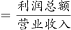
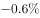
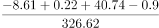
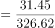
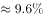

# 现期比重计算（总体利润率=利润总额代数和÷营业收入合计）

考点：[[20-考点/资料分析/比重/现期比重计算（总体利润率=利润总额代数和÷营业收入合计）|比重 / 现期比重计算（总体利润率=利润总额代数和÷营业收入合计）]]
材料：[[15-材料/资料分析/277849 2020年前三季度G省智能机器人产业|277849 2020年前三季度G省智能机器人产业]]

**问法模型**：'总体利润率约为'→分子取四大行业利润总额带符号代数和，分母取营业收入合计326.62亿元，现期数据直接相除，无需基期换算

## 推理链
1. 第1步：题干问2020年前三季度总体利润率，材料时间即为现期，属现期比重（比率）计算，定位文字段第二段与表2
2. 第2步：从表2提取四大行业利润总额：工业机器人-8.61亿元、特殊作业0.22亿元、智能无人飞行器40.74亿元、服务消费-0.9亿元，其中两项为负
3. 第3步：带符号求代数和：40.74+0.22-8.61-0.9=40.96-9.51=31.45亿元
4. 第4步：分母取文字段给出的营业收入合计326.62亿元（不能用表1总产值306.90亿元，两口径不同）
5. 第5步：代入公式利润率=利润总额÷营业收入=31.45÷326.62≈0.0963，即约9.6%
6. 第6步：与选项对照，只有C项数值吻合，故正确答案为C

**最快解法**：⚡ 带符号加总+截位直除：先算40.74+0.22=40.96，再减(8.61+0.9)=9.51得31.45；31.45÷326.62首位商9，约9.6%，直接锁定C

## 易错点
- ⚠ 分子漏负号：若忽略-8.61与-0.9的负号，会算成(40.74+0.22+8.61+0.9)=50.47÷326.62≈15.5%，落入错误选项
- ⚠ 分母口径错：误用表1总产值306.90亿元做分母得约10.2%，正确分母是营业收入326.62亿元，严禁跨表混用
- ⚠ 单位与符号保留：利润总额出现负值须保留符号参与代数和，且'增速高于32.8个百分点'等文字段信息与本题无关，勿被干扰

## 母题抽象
> 🧩 当题干出现'总体利润率/总利润率约为'且利润项有正有负时，用'带符号代数和÷对应收入合计'的现期比率模型，再截位直除与选项对照，验证分子符号与分母口径

**同类特征**：总体利润率约为、现期比重（比率）计算、分子有负值须带符号求和、跨材料取数（表2利润+文字段营业收入）、营业收入合计326.62亿元、两口径指标不可混用

## 相关题
（暂无）

---

### 题干

2020年前三季度，G省智能机器人产业的总体利润率（利润率）约为（    ）。

### 选项
- A. 

- B. 

- C. 

　✅
- D. 

### 官方解析

根据题干“2020年前三季度······总体利润率（利润率）约为”，结合材料时间为2020年前三季度，可判定本题为现期比重计算问题。定位文字材料第二段可得，2020年前三季度，G省智能机器人产业实现营业收入326.62亿元；定位表2可得，2020年前三季度，G省智能机器人产业四大行业利润总额分别为-8.61亿元、0.22亿元、40.74亿元、-0.9亿元。则所求总体利润率为。

故正确答案为C。

### 给定材料

        智能机器人产业是G省战略性新兴产业之一。2020年前三季度，G省智能机器人产业纳入规模以上工业统计的法人单位共140家，完成总产值306.90亿元，占全部规模以上工业产值的，同比增长，增速高于全部规模以上工业产值32.8个百分点；前三季度平均用工人数3.12万人，同比增长。

        2020年前三季度，G省智能机器人产业实现营业收入326.62亿元，同比增长超，四大行业营业收入均实现正增长，经济效益好于全部规模以上工业企业。

