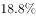

# 基期比重计算（现期占比回溯基期占比）

考点：[[20-考点/资料分析/比重/基期比重计算（现期占比回溯基期占比）|比重 / 基期比重计算（现期占比回溯基期占比）]]
材料：[[15-材料/资料分析/277851 2020年上半年我国农产品进出口情况|277851 2020年上半年我国农产品进出口情况]]

**问法模型**：题干出现'基期时间（2019年上半年）＋部分在整体中约占'的设问特征 → 判定为基期比重问题，套用公式：基期比重＝现期比重×(1+整体增速)÷(1+部分增速)。

## 推理链
1. 第1步：题干问2019年上半年而材料为2020年上半年，判定求基期比重；从六大洲进口额占比饼图读出2020年上半年欧洲进口额占比18.8%，进口口径总额为807.5亿美元（对应欧洲现期进口额≈807.5×18.8%≈151.8亿美元）。
2. 第2步：从文字材料提取两个增速：第一段的农产品进口额总增速、第二段'欧洲国家或地区农产品进口额增幅最大，达…'的欧洲进口增幅（本文本中这两处数据以空格缺省，按原卷数值代入官方解析流程）。
3. 第3步：套用基期比重公式：2019年上半年欧洲占比＝18.8%×(1+进口总增速)/(1+欧洲进口增速)。
4. 第4步：先做方向判断——欧洲增幅为六大洲中最大，必大于进口总增速，故(1+总增速)/(1+欧洲增速)<1，基期占比必然小于现期占比18.8%，可据此排除不小于18.8%的选项。
5. 第5步：代入文字中的两个增速数值，对18.8%×(1+进口总增速)/(1+欧洲进口增速)截位直除，所得结果与B项最接近，故正确答案为B。

**最快解法**：⚡ 公式法＋方向排除：基期比重＝现期比重×(1+整体增速)/(1+部分增速)＝18.8%×(1+进口总增速)/(1+欧洲进口增速)；先用'欧洲增幅最大⇒比值<1⇒2019年占比<18.8%'快速排除偏大选项，再截位直除锁定略小于18.8%的B项，无需精确算出欧洲金额151.8亿美元。

## 易错点
- ⚠ 现期/基期混淆：饼图给的是2020年（现期）占比18.8%，题干问2019年（基期），直接把18.8%或用现期金额算出的占比当答案必错，必须乘(1+整体增速)/(1+部分增速)回溯。
- ⚠ 进出口口径混用：欧洲18.8%出自进口饼图，勿误用出口饼图的欧洲14.7%；金额只能乘进口总额807.5亿美元，误乘出口351.5或进出口总额1159.0即掉坑。
- ⚠ 公式方向记反/口径误读：把基期比重公式分子分母放反会得到大于18.8%的结果而误选大数选项；且文字中'增幅百分之几'是相对幅度口径，与'下降1.9个百分点'的百分点口径不可混同。

## 母题抽象
> 🧩 当题干出现'基期年份＋部分在整体中约占'的特征时，用基期比重公式：基期比重＝现期比重×(1+整体增速)÷(1+部分增速)，先由'部分增速与整体增速的大小关系'判断占比相对现期是升还是降以排除选项，再截位直除验证。

**同类特征**：2019年上半年（基期设问）、……中……约占（比重问法）、欧洲国家或地区（进口饼图对应部分）、现期占比18.8%来自饼图、金额须乘807.5、部分增速与整体增速均取自文字材料、选项为百分比区间

## 相关题
（暂无）

---

### 题干
2019年上半年，我国农产品进口额中欧洲国家或地区约占：

### 选项
- A. 

- B. 

　✅
- C. 

- D. 

### 官方解析
根据题干“2019年上半年······中······约占”，结合材料时间为2020年上半年，可判定本题为基期比重问题。定位文字材料第一段可得：农产品进口额同比增长（）；定位文字材料第二段可得：欧洲国家或地区农产品进口额增幅最大，达（）；定位饼状图材料可得：2020年上半年欧洲进口额占比为。根据公式：基期比重，其中即2020年上半年欧洲进口额占比为，则2019年上半年，欧洲国家或地区进口额占比为，与B项最接近。
故正确答案为B。

### 给定材料

        2020年上半年，我国农产品进出口总额达1159.0亿美元。农产品进口额为807.5亿美元，同比增长。受新冠肺炎疫情影响，我国农产品出口额同比下降，为351.5亿美元。

        在我国的农产品进口中，除大洋洲农产品进口额同比下降1.9个百分点外，其余各大洲的农产品进口额均有所增加；欧洲国家或地区农产品进口额增幅最大，达。农产品出口中，对亚洲国家或地区的出口额最高，达229.7亿美元，较2019年同期下降了3.7个百分点。

随着我国居民饮食结构的调整，居民对肉类食品的需求量逐年增加。2020年上半年畜类产品进口额同比增长，对农产品进口额的增长贡献超7成。我国农产品出口最多的两大类别分别是食用蔬菜和水、海产品，合计出口额达93.6亿美元，占农产品出口总额的。 

