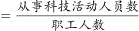
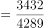
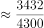

# 现期比重（表中数据直接计算）

考点：[[20-考点/资料分析/比重/现期比重（表中数据直接计算）|比重 / 现期比重（表中数据直接计算）]]
材料：[[15-材料/资料分析/277880 G省农业科研和科技开发机构2015—|277880 G省农业科研和科技开发机构2015—]]

**问法模型**：题干出现'某年A占B的比重约为'且该年份（2018年）数据在表中已直接给出 → 直接取同年度分子分母相除，比重=A÷B×100%，无需基期换算

## 推理链
1. 第1步：题干限定2018年，求'从事科技活动人员数占职工人数'的比重，两个指标均为统计表中独立行项目，数据齐备
2. 第2步：定位表格2018年列：从事科技活动人员3432人，职工人数4289人（注意从事科技活动人员是职工人数的子集，构成分子/分母关系）
3. 第3步：代入比重公式：3432÷4289×100%
4. 第4步：速算验证：4289×0.8=3431.2，与分子3432几乎相等，故比重≈80.0%
5. 第5步：对照选项，80%对应C项，故正确答案为C

**最快解法**：⚡ 直除法（一步直除）：3432÷4289，首位商8，即约80%；亦可用乘法验证——4289×80%=3431.2≈3432，秒锁定80%对应C，无需精算

## 易错点
- ⚠ 看串年份：表中2018年（3432/4289≈80.0%）与2019年（3995/4633≈86.2%）相邻，题干问2018年，勿误用2019年数据得约86%
- ⚠ 分子分母颠倒：从事科技活动人员是职工人数的子集，应为3432÷4289（结果小于100%），若颠倒成4289÷3432会得到大于100%的荒谬比重
- ⚠ 画蛇添足作基期换算：虽然2018年早于材料最新年份2019年，但表中直接给出2018年实际值，属于现期比重，勿再除以(1+增长率)

## 母题抽象
> 🧩 当题干出现'某年A占B的比重约为'且该年数据在表中直接给出时，直接取同年度分子分母相除，用直除首位或选项百分数反乘分母验证即可锁定答案

**同类特征**：限定具体年份（2018年）、'占……比重约为'、分子为分母的子集（从事科技活动人员⊂职工人数）、数据可直接从统计表查找、选项为百分数形式

## 相关题
- [[10-真题/资料分析/比重/2187787 现期比重计算|2187787]]（黑龙江 2018，相关度1）
- [[10-真题/资料分析/增长/2742312 一般增长率计算（基期总额需由基期量×基期均价构造）|2742312]]（北京 2021，相关度1）
- [[10-真题/资料分析/比重/2033354 现期比重之差（同分母比重差一步求解）|2033354]]（河南 2016，相关度1）
- [[10-真题/资料分析/增长/2144703 一般增长率计算（个数型增长，基期为'个'数）|2144703]]（新疆 2017，相关度1）

---

### 题干
2018年，G省农业科研和科技开发机构从事科技活动人员数占职工人数比重约为（    ）。

### 选项
- A. 

- B. 

- C. 

　✅
- D. 

### 官方解析

根据题干“2018年，······占······比重约为”，结合表格材料2018年数据均已给出，可判定本题为现期比重问题。定位表格材料可得：2018年从事科技活动人员3432人，职工人数4289人。故从事科技活动人员数占职工人数比重。

故正确答案为C。

### 给定材料

        2019年G省共有农业科研和科技开发机构68个，职工人数4633人，其中1254人有高级职称，1148人有中级职称。全省共有农村科普示范基地554个、科普示范街道（乡镇）145个、科普示范社区（村）1341个。

