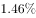
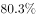

# 现期比重计算（比重与图形阴影匹配）

考点：[[20-考点/资料分析/比重/现期比重计算（比重与图形阴影匹配）|比重 / 现期比重计算（比重与图形阴影匹配）]]
材料：[[15-材料/资料分析/280093 截至2019年12月31日中国共产党|280093 截至2019年12月31日中国共产党]]

**问法模型**：题干以'若阴影部分代表A，哪幅图最能反映A占B的比例'发问 → 用部分÷整体求现期比重，再按比重估图形阴影面积（约一半则选半圆阴影）

## 推理链
1. 第1步：定位文字材料第一段，提取同一时点的两个存量数：截至2019年12月31日党员总数9191.6万名，大专及以上学历党员4661.5万名
2. 第2步：现期比重公式：比重=部分÷整体=4661.5÷9191.6
3. 第3步：代入估算：9191.6的一半≈4595.8，分子4661.5仅比一半多约66万，故比重略超50%（精算4661.5/9191.6≈50.7%），阴影面积应约占一半
4. 第4步：对照饼状图选项，C项阴影约占一半（略超半圆），与50.7%吻合，故正确答案为C

**最快解法**：⚡ 半数判断法：整体9191.6万的一半≈4596万，部分4661.5万略大于一半，比重≈50%略多，阴影约半圆即可锁定C，无需截位精除

## 易错点
- ⚠ 分子口径错拿：误用2019年发展党员中大专及以上106.8万名（年度流量）作分子，正确应取截至2019年底的存量4661.5万名
- ⚠ 分母错用：分母必须是党员总数9191.6万名，勿误用发展党员234.4万或图1某年龄段人数（如61岁及以上2657.7万）
- ⚠ 精算陷阱：图形匹配题只需判断比重接近50%（约一半），若纠结精确百分比或按25%、75%等其他比例比对阴影会浪费时间甚至选错

## 母题抽象
> 🧩 当题干出现'若阴影部分代表A，哪幅图最能反映A占B的比例'时，直接用部分÷整体算现期比重，估出量级（如约50%、约25%）后按阴影面积匹配图形，无需精算

**同类特征**：若阴影部分代表、最能反映、占党员总数的比例、截至2019年12月31日（现期时点）、部分÷整体、图形/饼图匹配

## 相关题
- [[10-真题/资料分析/比重/2453202 现期比重计算（部分÷整体）|2453202]]（北京 2020，相关度1）
- [[10-真题/资料分析/比重/16069865 现期比重计算与图形判定（部分占整体比重的饼图排除法）|16069865]]（贵州 2026，相关度1）
- [[10-真题/资料分析/比重/2393960 现期比重计算|2393960]]（青海 2019，相关度1）

---

### 题干
若阴影部分代表大专及以上学历党员人数，那么下列哪幅图最能反映截至2019年12月31日大专及以上学历党员占党员总数的比例？

### 选项
- A. A
- B. B
- C. C　✅
- D. D

### 官方解析
根据题干“······2019年12月31日······占······的比例”，结合材料时间为2019年12月31日，可判定本题为现期比重问题。定位文字材料第一段可得“截至2019年12月31日，中国共产党党员总数为9191.6万名，······大专及以上学历党员4661.5万名。”故2019年12月31日大专及以上学历党员占党员总数的比例。结合饼状图，阴影部分代表大专及以上学历党员人数，所占比例约等于一半，C项满足。
故正确答案为C。

### 给定材料

        截至2019年12月31日，中国共产党党员总数为9191.6万名，同比增长。在党员的性别、民族和学历上，女党员2559.9万名，少数民族党员680.3万名，大专及以上学历党员4661.5万名。在党员的入党时间上，新中国成立前入党的17.4万名，新中国成立后至党的十一届三中全会前入党的1550.9万名，党的十一届三中全会后至党的十八大前入党的6127.7万名，党的十八大以来入党的1495.6万名。在党员的职业上，工人（含工勤技能人员）644.5万名，农牧渔民2556.1万名，企事业单位、社会组织专业技术人员1440.3万名，企事业单位、社会组织管理人员1010.4万名，党政机关工作人员767.8万名，学生196.0万名，其他职业人员710.4万名，离退休人员1866.1万名。

        2019年共发展党员234.4万名，比上年增长。其中，发展女党员99.4万名，占；发展少数民族党员23.6万名，占；发展35岁及以下党员188.3万名，占；发展具有大专及以上学历的党员106.8万名，占。发展党员的职业上，工人（含工勤技能人员）14.3万名，企事业单位、社会组织专业技术人员31.6万名，企事业单位、社会组织管理人员25.3万名，农牧渔民42.4万名，党政机关工作人员13.4万名，学生84.4万名，其他职业人员22.9万名。

