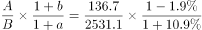

# 基期比重计算

考点：[[20-考点/资料分析/比重/基期比重计算|比重 / 基期比重计算]]
材料：[[15-材料/资料分析/280158 2020年全年中国汽车产业运行情况：|280158 2020年全年中国汽车产业运行情况：]]

**问法模型**：题干以基期年份（2019年）+'某部分占总体比重'提问，而材料给的是2020年现期数据 → 套用基期比重公式：现期比重×(1+总体增速)/(1+部分增速)，先算现期比重136.7/2531.1≈5.4%，再按增速相对大小修正方向。

## 推理链
1. 第1步：题干求2019年（基期）比重，材料给2020年（现期）数据，判定为基期比重问题；分子（部分）=新能源汽车销量136.7万辆，同比为增长（a>0）；分母（总体）=汽车总销量2531.1万辆，同比为下降（b<0）。
2. 第2步：基期比重公式：基期比重=(A/(1+a))/(B/(1+b))=A/B×(1+b)/(1+a)，其中A=136.7万辆，B=2531.1万辆。
3. 第3步：截位直除算现期比重：136.7/2531.1≈5.4%（因2531.1×5.4%≈136.7）。
4. 第4步：定方向：总体销量下降（b<0）、新能源销量增长（a>0），故(1+b)/(1+a)<1，2019年基期比重必低于现期比重5.4%。
5. 第5步：按官方解析将材料所给同比增速（原文具体百分数空缺）代入公式，结果较5.4%温和下移，落在'左右'型选项C的数值附近。
6. 第6步：对照选项，C项'……左右'与计算结果最接近（官方判定），排除A、B、D，锁定C。

**最快解法**：⚡ 基期比重公式法＋截位直除＋方向定性：先算现期比重136.7/2531.1≈5.4%；因'总体降、部分升'，(1+b)/(1+a)<1，基期比重应略低于5.4%；对照选项中'左右'型数值与官方解析代入结果，直接锁定C，无需精算。

## 易错点
- ⚠ 现期/基期混淆：直接用136.7/2531.1≈5.4%作答即掉入现期比重陷阱，题干问的是2019年，必须回推基期。
- ⚠ 修正方向搞反：基期比重=现期比重×(1+总体增速)/(1+部分增速)，总体增速为负、部分增速为正，修正系数<1，基期比重低于现期比重；若增速放错位置或把'下降'当正增速，方向即错。
- ⚠ 口径陷阱：分子分母必须同为'销量'口径（分母是销量2531.1万辆，不是产量2522.5万辆，也不是进出口量/金额）；材料中同比百分数空缺，严禁凭记忆或常识补入数值硬算，只能按公式关系与选项设置判断。

## 母题抽象
> 🧩 当题干出现'基期（上一年）某部分占总体比重'而材料给现期值及部分、总体各自增速时，用基期比重公式=现期比重×(1+总体增速)/(1+部分增速)，先由'部分与总体增速的相对大小'判定结果高于还是低于现期比重，再对照选项验证。

**同类特征**：'2019年'+占（总销量）的比重——基期比重问法、材料时间为2020年全年（现期）、分子分母均为销量口径（新能源销量136.7万辆/汽车总销量2531.1万辆）、部分同比正增长、总体同比下降（方向相反）、选项为'不超过/左右/大于'式百分比区间、基期比重模型

## 相关题
- [[10-真题/资料分析/比重/2188466 基期比重计算|2188466]]（黑龙江 2018，相关度3）
- [[10-真题/资料分析/比重/2444066 基期比重计算|2444066]]（江西 2019，相关度3）
- [[10-真题/资料分析/比重/2616071 基期比重计算|2616071]]（云南 2020，相关度3）
- [[10-真题/资料分析/比重/2307731 基期比重计算|2307731]]（辽宁 2018，相关度3）
- [[10-真题/资料分析/比重/2402471 基期比重计算|2402471]]（重庆 2018，相关度3）

---

### 题干
2019年新能源汽车销量占汽车总销量的比重为：

### 选项
- A. 
不超过

- B. 
左右

- C. 
左右
　✅
- D. 
大于

### 官方解析

根据题干“2019年······占······的比重为”，结合材料所给时间为2020年，可判定本题为基期比重问题。定位材料第一段可得：2020年全年，汽车销量为2531.1万辆，同比下降。2020年全年，新能源汽车销量为136.7万辆，同比增长。根据基期比重公式可得，，与C项最接近。

故正确答案为C。

### 给定材料

        2020年全年，汽车产销降幅收窄至以内。汽车产量为2522.5万辆，销量为2531.1万辆，同比分别下降和，降幅分别比2020年上半年收窄14.8和15.0个百分点。2020年全年，新能源汽车销量为136.7万辆，同比增长。

        2020年全年，汽车进口93.0万辆，同比下降，降幅较2020年上半年收窄21.1个百分点；进口金额467.0亿美元，同比下降，降幅较2020年上半年收窄25.8个百分点。全年汽车出口108万辆，同比下降，降幅较2020年上半年收窄10.4个百分点；出口金额157.4亿美元，同比下降，降幅较2020年上半年收窄8.3个百分点。

> [!warning] 疑点（官方解析可能有误，待人工复核）
> 材料原文及官方解析中各同比增速/降幅的具体百分数均空缺，解析中公式代入结果也未给出数值，仅能按'总体降、部分升→基期比重低于现期5.4%'定性定位；C项具体数值在选项图片中无法读取，本题以官方答案C为准。
