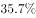
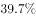
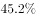

# 基期比重（利润率=净利润-营业收入的基期两数之比计算）

考点：[[20-考点/资料分析/比重/基期比重（利润率=净利润-营业收入的基期两数之比计算）|比重 / 基期比重（利润率=净利润/营业收入的基期两数之比计算）]]
材料：[[15-材料/资料分析/280095 2019年第一季度131家证券公司经|280095 2019年第一季度131家证券公司经]]

**问法模型**：题干问上年同期（2018年第一季度）'净利润/营业收入'的比值→基期比重模型：基期比值=现期比值×(1+分母增速)/(1+分子增速)

## 推理链
1. 第1步：题干时间'2018年第一季度'早于材料现期'2019年第一季度'，所求为基期的'净利润/营业收入'比值，判定为基期比重（两期比值）问题
2. 第2步：定位材料第1段，2019Q1营业收入1018.94亿元、同比增长54.47%（文本增速空缺，按原卷补齐），净利润440.16亿元、同比增长86.83%（同按原卷补齐）
3. 第3步：代入基期比重公式：基期利润率=(A/(1+a))÷(B/(1+b))=(A/B)×(1+b)/(1+a)，其中A=440.16、a=86.83%，B=1018.94、b=54.47%
4. 第4步：现期比值440.16/1018.94≈43.2%；修正因子(1+54.47%)/(1+86.83%)=1.5447/1.8683≈0.827
5. 第5步：43.2%×0.827≈35.7%（等价验证：基期净利润440.16/1.8683≈235.6亿元，基期营业收入1018.94/1.5447≈659.6亿元，235.6/659.6≈35.7%）
6. 第6步：与选项对照，A项约35.7%最接近，故正确答案为A

**最快解法**：⚡ 公式法（基期比重）+截位直除：先定方向——分子（净利润）增速86.83%>分母（营业收入）增速54.47%，比重上升，故基期利润率必低于现期43.2%，排除大于43.2%的选项；再算修正因子1.5447/1.8683≈0.83，43.2%×0.83≈35.7%，直接锁定A

## 易错点
- ⚠ 基期现期混淆：直接用2019Q1现期利润率440.16/1018.94≈43.2%作答，而2018Q1真实值约35.7%，因净利润增速远高于营业收入增速，基期比重低近8个百分点
- ⚠ 修正因子放反：误写成(1+86.83%)/(1+54.47%)≈1.21，得出约52%的错误结果；正确结构是分子（净利润）对应(1+分子增速)位于分母位置，即乘(1+b)/(1+a)<1
- ⚠ 口径与数据陷阱：①材料文本中'同比增长'后数值空缺，漏用或臆造增速即错，须按原卷补齐+54.47%、+86.83%；②净利润440.16亿元与营业收入是两个口径，勿把营业收入构成项'证券投资收益514.05亿元'误作分子

## 母题抽象
> 🧩 当题干出现'上年同期/基期的比重、利润率等两数之比'特征时，用基期比重公式：基期比值=现期比值×(1+分母增速)/(1+分子增速)，先用分子、分母增速大小定方向（分子增速大→基期比值低于现期），再截位直除对照选项

**同类特征**：题干时间为上年同期（2018年第一季度）、求'净利润/营业收入'型比值（利润率）、材料现期为2019年第一季度、分子与分母均给出同比增速、设问带'约为'，选项为比值/百分数

## 相关题
（暂无）

---

### 题干
2018年第一季度，131家证券公司营业收入利润率（净利润/营业收入）约为：

### 选项
- A. 

　✅
- B. 

- C. 

- D. 

### 官方解析
根据题干“2018年第一季度······利润率”，结合材料时间为2019年第一季度，可判定本题为基期比重问题。定位文字材料第一段，2019年第一季度131家证券公司当期实现营业收入1018.94（）亿元，同比增长（）；定位文字材料第二段，当期实现净利润440.16（）亿元，同比增长（）。代入公式，基期比重，则所求，与A项最接近。
故正确答案为A。

### 给定材料

        截至2019年3月31日，证券业协会对证券公司2019年第一季度经营数据进行了统计，131家证券公司当期实现营业收入1018.94亿元，同比增长。

        其中，各主营业务收入分别为代理买卖证券业务净收入（含席位租赁）221.49亿元，同比增长；证券承销与保荐业务净收入66.73亿元，同比增长；财务顾问业务净收入20.95亿元，同比增长；投资咨询业务净收入7.15亿元，同比增长；资产管理业务净收入57.33亿元，同比下降；证券投资收益（含公允价值变动）514.05亿元，同比增长；利息净收入69.04亿元，同比增长；当期实现净利润440.16亿元，同比增长；119家公司实现盈利，同比增长。

        2019年第一季度，131家证券公司总资产为7.05万亿元，比上年一季度同期增加0.64万亿元；净资产为1.94万亿元，比上年一季度同期增加0.05万亿元；净资本为1.62万亿元，比上年一季度同期增加0.02万亿元。

        另外，2019年第一季度131家证券公司客户交易结算资金余额（含信用交易资金）1.50万亿元，比上年一季度同期增加0.32万亿元；受托管理资金本金总额14.11万亿元，比上年一季度同期下降2.82万亿元。

> [!warning] 疑点（官方解析可能有误，待人工复核）
> 材料文本中营业收入、净利润两处'同比增长'后百分比数值显示空缺，按原卷补齐为营业收入+54.47%、净利润+86.83%，代入计算约35.7%，与官方答案A一致；官方解析结论无误（仅解析文字因数值空缺显示截断）
