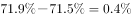

# 两期占比差（百分点）计算与升降方向判断（读图比较型）

考点：[[20-考点/资料分析/比重/两期占比差（百分点）计算与升降方向判断（读图比较型）|比重 / 两期占比差（百分点）计算与升降方向判断（读图比较型）]]
材料：[[15-材料/资料分析/280258 2019年我国电信业务收入规模、增速|280258 2019年我国电信业务收入规模、增速]]

**问法模型**：题干问'增速最高的年份，当年某占比比上年（升降+幅度分级）'→ 先从折线定位增速峰值年份，再从柱图读该年与上年占比作差，按'升降方向+是否超过1个百分点'四选一。

## 推理链
1. 第1步：从折线图提取2015-2019年电信业务收入同比增速：2015年-2%、2016年5.4%、2017年6.6%、2018年2.9%、2019年0.8%（2014年-1.6%不在题干年份范围内）。
2. 第2步：比较五年增速，最高为2017年的6.6%，故目标年份锁定2017年。
3. 第3步：从柱状图读取移动通信业务收入占比：2017年为71.9%，上年（2016年）为71.5%。
4. 第4步：两期占比差=71.9%−71.5%=+0.4个百分点，即上升了0.4个百分点（占比差用'百分点'表述，非'增长%'）。
5. 第5步：0.4个百分点<1个百分点且方向为上升，对照选项A'上升了不到1个百分点'，故选A。

**最快解法**：⚡ 读图直查法：折线找最高点即2017年（6.6%），柱图心算71.9−71.5=0.4个百分点<1且为上升，直接秒选A，无需任何列式。

## 易错点
- ⚠ 增速峰值定位错误：若误把2016年5.4%当最高（如材料导读中误标），会去比2016与2015年占比（71.5−70.4=1.1个百分点），错选B；必须逐点核对，2017年6.6%才是峰值。
- ⚠ 柱与折线含义混淆：图中柱是占比、折线是增速，单位都是%但含义完全不同，且左右轴刻度不一致（左轴-40~10为增速、右轴0~150为另一口径），读数勿串轴。
- ⚠ '上升了X个百分点'与'增长了X%'混淆：占比比较只能用百分点作差，不能套用增长率公式。

## 母题抽象
> 🧩 当题干出现'（某区间内）增速最高的年份，当年某占比比上年…'时，先从折线定位峰值年份，再从柱图读该年与上年占比作差，按'升降方向+是否超1个百分点'直接匹配选项，纯读图心算即可。

**同类特征**：2015-2019年间同比增速最高的年份、当年……占比比上年、上升/下降+不到1个百分点/1个百分点以上的幅度分级、折线定位峰值+柱图读占比的组合图配合、移动通信业务收入占比（大类口径，区别于移动数据及互联网业务收入）

## 相关题
（暂无）

---

### 题干
2015-2019年间，电信业务收入同比增速最高的年份，当年移动通信业务收入占比比上年：

### 选项
- A. 上升了不到1个百分点　✅
- B. 上升了1个百分点以上
- C. 下降了不到1个百分点
- D. 下降了1个百分点以上

### 官方解析

根据题干“······电信业务收入同比增速最高的年份，当年移动通信业务收入占比比上年”，结合选项与材料时间，可判定本题为两期比重计算问题。定位折线图找到增速最高的年份为2017年，定位柱形图找到2017年移动收入占比为，2016年移动收入占比为，，上升了0.4个百分点，即上升了不到1个百分点。

故正确答案为A。

### 给定材料

        2019年，我国电信业务收入完成1.31万亿元，比上年增长。其中：固定数据及互联网业务收入完成2175亿元，比上年增长；移动数据及互联网业务收入6082亿元，比上年增长；固定增值业务收入1371亿元，比上年增长，其中，IPTV（网络电视）业务收入294亿元，比上年增长；物联网业务收入比上年增长。

