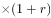
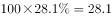
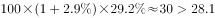

# 两期比重之部分量同比增减判定（部分=整体×比重，逐年判号）

考点：[[20-考点/资料分析/比重/两期比重之部分量同比增减判定（部分=整体×比重，逐年判号）|比重 / 两期比重之部分量同比增减判定（部分=整体×比重，逐年判号）]]
材料：[[15-材料/资料分析/280258 2019年我国电信业务收入规模、增速|280258 2019年我国电信业务收入规模、增速]]

**问法模型**：'某部分收入同比增长的年份有几个'→部分量未直接给出，须用'部分现年=整体上年×(1+整体增速)×现年占比'与'部分上年=整体上年×上年占比'比较，即判定(1+整体增速)×现期占比是否大于基期占比，逐年判号后计数

## 推理链
1. 第1步：从图中提取数据——固定通信业务收入占比2014-2018年为27.8%、29.6%、28.5%、28.1%、29.2%，电信业务总收入增速2015年-2%、2016年5.4%、2017年6.6%、2018年2.9%；固定通信收入绝对额材料未给，只能由占比×整体推得
2. 第2步：依据'部分=整体×比重'：设上年整体=100，则部分上年=100×上年占比，部分现年=100×(1+整体增速)×现年占比；同比增长⟺(1+整体增速)×现年占比＞上年占比
3. 第3步：2015年：0.98×29.6=29.0＞27.8，同比增长（注意整体增速-2%须乘0.98）
4. 第4步：2016年：1.054×28.5=30.0＞29.6，同比增长
5. 第5步：2017年：1.066×28.1≈29.95＞28.5，同比增长
6. 第6步：2018年：1.029×29.2≈30.05＞28.1，同比增长
7. 第7步：2015-2018四年固定通信业务收入全部同比增长，共4个，对照选项选D

**最快解法**：⚡ 公式法+比重抵消速判：部分增速≈整体增速+占比相对变化（占比差÷基期占比）。2015：-2%+1.8/27.8≈+4.5%；2016：5.4%−1.1/29.6≈+1.7%；2017：6.6%−0.4/28.5≈+5.2%；2018：2.9%+1.1/28.1≈+6.8%，四年全为正→直接数出4个选D，无需精算

## 易错点
- ⚠ 口径陷阱：文字段'固定数据及互联网业务收入2175亿元'与图中'固定通信业务收入占比'是不同口径，本题只能用图中柱状占比+折线增速，不能拿文字分项数据作答
- ⚠ 负增速方向：2015年整体增速为-2%，代入须乘(1-2%)=0.98，误乘(1+2%)=1.02会判错方向；这正是材料导读强调的2015年增速为负时除乘方向易错点
- ⚠ 直觉陷阱：只数'占比上升'的年份（2015、2018两年）会误选B；实际上占比下降的年份（2016、2017）只要整体增速大于占比相对降幅，部分量仍同比增长，必须整体增速与占比变化合起来判号

## 母题抽象
> 🧩 当题干出现'部分量同比增长/下降的年份有几个'且材料只给整体增速折线+部分占比柱时，设上年整体=100，用'(1+整体增速)×现期占比'与基期占比逐年比大小，数正号年份即可，占比相对变化与整体增速需合并抵消而非只看单一指标

**同类特征**：同比增长的年份有几个、固定通信业务收入、占比柱+增速折线组合图、部分量金额未直接给出、部分=整体×比重、2015-2018逐年判定

## 相关题
- [[10-真题/资料分析/比重/19283971 现期比重比较（部分占整体比重超10%的品类计数）|19283971]]（国考 2025，相关度1）
- [[10-真题/资料分析/比重/4769985 现期比重计算（部分=整体×比重，饼图多扇区求和）|4769985]]（四川 2017，相关度1）
- [[10-真题/资料分析/增长/5101663 增长量比较（量之和逐年同比判定）|5101663]]（云南 2022，相关度1）
- [[10-真题/资料分析/平均数/5893793 两期平均数比较（单位面积产量=产量÷面积的同比升降判定）|5893793]]（国考 2024，相关度1）
- [[10-真题/资料分析/比重/10942271 现期比重差求部分量之差（部分=整体×比重）|10942271]]（山东 2024，相关度1）

---

### 题干
2015-2018年间，固定通信业务收入同比增长的年份有几个？

### 选项
- A. 1
- B. 2
- C. 3
- D. 4　✅

### 官方解析

根据题干“固定通信业务收入同比增长的年份有几个”，结合材料中给出的固定通信业务收入占比和电信业务收入增速，可判定本题为两期比重问题。根据公式：现期量基期量和部分量整体量比重。

假设2014年电信业务收入为100，则2014年固定通信业务收入为，2015年固定通信业务收入为，则2015年固定通信业务收入同比增长。

假设2015年电信业务收入为100，则2015年固定通信业务收入为，2016年固定通信业务收入为，则2016年固定通信业务收入同比增长。

假设2016年电信业务收入为100，则2016年固定通信业务收入为，2017年固定通信业务收入为，则2017年固定通信业务收入同比增长。

假设2017年电信业务收入为100，则2017年固定通信业务收入为，2018年固定通信业务收入为，则2018年固定通信业务收入同比增长。

因此，2015-2018年固定通信业务收入同比增长的年份有4个。

故正确答案为D。

### 给定材料

        2019年，我国电信业务收入完成1.31万亿元，比上年增长。其中：固定数据及互联网业务收入完成2175亿元，比上年增长；移动数据及互联网业务收入6082亿元，比上年增长；固定增值业务收入1371亿元，比上年增长，其中，IPTV（网络电视）业务收入294亿元，比上年增长；物联网业务收入比上年增长。

