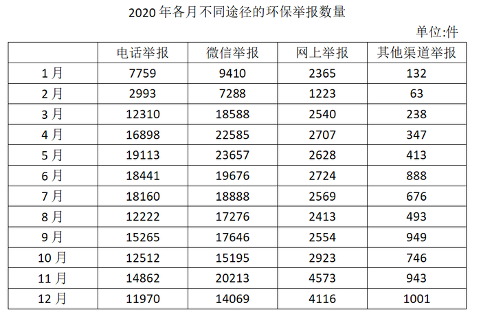

# 现期比重比较（逐月比重取最大值）

考点：[[20-考点/资料分析/比重/现期比重比较（逐月比重取最大值）|比重 / 现期比重比较（逐月比重取最大值）]]
材料：[[15-材料/资料分析/307042 2020年1～12月全国'12369|307042 2020年1～12月全国'12369]]

**问法模型**：题干问'1～4月微信举报占当月举报总量比重最高的月份'→ 逐月套用现期比重模型：比重=当月微信举报数÷当月举报总量（分子取表格、分母取柱图受理+未受理加和），比较四个百分数取最大。

## 推理链
1. 第1步：从统计表读出2020年1～4月微信举报件数：1月9410件、2月7288件、3月18588件、4月22585件。
2. 第2步：当月举报总量材料未单列，需拼合：总量=受理量+未受理量（柱状图）或=电话+微信+网上+其他四渠道加和（表格），两条路径互验。
3. 第3步：加和得1～4月总量：1月15123+4543=19666件（7759+9410+2365+132=19666吻合）；2月8180+3387=11567件（2993+7288+1223+63=11567吻合）；3月26218+7458=33676件（12310+18588+2540+238=33676吻合）；4月32976+11557=44533件（16898+22585+2707+347=44533吻合）。
4. 第4步：代入比重=微信÷总量：1月9410/19666≈47.9%；2月7288/11567≈63.0%；3月18588/33676≈55.2%；4月22585/44533≈50.7%。
5. 第5步：比较四个比重，2月约63.0%为最高，对应选项B。

**最快解法**：⚡ 化归比较法（避免算四个百分数）：比重高⇔'非微信部分÷微信'小。非微信=总量−微信：1月10256/9410≈1.09，2月(2993+1223+63)=4279/7288≈0.59，3月15088/18588≈0.81，4月21948/22585≈0.97，2月最小即微信占比最高；或用'微信×2与总量比'粗判：2月7288×2=14576>11567明显超半（其余1月9410×2<19666直接排除），锁定B。

## 易错点
- ⚠ 绝对值陷阱：4月微信举报22585件是四个月中绝对值最大的，若只比微信件数不除以总量，会误选D；比重比较必须落在同一总量口径上。
- ⚠ 总量需自行拼合：表格无'当月总量'列，柱状图每柱是受理/未受理两段，只拿柱图单段（如受理量）当分母会算错比重。
- ⚠ 加和准确性：分母是四个四/五位数逐月加和（最高44533），逐项相加易错，可用表格四渠道和与柱图两段和互验后再算。

## 母题抽象
> 🧩 当题干出现'某月份某部分占当月总量比重最高'且总量需跨图/跨列拼合时，先补齐总量列（两条加和路径互验），再用'部分×2与总量比'或'剩余部分÷部分'的化归比较替代逐一精算比重。

**同类特征**：占当月…比重最高的月份、现期比重比较、1～4月逐月比较、分子在统计表、分母需跨图拼合、总量无现成列需自行加和、堆积柱图受理+未受理

## 相关题
- [[10-真题/资料分析/比重/10204607 现期比重比较（与1-3判定，分母需由累计值差分）|10204607]]（辽宁 2024，相关度1）
- [[10-真题/资料分析/比重/18643847 现期比值计算与百分点差值比较（资产负债率=总负债÷总资产）|18643847]]（四川 2026，相关度1）
- [[10-真题/资料分析/比重/19283749 现期比重比较（逐组求比重比大小）|19283749]]（国考 2025，相关度1）
- [[10-真题/资料分析/比重/2042810 现期比重比较（子口径占全口径比重，逐部计数判断）|2042810]]（江苏 2017，相关度1）
- [[10-真题/资料分析/比重/2052082 现期比重比较|2052082]]（吉林 2017，相关度1）

---

### 题干
2020年1～4月，通过微信举报的件数占当月环保举报件数比重最高的月份是：

### 选项
- A. 1月
- B. 2月　✅
- C. 3月
- D. 4月

### 官方解析
根据题干“2020年1～4月······占······比重”，结合材料时间为2020年各月，可判定本题为现期比重问题。定位表格材料可得：2020年1～4月，各月通过微信举报的件数分别为9410件、7288件、18588件、22585件。通过微信举报的件数占当月环保举报件数比重，由环保举报件数=受理量+未受理量，定位统计图可得：2020年1～4月，各月环保举报件数分别为件、件、件、件。故2020年1～4月，各月通过微信举报的件数占当月环保举报件数比重分别为、、、，即2月通过微信举报的件数占当月环保举报件数比重最高。
故正确答案为B。

### 给定材料

        2020年12月，全国“12369环保举报联网管理平台”共接到环保举报31156件，环比下降23.2%，同比下降10.3%，其中，受理量23792件，较11月减少6316件；因举报线索不详或不属于生态环境部门职责范围而未受理7364件，较11月减少3119件。

