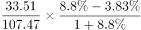
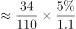

# 两期比重差计算（比重比上年变化几个百分点）

考点：[[20-考点/资料分析/比重/两期比重差计算（比重比上年变化几个百分点）|比重 / 两期比重差计算（比重比上年变化几个百分点）]]
材料：[[15-材料/资料分析/307048 C市天然气用量的月度与年度统计，围绕|307048 C市天然气用量的月度与年度统计，围绕]]

**问法模型**：题干出现'A占B的比重比上年增加/减少（几个百分点）'且给出部分与整体的现期值及各自同比增速 → 采用两期比重差公式：比重差=A/B×(a-b)/(1+a)，先比a、b定方向，再算幅度定选项。

## 推理链
1. 第1步：定位材料第二段（2020年全年）：中石化供应33.51亿立方米（部分A，同比a=8.8%），C市天然气总用量107.47亿立方米（整体B，同比b=3.83%）
2. 第2步：方向判断——部分增速a=8.8%大于整体增速b=3.83%，中石化占比应上升，答案为'增加'，排除A、C
3. 第3步：套用两期比重差公式：比重差=A/B×(a-b)/(1+a)
4. 第4步：代入计算：A/B=33.51/107.47≈0.31，(a-b)/(1+a)=(8.8%-3.83%)/(1+8.8%)=4.97%/1.088≈4.57%
5. 第5步：比重差≈0.31×4.57%≈1.4个百分点，为正且远小于3个百分点
6. 第6步：与选项对照——'增加了不到3个百分点'，只有B项符合，故选B

**最快解法**：⚡ 两期比重差公式法+截位直除：先由a=8.8%>b=3.83%秒定'增加'（排除A、C）；再估算幅度，比重差=33.51/107.47×4.97%/1.088，截位得0.31×4.57%≈1.4个百分点<3，锁定B；更快的量级判断：比重差必远小于|a-b|=4.97个百分点，因乘了A/B≈0.31和1/(1+a)两级缩水，必不到3个百分点。

## 易错点
- ⚠ 方向判反：误记为'b-a'或把整体与部分增速对调，得出'减少'而错选A
- ⚠ 幅度高估：直接用|a-b|=4.97个百分点与3比较而误选C或D，忽略两期比重差须再乘A/B≈0.31和除以(1+a)，实际仅约1.4个百分点
- ⚠ 取数错位：材料有四段数据，本题必须用第二段2020年全年数据（33.51、107.47）；若误用2020年12月（2.45/9.67）或2021年1—2月（4.98/19.21，且中石化增速为-1.58%为负）均会算错

## 母题抽象
> 🧩 当题干出现'某部分占整体的比重比上年（同期）增加/减少几个百分点'且给出部分、整体的现期值与同比增速时，用两期比重差公式A/B×(a-b)/(1+a)：a>b则比重上升，差值必小于|a-b|且经A/B与(1+a)双重缩水，先定方向再估幅度即可秒杀。

**同类特征**：占……的比重比上年、选项为'增加/减少+不到/以上几个百分点'组合、部分与整体的现期值及同比增速均已知、两期比重变化量计算、单一时期主体（2020年全年）、第二段文字材料定位

## 相关题
- [[10-真题/资料分析/比重/15419181 两期比重变化（比重差计算与升降判断）|15419181]]（湖北 2025，相关度1）
- [[10-真题/资料分析/比重/4714000 两期比重差（比重变化量）|4714000]]（福建 2018，相关度1）

---

### 题干
2020年，中石化供气量占C市天然气用量的比重比上年：

### 选项
- A. 减少了不到3个百分点
- B. 增加了不到3个百分点　✅
- C. 减少了3个百分点以上
- D. 增加了3个百分点以上

### 官方解析

根据题干“2020年······占······的比重比上年”，结合选项为增加/减少+百分点，可判定本题为两期比重计算问题。定位文字材料第二段可得：2020年，C市天然气用量为107.47亿立方米（B），同比增长3.83%（b）。中石化供应33.51亿立方米（A），同比增长8.8%（a）。根据公式：两期比重差，则2020年与上年的比重差值为，即增加了不到1.5个百分点，只有B项符合。

故正确答案为B。

### 给定材料

        2020年12月，C市天然气用量为9.67亿立方米，同比增长11.66%。从供应结构看：中石油供应7.22亿立方米，同比增长7.44%；中石化供应2.45亿立方米，同比增长26.29%。从用气结构看：民用气为3.98亿立方米，同比增长16.72%；CNG用气0.64亿立方米，同比下降7.25%；工业用气5.05亿立方米，同比增长10.75%。

        2020年，C市天然气用量为107.47亿立方米，同比增长3.83%。其中，中石油供应73.96亿立方米，同比增长1.72%；中石化供应33.51亿立方米，同比增长8.8%。从用气结构看：民用气为33.75亿立方米，同比增长5.4%；CNG用气6.99亿立方米，同比下降13.92%；工业用气66.73亿立方米，同比增长5.3%。

        2021年2月，C市天然气用量为9.31亿立方米，同比增长21.38%。从供应结构看：中石油供应6.7亿立方米，同比增长25.23%；中石化供应2.61亿立方米，同比增长12.5%。从用气结构看：民用气为3.56亿立方米，同比增长16.34%；CNG用气0.52亿立方米，同比增长205.88%；工业用气5.23亿立方米，同比增长17.79%。

        2021年1—2月，C市天然气用量为19.21亿立方米，同比增长12.8%。其中，中石油供应14.23亿立方米，同比增长18.88%；中石化供应4.98亿立方米，同比下降1.58%。从用气结构看：民用气为7.78亿立方米，同比增长12.75%；CNG用气1.14亿立方米，同比增长44.3%；工业用气10.29亿立方米，同比增长10.17%。

