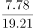

# 现期比重计算与饼图占比对照

考点：[[20-考点/资料分析/比重/现期比重计算与饼图占比对照|比重 / 现期比重计算与饼图占比对照]]
材料：[[15-材料/资料分析/307048 C市天然气用量的月度与年度统计，围绕|307048 C市天然气用量的月度与年度统计，围绕]]

**问法模型**：题干问'哪个饼图最能准确反映某时期各部分占比关系'→ 先定位对应时段数据，用现期比重=部分量/总量估算各类占比，再与饼图扇区大小对照排除

## 推理链
1. 第1步：定位材料第四段，2021年1—2月C市天然气总量19.21亿立方米，用气结构中民用7.78、CNG 1.14、工业10.29亿立方米
2. 第2步：现期比重公式：占比=部分量÷总量，饼图扇区大小与占比成正比
3. 第3步：民用占比=7.78/19.21≈40.5%（介于25%与50%之间）；工业占比=10.29/19.21≈53.6%（超过一半）；CNG占比=1.14/19.21≈5.9%（很小）
4. 第4步：对照选项：A、B两项民用气扇区大于半圆（>50%），与40.5%不符，排除；C项民用气扇区小于四分之一（<25%），也不符，排除
5. 第5步：D项民用气扇区介于25%~50%之间且工业扇区最大，与估算一致，故选D

**最快解法**：⚡ 半圆/四分位定性排除法：以总量19.21的一半9.6为标尺，7.78<9.6→民用<50%，一眼排除A、B；再以四分之一约4.8为标尺，7.78>4.8→民用>25%，排除C，无需精算角度直接锁定D

## 易错点
- ⚠ 当月值与累计值混排：2021年2月单月数据（民用3.56、CNG 0.52、工业5.23）与1—2月累计（7.78/1.14/10.29）数值接近，误取单月或误用总量19.21配单月分子会得出错误占比
- ⚠ 供应结构（中石油/中石化）与用气结构（民用/CNG/工业）是两套分类，饼图要求用气结构，误用供应结构数据（14.23/4.98）则完全跑偏
- ⚠ 逐个精算扇区圆心角费时费力，应利用50%线和25%线定性排除；同时注意CNG占比极小（约6%），扇区应几乎可以忽略

## 母题抽象
> 🧩 当题干出现'哪个饼图最能准确反映……占比关系'时，先估算最大类占比，用总量的50%线和25%线作标尺与图形定性对照排除，无需精算角度即可锁定答案

**同类特征**：饼图、最能准确反映占比关系、现期比重、2021年1—2月累计、用气结构三类（民用/CNG/工业）、图形对照排除

## 相关题
- [[10-真题/资料分析/比重/13504304 现期比重饼图识别（结构占比比较+排除法）|13504304]]（河南 2025，相关度2）
- [[10-真题/资料分析/比重/4792819 现期比重计算（多部分比重依次求解）|4792819]]（新疆 2014，相关度1）
- [[10-真题/资料分析/比重/827355 现期比重比较（部分占比过半速判）|827355]]（政法干警 2014，相关度1）
- [[10-真题/资料分析/比重/2272297 现期比重比较|2272297]]（选调 2015，相关度1）
- [[10-真题/资料分析/比重/2032972 现期比重计算（多地区占比求和）|2032972]]（吉林 2015，相关度1）

---

### 题干
以下哪个饼图最能准确反映2021年1—2月C市天然气用量中，民用气（白色）、CNG用气（黑色）和工业用气（斜线）的占比关系？

### 选项
- A. 

- B. 

- C. 

- D. 

　✅

### 官方解析

根据题干“以下哪个饼图最能准确反映2021年1—2月······的占比关系”，结合材料时间为2021年，可判定本题为现期比重问题。定位文字材料第四段可得“2021年1—2月，C市天然气用量为19.21亿立方米······从用气结构看：民用气为7.78亿立方米；CNG用气1.14亿立方米；工业用气10.29亿立方米”。因此，民用气占比为，观察图形，A、B两项民用气占比大于50%，C项民用气占比小于25%，均不满足，排除A、B、C三项，D项当选。

故正确答案为D。

### 给定材料

        2020年12月，C市天然气用量为9.67亿立方米，同比增长11.66%。从供应结构看：中石油供应7.22亿立方米，同比增长7.44%；中石化供应2.45亿立方米，同比增长26.29%。从用气结构看：民用气为3.98亿立方米，同比增长16.72%；CNG用气0.64亿立方米，同比下降7.25%；工业用气5.05亿立方米，同比增长10.75%。

        2020年，C市天然气用量为107.47亿立方米，同比增长3.83%。其中，中石油供应73.96亿立方米，同比增长1.72%；中石化供应33.51亿立方米，同比增长8.8%。从用气结构看：民用气为33.75亿立方米，同比增长5.4%；CNG用气6.99亿立方米，同比下降13.92%；工业用气66.73亿立方米，同比增长5.3%。

        2021年2月，C市天然气用量为9.31亿立方米，同比增长21.38%。从供应结构看：中石油供应6.7亿立方米，同比增长25.23%；中石化供应2.61亿立方米，同比增长12.5%。从用气结构看：民用气为3.56亿立方米，同比增长16.34%；CNG用气0.52亿立方米，同比增长205.88%；工业用气5.23亿立方米，同比增长17.79%。

        2021年1—2月，C市天然气用量为19.21亿立方米，同比增长12.8%。其中，中石油供应14.23亿立方米，同比增长18.88%；中石化供应4.98亿立方米，同比下降1.58%。从用气结构看：民用气为7.78亿立方米，同比增长12.75%；CNG用气1.14亿立方米，同比增长44.3%；工业用气10.29亿立方米，同比增长10.17%。

