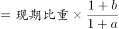
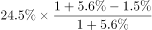
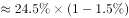
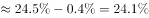

# 基期比重计算（增速由'快X个百分点'隐含倒推）

考点：[[20-考点/资料分析/比重/基期比重计算（增速由'快X个百分点'隐含倒推）|比重 / 基期比重计算（增速由'快X个百分点'隐含倒推）]]
材料：[[15-材料/资料分析/307971 2020年江苏省'三新'经济发展情况|307971 2020年江苏省'三新'经济发展情况]]

**问法模型**：题干问'2019年……占……比重'而材料只有2020年数据 → 基期比重＝现期比重×(1+整体增速)/(1+部分增速)，其中整体（GDP）增速须由'比GDP增速快1.5个百分点'减法倒推

## 推理链
1. 第1步：题干求2019年'三新'经济增加值占GDP比重，属基期比重；材料给出2020年三新增加值25177亿元、同比增长5.6%、占GDP比重24.5%。
2. 第2步：整体（全省GDP）增速为隐含数据，由'三新增速比GDP增速快1.5个百分点'倒推：GDP增速＝5.6%−1.5%＝4.1%。
3. 第3步：套用基期比重公式：基期比重＝现期比重×(1+整体增速)/(1+部分增速)＝24.5%×(1+4.1%)/(1+5.6%)＝24.5%×1.041/1.056。
4. 第4步：计算比值1.041/1.056≈0.9858，故24.5%×0.9858≈24.15%，约为24.2%。
5. 第5步：与选项对照：A.20.5%、B.24.2%、C.27.1%、D.30.0%，仅B与计算结果最接近，故选B。

**最快解法**：⚡ 公式法+速算：先减法倒推GDP增速＝5.6%−1.5%＝4.1%；因两增速接近，用近似(1+4.1%)/(1+5.6%)≈1−1.5%＝0.985，24.5%×0.985≈24.13%，结合精确值24.15%直接锁定B.24.2%（部分增速快于整体→基期比重应略低于现期24.5%，可排除C、D）。

## 易错点
- ⚠ GDP增速是隐含数据：若未识别'快1.5个百分点'需倒推，直接拿5.6%当GDP增速或直接用24.5%作答均会算错。
- ⚠ 口径混淆：'个百分点'只能做减法（5.6%−1.5%＝4.1%），不能当比值运算，也不能与增速'%'混同。
- ⚠ 方向性错误：部分增速(5.6%)快于整体增速(4.1%)，基期比重必低于现期24.5%，若得出27.1%或30.0%这类高于现期的结果，说明乘除关系用反。

## 母题抽象
> 🧩 当题干出现'上年/基期A占B的比重'且材料只给'现期比重＋A增速＋A比B快X个百分点'时，先倒推B的增速，再用基期比重＝现期比重×(1+g_B)/(1+g_A)，结果向'部分增速快则基期比重略低'方向微调即可快速锁定选项。

**同类特征**：2019年（基期时间）、占全省地区生产总值的比重、'三新'经济增加值、比GDP增速快1.5个百分点（隐含整体增速）、现期比重24.5%、基期比重计算

## 相关题
- [[10-真题/资料分析/比重/2050968 基期比重计算|2050968]]（江西 2017，相关度1）
- [[10-真题/资料分析/比重/2434312 基期比重计算|2434312]]（新疆 2019，相关度1）
- [[10-真题/资料分析/倍数/4663221 基期倍数计算|4663221]]（山东 2022，相关度1）

---

### 题干
2019年江苏“三新”经济增加值占全省地区生产总值的比重是：

### 选项
- A. 20.5%
- B. 24.2%　✅
- C. 27.1%
- D. 30.0%

### 官方解析

根据题干“2019年······占······的比重是”，结合材料时间为2020年，可判定本题为基期比重计算问题。定位文字材料可得：2020年江苏省实现以新产业、新业态、新模式为主要内容的“三新”经济增加值25177亿元，比上年增长5.6%，比全省地区生产总值的增速快1.5个百分点，占全省地区生产总值的比重为24.5%。根据公式：基期比重，可得2019年江苏“三新”经济增加值占全省地区生产总值的比重为，与B项最接近。

故正确答案为B。

### 给定材料

        2020年江苏省实现以新产业、新业态、新模式为主要内容的“三新”经济增加值25177亿元，比上年增长5.6%，比全省地区生产总值的增速快1.5个百分点，占全省地区生产总值的比重为24.5%。全省战略性新兴产业产值增长11.0%，快于规模以上工业5.5个百分点。其中新能源汽车、数字创意、新能源和高端装备制造业的产值增速分别为21.0%、19.8%、15.6%和15.5%。高技术制造业增加值增长10.3%，占规模以上工业的比重为23.5%，提高1.7个百分点。高技术服务业营业收入增长14.1%，占规模以上服务业的比重为37.9%，提高2.4个百分点。全省碳纤维增强复合材料、新能源汽车、城市轨道车辆、集成电路、太阳能电池等新产品的产量分别增长48.9%、42.0%、24.5%、22.3%和16.5%。全省现代设施农业占地面积100.5万公顷，其中属于战略性新兴产业的中药材种植业种植面积1.8万公顷，实现产值32亿元，产值增长138.1%。全省网上零售额10602亿元，增长10.0%。其中，实物商品网上零售额增长13.9%，增速比上年快5.2个百分点，占社会消费品零售总额37086亿元的比重为24.9%，提高2.7个百分点。

