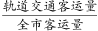
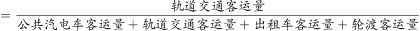
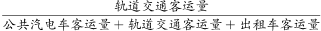
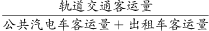
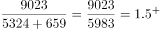
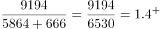
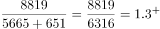
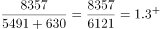

# 现期比重比较（月度比重，分母跨段拼合+极小成分忽略）

考点：[[20-考点/资料分析/比重/现期比重比较（月度比重，分母跨段拼合+极小成分忽略）|比重 / 现期比重比较（月度比重，分母跨段拼合+极小成分忽略）]]
材料：[[15-材料/资料分析/307978 某市2021年1—7月（图表部分为1|307978 某市2021年1—7月（图表部分为1]]

**问法模型**：题干'2021年上半年…轨道交通客运量占全市客运量比重最大的月份是'→现期比重逐月比较模型：逐月算 轨道/(汽电车+轨道+出租车+轮渡)，等价转化为 轨道/(汽电车+出租车) 直除比大小

## 推理链
1. 第1步：从图中提取1—6月轨道交通客运量7729、5534、9023、9194、8819、8357万人，公共汽电车5782、4564、5324、5864、5665、5491万人；从文字段提取出租车逐月576、472、659、666、651、630万人
2. 第2步：规则：比重=轨道交通/全市，全市=汽电车+轨道+出租车+轮渡；轮渡仅给1—7月累计135万人、无月度值且约占总盘0.14%，按官方口径可忽略
3. 第3步：同构变形，比较轨道/全市等价于比较 轨道/(汽电车+出租车)：3月=9023/(5324+659)=9023/5983≈1.51，4月=9194/(5864+666)=9194/6530≈1.41，5月=8819/(5665+651)=8819/6316≈1.40，6月=8357/(5491+630)=8357/6121≈1.37
4. 第4步：3月比值≈1.51为3—6月中最大；验算实际比重：3月=9023/15006≈60.1%，4月=9194/15724≈58.5%，5月=8819/15135≈58.3%，6月=8357/14478≈57.7%（1月54.9%、2月52.4%均更低）
5. 第5步：与选项对照，比重最大月份为3月，对应A

**最快解法**：⚡ 同构分数比较法（考场最快）：不做减法不出比重，直接比'轨道柱÷(汽电车柱+出租车月值)'，截位直除首位——3月9023/5983≈1.5、4月9194/6530≈1.4、5月8819/6316≈1.4、6月8357/6121≈1.37，首位即锁定3月最大

## 易错点
- ⚠ 分母拼合不全：全市客运量无单处给全，须图(汽电车+轨道)+文字(出租车逐月)拼合，漏加出租车月度数据则口径不符（本题结论碰巧不变但过程失分）
- ⚠ '46.7%'数值撞车：图中2月汽电车增速46.7%与文字中轨道1—7月累计增速46.7%同数不同口径，本题只用客运量柱形，勿把增速折线数据当客运量代入
- ⚠ 时间口径错位：文字中轨道55863万是1—7月累计，本题要1—6月逐月值，必须读图中柱形，不能拿累计值÷7或÷6折算当月

## 母题抽象
> 🧩 当题干出现'某时段内某部分占整体比重最大(小)的月份/季度'特征时，用现期比重逐期比较法：分子取部分逐期值，分母跨文字段与图拼合整体，占比极小且缺数据的成分可忽略，再化同构为'部分/(其余部分之和)'截位直除定大小

**同类特征**：上半年…比重最大的月份、现期比重比较、逐月数据逐一计算、分母需跨段拼合(图+文字)、极小成分可忽略(轮渡)、双轴图柱形读数

## 相关题
- [[10-真题/资料分析/比重/10204607 现期比重比较（与1-3判定，分母需由累计值差分）|10204607]]（辽宁 2024，相关度1）
- [[10-真题/资料分析/比重/18643847 现期比值计算与百分点差值比较（资产负债率=总负债÷总资产）|18643847]]（四川 2026，相关度1）
- [[10-真题/资料分析/比重/19283749 现期比重比较（逐组求比重比大小）|19283749]]（国考 2025，相关度1）
- [[10-真题/资料分析/比重/2042810 现期比重比较（子口径占全口径比重，逐部计数判断）|2042810]]（江苏 2017，相关度1）
- [[10-真题/资料分析/比重/2052082 现期比重比较|2052082]]（吉林 2017，相关度1）

---

### 题干
2021年上半年，该市轨道交通客运量占全市客运量比重最大的月份是：

### 选项
- A. 3月　✅
- B. 4月
- C. 5月
- D. 6月

### 官方解析

根据题干“2021年上半年······占······比重最大的月份是”，可判定本题为现期比重问题。定位文字材料可得：2021年1—6月，出租车客运量分别为576万人、472万人、659万人、666万人、651万人和630万人。定位统计图可知，2021年1-6月某市轨道交通与公共汽电车客运量。全市客运量=公共汽电车客运量+轨道交通客运量+出租车客运量+轮渡客运量。根据公式：比重，即，由于轮渡客运量和其他客运量相比起来非常小，可忽略。要想比较的大小，可以直接比较的大小。代入数据可知，3月：；4月：；5月：；6月：。比较可知，2021年上半年，该市轨道交通客运量占全市客运量比重最大的月份是3月。

故正确答案为A。

### 给定材料

        2021年1—7月，某市累计客运量97638万人，同比增长40.8%。其中，公共汽电车客运量37465万人、增长33.4%；轨道交通客运量55863万人，增长46.7%；出租车客运量4175万人、增长36.5%；轮渡客运量135万人、增长42.1%。2021年1—6月，出租车客运量分别为576万人、472万人、659万人、666万人、651万人和630万人。

