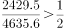
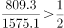
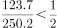
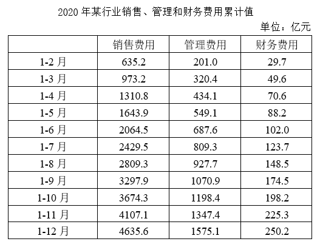

# 现期比重比较（前7月累计与全年总额一半的比较计数）

考点：[[20-考点/资料分析/比重/现期比重比较（前7月累计与全年总额一半的比较计数）|比重 / 现期比重比较（前7月累计与全年总额一半的比较计数）]]
材料：[[15-材料/资料分析/308024 2020年某行业销售费用、管理费用、|308024 2020年某行业销售费用、管理费用、]]

**问法模型**：题干问'前7个月费用额不到全年总额一半的有几项'→ 逐项判断现期比重是否小于50%，即比较1-7月累计值与全年总额÷2的大小后计数

## 推理链
1. 第1步：表格为2020年累计值，直接读两行：1-7月累计 销售2429.5、管理809.3、财务123.7亿元；1-12月全年 销售4635.6、管理1575.1、财务250.2亿元（本题恰好无需差分求单月值）
2. 第2步：'不到全年一半'等价于现期比重<50%，判据为：1-7月累计值 < 1-12月全年值÷2
3. 第3步：代入逐项比较：销售 2429.5 vs 4635.6÷2=2317.8，2429.5>2317.8 不满足；管理 809.3 vs 1575.1÷2=787.55，809.3>787.55 不满足；财务 123.7 vs 250.2÷2=125.1，123.7<125.1 满足
4. 第4步：对应比重约为：销售2429.5/4635.6≈52.4%、管理809.3/1575.1≈51.4%、财务123.7/250.2≈49.4%，仅财务费用低于50%
5. 第5步：满足'不到一半'的共1项，与选项对照，B（1）当选

**最快解法**：⚡ 半数直比法：读1-7月行与1-12月行两个累计行，全年值取一半再比（2317.8/787.6/125.1），或反向把前7月值×2与全年值比（4859.0 vs 4635.6、1618.6 vs 1575.1、247.4 vs 250.2），只有财务满足，秒定B；全部用加减乘二，无需除法

## 易错点
- ⚠ 时间口径切换：全表是累计值，本题直接用1-7月与1-12月两个累计行比较即可，若误去做相邻行差分求单月值反而多余且易错
- ⚠ 三项费用量级悬殊且财务费用列数值小（123.7 vs 250.2），极易把三列数字看串行导致销售/管理/财务判定错位
- ⚠ '不到一半'的基准是全年总额÷2，误用'前7月与下半年（差分值）比较'或把比重算成前7月÷下半年会数错项数

## 母题抽象
> 🧩 当题干出现'前X个月不到全年总额一半的有几项'特征时，累计表直接取1-X月行与1-12月行，用'前X月累计 vs 全年÷2'逐项比较（等价于现期比重<50%）后计数，无需差分

**同类特征**：前7个月、全年总额一半、累计值直接读行、现期比重<50%、有几项（计数型比较）、三项费用分别判断

## 相关题
（暂无）

---

### 题干
在该行业销售费用、管理费用和财务费用三项费用中，2020年前7个月费用额不到全年总额一半的有几项？

### 选项
- A. 0
- B. 1　✅
- C. 2
- D. 3

### 官方解析

根据题干“······2020年前7个月······不到全年总额一半的有几项”，结合材料时间为2020年，可判定本题为现期比重问题。根据公式：比重，定位表格材料可得，2020年前7个月该行业销售费用、管理费用和财务费用占全年总额的比重分别为：、、，符合题意的共有1项。

故正确答案为B。

### 给定材料

