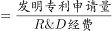

# 现期比重计算＋条件充分性判断（双路径验证）

考点：[[20-考点/资料分析/比重/现期比重计算＋条件充分性判断（双路径验证）|比重 / 现期比重计算＋条件充分性判断（双路径验证）]]
材料：[[15-材料/资料分析/308027 2019年A市专利密集型产业的增加值|308027 2019年A市专利密集型产业的增加值]]

**问法模型**：题干以'补充条件①/②能否求得发明专利申请量'设问 → 对目标量分别建立'部分=总体×比重'的两条公式链，逐链检验所缺量是否恰为①或②，判断充分性

## 推理链
1. 第1步：从材料提取桥梁数据——2019年专利密集型产业发明专利申请量占专利申请总量的比重为66%，每亿元R&D经费产生发明专利申请量73.1件，专利密集型产业增加值6918.8亿元
2. 第2步：路径①公式——发明专利申请量=专利申请总量×66%，条件①恰为专利申请总量，代入即得目标量（件）
3. 第3步：路径②先求中间量——由'R&D经费占增加值的比重为②'，得R&D经费=6918.8×②亿元
4. 第4步：路径②再求目标量——发明专利申请量=73.1件/亿元×R&D经费=73.1×6918.8×②件，条件②代入即得
5. 第5步：两条路径各自恰好只缺一个条件且分别对应①、②，故补充任一条均可独立求得目标量，无需同时补充、更无需相加
6. 第6步：对照选项，'补充①和②中任一条可以得到'即C项

**最快解法**：⚡ 数据充分性判断＋量纲检验：写出两条公式链'目标量=①×66%'与'目标量=73.1×(②×6918.8)'，每条链只缺一个已知量且恰为①或②，补哪条都通，直接秒选C；用'件/亿元×亿元=件'的量纲检验确认②路径成立

## 易错点
- ⚠ 误选D：以为需将①②'相加'（如总量×比重再加另一比重）才够用，实际两条路径各自独立完整，任一条即可，与'相加'无关
- ⚠ 路径②漏掉桥梁量：须先由增加值6918.8亿元×比重②得R&D经费，再乘73.1件/亿元；漏掉'增加值×比重'这一中间量会误判②不可得而错选A/B
- ⚠ 比重口径混淆：66%是发明专利申请量占'专利申请总量'的比重，不是占有效发明专利或授权量的比重；题干补充的②是'R&D经费占增加值的比重'，须与'每亿元R&D经费73.1件'连乘，两者不能混用或直接相加

## 母题抽象
> 🧩 当题干出现'补充条件①/②能否求得某量'的条件充分性特征时，列出目标量的全部公式链并逐链核对所缺量：所缺量恰为①或②即该条充分，任一条充分就选'任一可得'，不需要也不应将两条相加

**同类特征**：补充①②条件充分性判断、现期比重计算、部分=总体×比重、发明专利申请量占专利申请总量66%、每亿元R&D经费73.1件、增加值6918.8亿元作桥梁

## 相关题
- [[10-真题/资料分析/比重/15527 现期比重计算（多子条件混合的加权平均）|15527]]（黑龙江 2010，相关度1）
- [[10-真题/资料分析/比重/2028300 现期比重计算+饼图扇区匹配|2028300]]（国考 2017，相关度1）
- [[10-真题/资料分析/比重/1752662 现期比重计算（表格空缺比率补值）|1752662]]（北京 2016，相关度1）
- [[10-真题/资料分析/比重/1758932 现期比重计算＋跨图表数值比对定位|1758932]]（上海 2016，相关度1）
- [[10-真题/资料分析/比重/2448500 现期比重计算（整体=部分÷比重，比重=部分÷整体）|2448500]]（国考 2020，相关度1）

---

### 题干
现已知2019年A市①专利密集型产业专利申请总量、②专利密集型产业R&D经费占专利密集型产业实现增加值的比重。如果想得到当年A市专利密集型产业发明专利申请量的数值，下列说法正确的是：

### 选项
- A. 补充①可以得到，补充②不可以得到
- B. 补充①不可以得到，补充②可以得到
- C. 补充①和②中任一条可以得到　✅
- D. ①和②两条相加才可以得到

### 官方解析

根据题干“2019年······占······的比重······得到当年A市专利密集型产业发明专利申请量”，结合材料给出“专利密集型产业发明专利申请量占······的比重”，可判定本题为现期比重计算问题。定位文字材料第一段可得：2019年A市专利密集型产业实现增加值6918.8亿元；定位文字材料第二段可得：2019年专利密集型产业发明专利申请量占专利申请总量的比重为66%，专利密集型产业每亿元R&amp;D经费产生的发明专利申请量为73.1件。

令条件①所述量为A件，根据部分=总体×比重，可得A市专利密集型产业发明专利申请量=A×66%件。

令条件②所述比重为m，根据部分=总体×比重，可得A市专利密集型产业R&amp;D经费为6918.8m亿元；由于专利密集型产业每亿元R&amp;D经费产生的发明专利申请量，故发明专利申请量为73.1×6918.8m件。

补充①和②中任意一条都可以得到。

故正确答案为C。

### 给定材料

        2019年A市专利密集型产业实现增加值6918.8亿元，比上年增长9.6%，分别高于战略性新兴产业、高技术产业增加值增速2.3个和1.7个百分点；专利密集型产业增加值占GDP的比重为19.5%，比上年提高0.4个百分点。

        2019年专利密集型产业发明专利申请量占专利申请总量的比重为66%，比规模以上重点企业高5.1个百分点。专利密集型产业每亿元R&amp;D经费产生的发明专利申请量为73.1件，比规模以上重点企业高3.6件；企业户均拥有有效发明专利15.6件，是规模以上重点企业的2.2倍。从成果转化看，已被成功实施的发明专利数为5.2万件，占有效发明专利数的58.4%。

        在专利密集型产业中，2019年信息通信技术服务业实现营业收入10198.5亿元，增速达41.3%；实现利润197.6亿元，比上年增长1倍；单位企业实现营业收入12亿元，是专利密集型产业平均水平的3.3倍。

        在专利密集型产业中，2019年医药医疗产业营业收入、利润分别增长13.7%和5%；收入利润率达到17%，高于专利密集型产业平均水平4.1个百分点；单位企业营业收入、利润分别为4.5亿元和0.76亿元。

