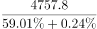
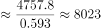

# 基期比重求基期总量（整体=部分÷比重，比重需先还原到基期）

考点：[[20-考点/资料分析/比重/基期比重求基期总量（整体=部分÷比重，比重需先还原到基期）|比重 / 基期比重求基期总量（整体=部分÷比重，比重需先还原到基期）]]
材料：[[15-材料/资料分析/308028 2016—2020年末S省就业人口总|308028 2016—2020年末S省就业人口总]]

**问法模型**：题干问基期年份（2019年末）的总量，而材料只给现期比重及其变化（下降0.24个百分点）和基期部分量（柱状图2019年就业人口4757.8）→ 先用'59.01%+0.24%'还原基期比重，再套'整体=部分÷比重'求基期整体。

## 推理链
1. 第1步：题干求2019年末常住人口总数；文字材料给出2020年末就业人口占常住人口59.01%，且该比重比2019年末下降0.24个百分点
2. 第2步：还原基期比重：2019年末占比=59.01%+0.24%=59.25%（比重是下降的，基期更高）
3. 第3步：从柱状图提取2019年末就业人口（部分量）=4757.8万人
4. 第4步：代入公式 整体=部分÷比重：2019年末常住人口=4757.8÷59.25%
5. 第5步：截位估算：0.5925×8000=4740，4757.8−4740=17.8，17.8÷0.5925≈30，故结果≈8030万人（反乘验证：8030×59.25%≈4757.8，吻合）
6. 第6步：与选项对照：B项8030与计算结果一致，A(7910)、C(8096)、D(8199)均偏差明显，故选B

**最快解法**：⚡ 基期比重还原＋截位直除：先加回0.24个百分点得59.25%，再算4757.8÷59.25%——首位商8（59.25%×8000=4740），余17.8再商约30，锁定8030选B；也可从选项反乘验证：8030×59.25%≈4757.8最贴合。

## 易错点
- ⚠ 时间口径混淆：误用2020年数据4750.9÷59.01%≈8051万人，那是2020年末常住人口而非题干所求的2019年末
- ⚠ 百分点方向搞反：比重'下降0.24个百分点'说明基期比重更高，应59.01%+0.24%=59.25%；若误减成58.77%，得4757.8÷58.77%≈8096，恰好落入C项陷阱
- ⚠ 分母口径混淆：59.01%的分母是'常住人口'而非'就业人口'，'个百分点'不能当百分比增速参与计算；另柱状图纵轴非零起点，勿据柱高误判总量大幅变动

## 母题抽象
> 🧩 当题干问'基期总量/整体'且材料只给'现期比重＋比重较基期的变化（个百分点）＋基期部分量'时，先加减还原基期比重，再用 整体=基期部分量÷基期比重 截位直除，并用选项反乘验证。

**同类特征**：问基期（2019年末）总量、材料给现期比重及其升降的'个百分点'、需从柱状图跨材料取基期部分量、整体=部分÷比重、选项数值接近，需还原比重后精算或反乘验证

## 相关题
- [[10-真题/资料分析/比重/10204601 比重反推整体（整体=部分÷比重）后两期总量作差|10204601]]（黑龙江 2024，相关度1）
- [[10-真题/资料分析/综合/12881981 综合判断（比重比较+翻番判断+整体推算）|12881981]]（广东 2025，相关度1）
- [[10-真题/资料分析/综合/2776163 综合分析·逐项判断（比重判断-整体推算-倍数辨析-构成占比加和）|2776163]]（浙江 2021，相关度1）
- [[10-真题/资料分析/比重/18697345 现期比重求整体（已知部分量及其占比反推整体）|18697345]]（山东 2024，相关度1）
- [[10-真题/资料分析/比重/4808347 比重反推整体（整体=部分÷比重）与组间差值比较|4808347]]（湖北 2022，相关度1）

---

### 题干
2019年末S省常住人口总数约为多少万人？

### 选项
- A. 7910
- B. 8030　✅
- C. 8096
- D. 8199

### 官方解析

根据题干“2019年末······约为多少万人”，结合材料给出2019年末S省就业人口与比重的相关数据，可判定本题为现期比重问题。定位文字材料第一段可知：2020年末S省就业人口占常住人口总数的59.01%，与2019年末相比，就业人口占常住人口总数的比重下降0.24个百分点；定位图形材料可知：2019年末S省就业人口数量为4757.8万人。根据公式：整体，可得2019年末S省常住人口总数为万人，与B项最接近。

故正确答案为B。

### 给定材料

        2020年末S省就业人口4750.9万人，占常住人口总数的59.01%，与2019年末相比，就业人口占常住人口总数的比重下降0.24个百分点。

        2020年末S省第一产业、第二产业和第三产业的就业人口数量分别为764.89万人、2033.39万人、1952.62万人，与2019年末相比，第一、第二产业就业人口比重分别下降0.7个、0.1个百分点，第三产业就业人口比重上升0.8个百分点。

> [!warning] 疑点（官方解析可能有误，待人工复核）
> 官方解析将本题判型为'现期比重问题'，按材料导读口径实为'基期比重求基期总量'（以2019年为基准的整体=部分÷比重），属判型表述差异，计算过程与答案B本身无误。

<!-- CODEX-ANSWER-REVIEW:BEGIN -->
### 本次独立复核

**复核状态：** `resolved`（答案与解析已核定）

**计分答案：** B（可计分）

**复核解析：**

就业人口占常住人口比重2019年为59.01%+0.24%=59.25%。常住人口=就业人口/比重=4757.8/0.5925≈8022万人，最接近8030，选B。

**相关信息：**

比重变化：分项增速高于整体增速时占比上升；基期比重需分别还原分子、分母后求比。

**题源依据：** [固定版本原题](https://github.com/Mentat-Uran/kaogongzhentizhengliu/blob/84ab93d4b64b61d897bece8a1c0a5bab06b4feb2/10-%E7%9C%9F%E9%A2%98/%E8%B5%84%E6%96%99%E5%88%86%E6%9E%90/%E6%AF%94%E9%87%8D/4652179%20%E5%9F%BA%E6%9C%9F%E6%AF%94%E9%87%8D%E6%B1%82%E5%9F%BA%E6%9C%9F%E6%80%BB%E9%87%8F%EF%BC%88%E6%95%B4%E4%BD%93%3D%E9%83%A8%E5%88%86%C3%B7%E6%AF%94%E9%87%8D%EF%BC%8C%E6%AF%94%E9%87%8D%E9%9C%80%E5%85%88%E8%BF%98%E5%8E%9F%E5%88%B0%E5%9F%BA%E6%9C%9F%EF%BC%89.md)；固定内容 commit `84ab93d4b64b61d897bece8a1c0a5bab06b4feb2`，Markdown blob `0d17e516db8ea83d6a1c0e52524adabca269b7bf`。
<!-- CODEX-ANSWER-REVIEW:END -->
