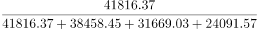
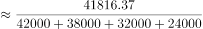
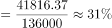
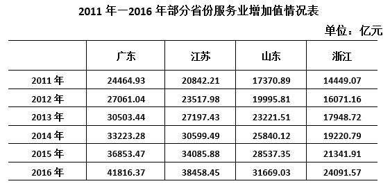

# 现期比重计算（部分占多省份合计的比重）

考点：[[20-考点/资料分析/比重/现期比重计算（部分占多省份合计的比重）|比重 / 现期比重计算（部分占多省份合计的比重）]]
材料：[[15-材料/资料分析/308283 2011—2016年广东、江苏、山东|308283 2011—2016年广东、江苏、山东]]

**问法模型**：'某年A省占表中各省之和的比重'且选项为百分数区间 → 用现期比重=部分÷整体，一步除法并对照区间

## 推理链
1. 第1步：题干时间为2016年、问'占……之和的比重'，材料无基期替换需求，判定为现期比重问题
2. 第2步：从表中提取2016年当年值：广东41816.37、江苏38458.45、山东31669.03、浙江24091.57（单位均为亿元）
3. 第3步：整体（分母）=表中四省之和=41816.37+38458.45+31669.03+24091.57=136035.42亿元，不得加入表外省份
4. 第4步：代入公式比重=部分/整体=41816.37÷136035.42≈30.7%
5. 第5步：30.7%落在28%—32%区间内，对照选项只有C符合，故选C

**最快解法**：⚡ 区间验证法（避免做除法）：先加总分母≈13.6万亿，再算两端界值0.28×136035≈38090、0.32×136035≈43531，部分值41816.37恰好落在两者之间，直接锁定C在28%—32%之间；若需精确值则截位直除41816÷136035≈418/1360≈30.7%

## 易错点
- ⚠ 分母只能取'表中四省'之和，表标题为'部分省份'，切勿擅自扩展为全国或其他口径
- ⚠ 必须用2016年当年值，勿误取2015年或其他年份数据（表中各年均为当期值非累计值）
- ⚠ 数值带两位小数、广东与江苏量级接近，加总求和时注意尾数精度，粗估量级错误（如把合计估成12万亿或15万亿）可能导致误选B或D

## 母题抽象
> 🧩 当题干出现'某年A占（表中）各部分之和的比重'且选项为百分数区间时，用现期比重=部分÷整体，可不做除法，直接用'整体×区间界值'与部分值比较即可锁定答案区间

**同类特征**：现期比重、占……之和的比重、部分/整体一步除法、选项为百分数区间（不到/在……之间/高于）、分母为表中多列数据合计、数据精确到两位小数

## 相关题
- [[10-真题/资料分析/比重/4792819 现期比重计算（多部分比重依次求解）|4792819]]（新疆 2014，相关度1）
- [[10-真题/资料分析/比重/827355 现期比重比较（部分占比过半速判）|827355]]（政法干警 2014，相关度1）
- [[10-真题/资料分析/比重/2272297 现期比重比较|2272297]]（选调 2015，相关度1）
- [[10-真题/资料分析/比重/2032972 现期比重计算（多地区占比求和）|2032972]]（吉林 2015，相关度1）
- [[10-真题/资料分析/比重/2187857 现期比重计算（部分量需先由'总量−其中量'减法间接求得）|2187857]]（山东 2018，相关度1）

---

### 题干
2016年，广东省服务业增加值占表中四省服务业增加值之和的比重：

### 选项
- A. 不到25%
- B. 在25%—28%之间
- C. 在28%—32%之间　✅
- D. 高于32%

### 官方解析

根据题干“2016年······占······的比重”，结合材料时间为2016年，可判定本题为现期比重问题。定位统计表可得：2016年广东、江苏、山东、浙江服务业增加值分别为41816.37亿元、38458.45亿元、31669.03亿元、24091.57亿元。根据公式：比重，则2016年广东省服务业增加值占表中四省服务业增加值之和的比重为，在C项范围内。

故正确答案为C。

### 给定材料

 

