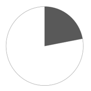
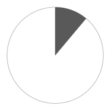
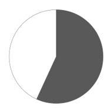
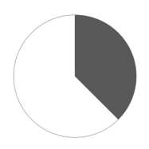
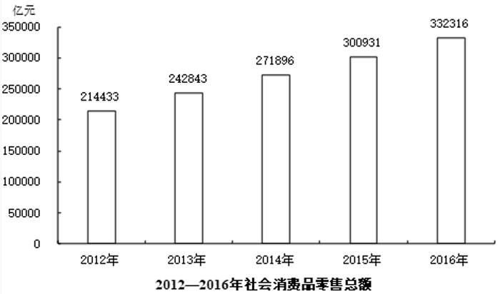

# 基期比重计算（饼图选项识别）

考点：[[20-考点/资料分析/比重/基期比重计算（饼图选项识别）|比重 / 基期比重计算（饼图选项识别）]]
材料：[[15-材料/资料分析/308285 2016年我国社会消费品零售总额的总|308285 2016年我国社会消费品零售总额的总]]

**问法模型**：题干以现期材料年份的上一期（2015年）+'占当年社零总额比重'+饼图选项设问 → 判定为基期比重模型：基期比重=现期部分量÷(1+部分增速)÷基期总量，算出百分比后与饼图份额对照

## 推理链
1. 第1步：题干问2015年的比重而材料数据均为2016年，判定为基期比重问题，不能用现期比重12.6%直接作答
2. 第2步：从文字第三段提取部分量：2016年网上商品零售额41944亿元、增长25.6%；从统计图提取基期总量：2015年社会消费品零售总额300931亿元
3. 第3步：列式41944÷(1+25.6%)÷300931=41944/1.256÷300931≈33395÷300931≈11.1%
4. 第4步：11.1%即略高于1/10（不足1/8、远小于1/4），对照四个饼图，份额约一成多的B项最接近，故选B

**最快解法**：⚡ 公式法+截位直除：基期部分量41944/1.256，截位直除首商3得约33400；再33400÷300931，首位商1、次位1，约11%；饼图中约占九分之一（约11%）的即为B。替代路径：基期比重=现期比重12.6%×(1+总体增速)/(1+25.6%)，总体增速≈31385/300931≈10.4%，12.6%×1.104/1.256≈12.6%×0.88≈11.1%

## 易错点
- ⚠ 指标口径陷阱：'网上零售额51556亿元(+26.2%)'与'网上商品零售额41944亿元(+25.6%)'是包含关系的两个指标，本题必须用后者（前者含服务类）
- ⚠ 基期现期混淆：文字直接给出'占社零总额比重12.6%'是2016年现期比重，题干问2015年，直接选约12.6%份额的饼图即踩坑
- ⚠ 分母取数错误：基期总量应取图表中2015年的300931亿元，误用2016年332316亿元或忘记对41944除以(1+25.6%)还原基期

## 母题抽象
> 🧩 当题干出现'基期年份+某部分占当年总体的比重'且选项为饼图/扇形图时，用基期比重公式：现期部分量÷(1+部分增速)÷基期总量（基期总量常需跨段从图表取数），算出百分比后与图形份额对照选最近项

**同类特征**：题干年份（2015年）早于材料现期（2016年）、'占当年……比重'、选项为饼图/扇形图、部分量及其增速在文字段、基期总量需从统计图读取（跨段拼数据）、区分'网上零售额'与'网上商品零售额'

## 相关题
（暂无）

---

### 题干
2015年，我国网上商品零售额占当年社会消费品零售总额的比重可用下列哪一图形表示？

### 选项
- A. 

- B. 

　✅
- C. 

- D. 

### 官方解析
根据题干“2015年······占······的比重”，结合材料时间为2016年，可判定本题为基期比重问题。定位统计图，可得2015年社会消费品零售总额为300931亿元；定位文字材料第三段，可得2016年我国网上商品零售额41944亿元，增长25.6%。根据公式：基期量，2015年我国网上商品零售额亿元，则2015年我国网上商品零售额占当年社会消费品零售总额的比重，约占饼状图面积的，与B项最接近。
故正确答案为B。

### 给定材料

        2016年，我国全年社会消费品零售总额332316亿元。按经营地统计，城镇消费品零售额285814亿元，增长10.4%；乡村消费品零售额46503亿元，增长10.9%。按消费类型统计，商品零售额296518亿元，增长10.4%；餐饮收入额35799亿元，增长10.8%。

        在限额以上企业商品零售额中，粮油、食品、饮料、烟酒类零售额比上年增长10.5%，服装、鞋帽、针纺织品类增长7.0%，化妆品类增长8.3%，金银珠宝类与上年持平，日用品类增长11.4%，家用电器和音像器材类增长8.7%，中西药品类增长12.0%，文化办公用品类增长11.2%，家具类增长12.7%，通讯器材类增长11.9%，建筑及装潢材料类增长14.0%，汽车类增长10.1%，石油及制品类增长1.2%。

        全年网上零售额51556亿元，比上年增长26.2%。其中，网上商品零售额41944亿元，增长25.6%，占社会消费品零售总额的比重为12.6%。在网上商品零售额中，吃类商品增长28.5%，穿类商品增长18.1%，用类商品增长28.8%。

> [!warning] 疑点（官方解析可能有误，待人工复核）
> 官方解析中公式与计算式文字存在明显截断缺漏（'根据公式：基期量，……零售额亿元'处内容不完整），但结论可复核无误：41944/1.256÷300931≈11.1%，与答案B一致，不影响正确性
