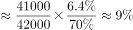
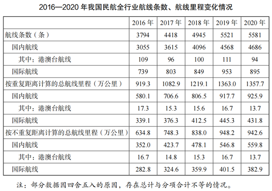

# 两期比重差值计算（基期与现期占比比较）

考点：[[20-考点/资料分析/比重/两期比重差值计算（基期与现期占比比较）|比重 / 两期比重差值计算（基期与现期占比比较）]]
材料：[[15-材料/资料分析/308751 2020年我国民航全行业运输生产情况|308751 2020年我国民航全行业运输生产情况]]

**问法模型**：题干'相比2019年，2020年……占比约（提高/降低%）'→ 两期比重差模型：现期比重×(a-b)/(1+a)，方向由部分增速a与整体增速b的大小决定

## 推理链
1. 第1步：从文字段1提取数据：2020年全行业旅客运输量B=41777.82万人次、同比下降36.7%（b=-36.7%）；国内航线A=40821.30万人次、同比下降30.3%（a=-30.3%）
2. 第2步：判方向——部分增速a=-30.3%＞整体增速b=-36.7%，部分降得少，2020年占比比2019年提高，先排除A、B
3. 第3步：套两期比重差公式：比重差=A/B×(a-b)/(1+a)
4. 第4步：代入增速部分：a-b=-30.3%-(-36.7%)=6.4%，1+a=1-0.303=0.697，6.4%/0.697≈9.2%
5. 第5步：代入比重部分：现期比重A/B=40821.30/41777.82≈97.7%，故比重差≈97.7%×9.2%≈9.0个百分点
6. 第6步：与选项对照：占比约提高9%，选C

**最快解法**：⚡ 公式法+截位直除：先比a与b定方向锁CD；再算6.4/69.7≈9.2%（截位直除），由于现期比重40821.30/41777.82≈97.7%略小于1，最终差值略小于9.2个百分点、最接近9%，直接选C，无需精算基期比重

## 易错点
- ⚠ 降幅是负增速：a-b必须带符号相减（-30.3%-(-36.7%)=+6.4%），若把降幅当正增速或漏负号，方向与数值全错；分母1+a=0.697而非1.303
- ⚠ 方向误判：国内降幅30.3%小于整体降幅36.7%，是'提高'而非'降低'，易凭'都在下降'直觉误选A/B
- ⚠ 概念与结构陷阱：比重变化严谨表述是'变化几个百分点'（官方备注）；且'港澳台'是'其中'项包含于国内航线内，本题分子只能用国内40821.30，不得再加港澳台或误用国际956.51

## 母题抽象
> 🧩 当题干出现'相比(基期年)，(现期年)某部分占整体的比重提高/降低了约x%'时，用两期比重差公式A/B×(a-b)/(1+a)：先比a、b定升降方向排除一半选项，再速算(a-b)/(1+a)并结合现期比重<1缩小幅度，即可锁定答案

**同类特征**：相比2019年，2020年、占比约（提高/降低）、部分（国内航线）与整体（全行业）均给现期值+同比降幅、选项为提高了/降低了+整百分比、两期比重变化比较

## 相关题
（暂无）

---

### 题干
相比2019年，2020年我国民航全行业完成旅客运输中，国内航线完成旅客运输总量占比约（    ）。

### 选项
- A. 降低了9%
- B. 降低了15%
- C. 提高了9%　✅
- D. 提高了15%

### 官方解析

根据题干“相比2019年，2020年······中······占比约”，结合选项为提高了/降低了+%，可判定本题为两期比重计算问题。定位文字材料第一段可得：2020年，我国民航全行业完成旅客运输量41777.82万人次（B），比上年下降36.7%（b）。国内航线完成旅客运输量40821.30万人次（A），比上年下降30.3%（a）。根据公式：两期比重差，可得2020年国内航线完成旅客运输总量占比与2019年的差值为，即约提高了9%。

故正确答案为C。

备注：比重自身为率，一般只讨论比重变化的差值。本题严谨表示应为两期比重变化了几个百分点。

### 给定材料

        2020年，受新冠肺炎疫情影响，我国民航全行业完成旅客运输量41777.82万人次，比上年下降36.7%。国内航线完成旅客运输量40821.30万人次，比上年下降30.3%，其中港澳台航线完成旅客运输量96.13万人次，比上年下降91.3%，国际航线完成旅客运输量956.51万人次，比上年下降87.1%。尽管如此，我国国内航空运输市场在全球范围内恢复最快、运行最好。

        2020年，全行业运输航空公司完成运输飞行时长876.22万小时，比上年下降28.8%。国内航线完成运输飞行时长788.22万小时，比上年下降20.5%，其中港澳台航线完成运输飞行时长3.55万小时，比上年下降82.3%，国际航线完成运输飞行时长87.99万小时，比上年下降63.3%。

        2020年，全行业运输航空公司完成运输起飞371.09万架次，比上年下降25.3%。国内航线完成运输起飞357.29万架次，比上年下降20.2%，其中港澳台航线完成运输起飞1.65万架次，比上年下降80.3%，国际航线完成运输起飞13.79万架次，比上年下降71.8%。

