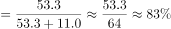

# 两期比重变化（比重差计算，基期数据需从图中拼取）

考点：[[20-考点/资料分析/比重/两期比重变化（比重差计算，基期数据需从图中拼取）|比重 / 两期比重变化（比重差计算，基期数据需从图中拼取）]]
材料：[[15-材料/资料分析/308754 2015—2020年全国基层群众性自|308754 2015—2020年全国基层群众性自]]

**问法模型**：题干'相较2019年，2020年A占B的比重（降低/提高…百分点）'→ 两期比重差模型：现期比重 − 基期比重（基期部分÷基期整体），方向看部分与整体增速孰大，差值精算后对照选项

## 推理链
1. 第1步：题干比较2020年与2019年'村委会占基层群众性自治组织'的比重，选项为'降低/提高+百分点'，判定为两期比重差问题
2. 第2步：文字材料直接给出2020年（现期）比重：村委会50.2万个，占81.63%
3. 第3步：2019年（基期）数据文字未给，从统计图取村委会53.3万个、居委会11.0万个，基期整体=53.3+11.0=64.3万个
4. 第4步：基期比重=53.3÷64.3≈82.9%（64.3×0.83≈53.4，故略低于83%）
5. 第5步：比重差=81.63%−82.9%≈−1.26个百分点，即2020年比重较2019年降低约1.26个百分点
6. 第6步：对照选项：方向为'降低'排除B/D，量级1.26（非12.6）排除C，锁定A

**最快解法**：⚡ 方向+量级双排除后一步直除：部分增速−3.1/53.3≈−5.8%低于整体增速−4.35%（文字直接给出），部分收缩更快→比重必降，排除B/D；两期比重均在81%~83%区间，差值必为个位数百分点，排除C/D的12.6；再截位直除53.3/64.3≈82.9%，81.63%−82.9%≈−1.26个百分点，锁定A（亦可验证公式：比重差≈现期比重×(a−b)/(1+a)=81.63%×(−5.8%+4.35%)/(1−5.8%)≈−1.27个百分点）

## 易错点
- ⚠ 基期整体量暗藏在图中：2019年总量64.3万个（53.3+11.0）文字未给，只盯文字会缺数，或误把2020年总量61.5万当作基期
- ⚠ 方向误判：村委会降幅（≈−5.8%）大于整体降幅（−4.35%），比重应下降；若'2020相较2019'基准理解反或分子分母颠倒，会误选B'提高了'
- ⚠ 量级与措辞陷阱：差值是1.26个百分点的量级，C/D的12.6是其10倍；比重差用'个百分点'而非'%'表述；图中村委会数值标在柱内下部、居委会标在上部，勿把11.0误读为村委会数

## 母题抽象
> 🧩 当题干出现'相较某基期年，现期A占B的比重提高/降低…百分点'时，用两期比重差模型：现期比重（文字常直接给出）减去基期比重（基期部分÷基期整体，数据常需从统计图拼取）；先用'部分增速vs整体增速'定方向、用两期比重同量级定差值量级排除干扰项，再一步截位直除精算验证

**同类特征**：相较2019年，2020年、占基层群众性自治组织的比重、降低/提高+个百分点、现期比重文字直接给出（81.63%）、基期部分与整体须从统计图取数（53.3与64.3）、部分降幅大于整体降幅→比重下降

## 相关题
（暂无）

---

### 题干
相较2019年，2020年村委会占基层群众性自治组织的比重（    ）。

### 选项
- A. 降低了约1.26个百分点　✅
- B. 提高了约1.26个百分点
- C. 降低了约12.6个百分点
- D. 提高了约12.6个百分点

### 官方解析

根据题干“相较2019年，2020年······占·······的比重”，结合选项为降低/提高+百分点，可判定本题为两期比重问题。定位文字材料第二段可得：截止2020年底，村委会占基层群众性自治组织的81.63%；定位统计图可得：2019年村委会53.3万个，居委会11.0万个。则2019年村委会占基层群众性自治组织的比重。所求比重差=81.63%-83.0%=-1.37%，即降低了约1.37个百分点，与A项最接近。

故正确答案为A。

### 给定材料

        基层群众性自治组织是我国在城市和农村按居民的居住地区建立起来的居民委员会或村民委员会，是城市居民或农村村民自我管理、自我教育、自我服务的组织。

        截止2020年底，全国基层群众性自治组织共计61.5万个，同比减少4.35%。其中，村委会50.2万个，占基层群众性自治组织的81.63%，村民小组376.1万个，村委会成员207.3万人；居委会11.3万个，占基层群众性自治组织的18.37%，居民小组123.6万个，居委会成员61.6万人。2016-2020年，我国村（居）委会完成选举数分别为9.7万个、18.2万个、27.6万个、8.8万个、6.1万个，其中，2020年村（居）委会登记选民数为1.1亿人，参与投票人数为0.65亿人。

> [!warning] 疑点（官方解析可能有误，待人工复核）
> 官方解析将2019年比重53.3÷64.3截位为83.0%，得差值−1.37个百分点；精确值≈82.89%，比重差=81.63%−82.89%≈−1.26个百分点，与A项'1.26'完全吻合；解析中间截位略粗（83.0%应为82.9%）但不影响答案A的正确性

<!-- CODEX-ANSWER-REVIEW:BEGIN -->
### 本次独立复核

**复核状态：** `resolved`（答案与解析已核定）

**计分答案：** A（可计分）

**复核解析：**

2020村委会占比=50.2/61.5=81.63%；2019按村委会53.3万、居委会11.0万计=53.3/64.3≈82.89%；变化约−1.26个百分点，降低约1.26，A。

**相关信息：**

两期比重变化常用公式：现期比重×(部分增长率−整体增长率)/(1+部分增长率)；部分增速高于整体时比重上升。

**题源依据：** [固定版本原题](https://github.com/Mentat-Uran/kaogongzhentizhengliu/blob/84ab93d4b64b61d897bece8a1c0a5bab06b4feb2/10-%E7%9C%9F%E9%A2%98/%E8%B5%84%E6%96%99%E5%88%86%E6%9E%90/%E6%AF%94%E9%87%8D/4673211%20%E4%B8%A4%E6%9C%9F%E6%AF%94%E9%87%8D%E5%8F%98%E5%8C%96%EF%BC%88%E6%AF%94%E9%87%8D%E5%B7%AE%E8%AE%A1%E7%AE%97%EF%BC%8C%E5%9F%BA%E6%9C%9F%E6%95%B0%E6%8D%AE%E9%9C%80%E4%BB%8E%E5%9B%BE%E4%B8%AD%E6%8B%BC%E5%8F%96%EF%BC%89.md)；固定内容 commit `84ab93d4b64b61d897bece8a1c0a5bab06b4feb2`，Markdown blob `8da0d3a98491d46baa191f68d9006853cdbca6e1`。
<!-- CODEX-ANSWER-REVIEW:END -->
