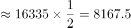

# 基期比重（基期部分量=基期整体×比重）

考点：[[20-考点/资料分析/比重/基期比重（基期部分量=基期整体×比重）|比重 / 基期比重（基期部分量=基期整体×比重）]]
材料：[[15-材料/资料分析/309014 2016年《中国妇女发展纲要（201|309014 2016年《中国妇女发展纲要（201]]

**问法模型**：题干问'2010年（基期）农村贫困妇女人数约为多少万人'→基期比重模型：基期整体=现期整体+减少量，再乘以比重约数'约一半'（50%）

## 推理链
1. 第1步：定位材料第三段：2016年全国农村贫困人口4335万人，比2010年减少1.2亿人（=12000万人），其中约一半为女性（按官方备注口径，此比重指2010年贫困人口中女性占比约50%）
2. 第2步：基期整体=现期+减少量（2016比2010'减少'，故减少量加回）：2010年全国农村贫困人口=4335+12000=16335万人
3. 第3步：部分=整体×比重：2010年农村贫困妇女人数=16335×50%≈8167.5≈8168万人
4. 第4步：与选项对照：D项8168与8167.5最接近（A项4335为未加工的现期总量），故选D

**最快解法**：⚡ 公式法+半数速算：4335+12000=16335，取一半即除以2得8167.5≈8168，直接锁定D，全程无需精算

## 易错点
- ⚠ 单位换算：'减少1.2亿人'必须换为12000万人才能与4335万相加，亿/万混排下漏换算或量级错位即错
- ⚠ 基期方向搞反：2016年比2010年'减少'，基期=现期+减少量；误做减法或直接用现期4335×50%≈2167.5万（这只是2016年女性的推算值）均掉坑
- ⚠ '约一半'口径归属：官方备注明确只能按'2010年贫困人口中约一半为女性'理解，若按2016年理解（2016年女性≈2167.5万，而1.2亿的减少量是总人数而非女性人数）则无法算出2010年女性数

## 母题抽象
> 🧩 当题干出现'基期年份+某部分量约为多少'且材料给出'现期整体±增减量+比重约数'时，先还原基期整体（减少量要加回），再乘比重约数即可锁定答案

**同类特征**：2010年（基期年份）、约为多少万人（估算问法）、比2010年减少1.2亿人（增减量需加回）、约一半为女性（比重≈50%）、亿人与万人混排需换算、部分=整体×比重

## 相关题
- [[10-真题/资料分析/比重/3523609 两期比重之部分量同比增减判定（部分=整体×比重，逐年判号）|3523609]]（四川 2021，相关度1）
- [[10-真题/资料分析/比重/19283971 现期比重比较（部分占整体比重超10%的品类计数）|19283971]]（国考 2025，相关度1）
- [[10-真题/资料分析/比重/4769985 现期比重计算（部分=整体×比重，饼图多扇区求和）|4769985]]（四川 2017，相关度1）
- [[10-真题/资料分析/比重/10942271 现期比重差求部分量之差（部分=整体×比重）|10942271]]（山东 2024，相关度1）
- [[10-真题/资料分析/比重/12019688 现期比重反推部分量（部分=整体×比重）|12019688]]（广东 2026，相关度1）

---

### 题干
2010年全国农村贫困妇女人数约为多少万人？

### 选项
- A. 4335
- B. 7356
- C. 2494
- D. 8168　✅

### 官方解析

根据题干“2010年全国农村贫困妇女人数约为多少万人”，结合材料时间为2016年，且材料中给出2010年全国农村贫困人口中贫困妇女占比，可判定本题为基期比重问题。定位文字材料第三段可知：2016年全国农村贫困人口为4335万人，比2010年减少1.2亿人，其中约一半为女性，则2010年全国农村贫困人口=4335+12000=16335万人。根据公式：部分=整体×比重，则2010年全国农村贫困妇女人数万人，与D项最接近。

故正确答案为D。

备注：材料第三段中“其中约一半为女性”可有两种理解：①2016年全国农村贫困人口中女性占比约为一半；②2010年全国农村贫困人口中女性占比约为一半；本题只能按照第二种理解，否则无法计算。

### 给定材料

        据国家统计局测算，妇女就业规模继续扩大。2016年全国女性就业人员占全社会就业人员的比重为43.1%，超过《中国妇女发展纲要（2011-2020年）》规定的40%的目标。

        女职工的合法权益得到进一步维护，为减少和解决女职工在工作中因生理特点造成的特殊困难发挥了积极作用。2016年，执行《女职工劳动保护特别规定》的企业比重明显提高，达73%，比2010年提高18个百分点。

        农村贫困妇女人数大幅度减少，基本实现应保尽保。按照年人均收入2300元的农村贫困标准计算，2016年全国农村贫困人口为4335万人，比2010年减少1.2亿人，其中约一半为女性。2016年农村贫困妇女享受“低保”及农村特困人员人数占全国农村女性贫困人口的比重为38%，比2010年提高4.1个百分点。

        女性生育保障水平有明显提高。《女职工劳动保护特别规定》发布以来，女职工在产假、怀孕流产等各个特殊时期的保护有了明确的规定，女性参加生育保险的人数迅速增加。2016年，女性参加生育保险的人数达8020万人，比2010年增长49%。

        享有基本社会保障的女性人数增加。2016年，全国参加基本养老保险人数8.9亿人，其中女性3.5亿人；参加城镇职工基本养老保险人数3.8亿人，其中女性1.8亿人，占比为46.6%；2016年，参加城乡居民基本养老保险人数5.1亿人，其中女性超过1.7亿人。女性参加失业保险和工伤保险的人数增加，2016年，全国参加失业保险的人数超过1.8亿人，其中女性7551万人，分别比2010年增加4713万人和2402万人，增长35%和47%；参加工伤保险人数2.2亿人，其中女性8129万人，分别增长35%和43%。

> [!note] 复核版本状态
> 原题不可计分（underdetermined；来源记录的答案键/竞争项：D）；仅当前明确标注的编辑版按答案D计分。
> 详细原题疑点、修订题面、解析和证据见下方独立复核记录。

<!-- CODEX-ANSWER-REVIEW:BEGIN -->
### 本次独立复核

**复核结论：** `resolved`（答案与解析已核定）

**原题计分状态：** 不计分（`underdetermined`：原题证据不足以唯一判定）。来源中记录的答案键/竞争项：D；这些记录不代表原题已核准答案。

**原题疑点与处理：**

选调 2020 〔20-考点/资料分析/比重/基期比重（基期部分量=基期整体×比重）〕 — 官方解析'则2010年全国农村贫困妇女人数万人'处公式数值显示缺失（应为16335×50%≈8167.5≈8168）；'约一半'存在2016/2010两种语法归…

**当前计分版本：** 明确标注的编辑版；未列出的题干、材料或选项沿用固定题源。答案不回填为原题答案。

**计分答案：** D（可计分）

**复核解析：**

国家统计局原始材料写明：2016年农村贫困人口4335万人，比2010年减少1.2亿多人，“其中约一半为女性”。“其中”承接紧邻的减少人数，因此只说明减贫人数中女性约占一半，不能推出2010年贫困人口中女性占一半。原解析还将“1.2亿多人”按精确12000万人处理。故原D的8168万人缺少数据依据。为使题目有准确的唯一作答，本编辑版将D选项改为“材料不足，无法确定”，答案D；此为明确的选项修订，不冒充原标准答案。

**题干：** 沿用固定题源原题；本编辑版只替换下列列明的内容。

**修订/采用选项：**

A. 4335
B. 7356
C. 2494
D. 【编辑修订】材料未提供2010年农村贫困妇女人数占比或人数，无法确定。

**相关信息：**

资料分析—基期比重。比例的指代对象必须由原文明确；“约一半”不能从减少量挪用为基期存量占比。

**核对依据与来源边界：**

- 固定题源：[原题文件](https://github.com/Mentat-Uran/kaogongzhentizhengliu/blob/84ab93d4b64b61d897bece8a1c0a5bab06b4feb2/10-%E7%9C%9F%E9%A2%98/%E8%B5%84%E6%96%99%E5%88%86%E6%9E%90/%E6%AF%94%E9%87%8D/4678665%20%E5%9F%BA%E6%9C%9F%E6%AF%94%E9%87%8D%EF%BC%88%E5%9F%BA%E6%9C%9F%E9%83%A8%E5%88%86%E9%87%8F%3D%E5%9F%BA%E6%9C%9F%E6%95%B4%E4%BD%93%C3%97%E6%AF%94%E9%87%8D%EF%BC%89.md)；内容版本 `84ab93d4b64b61d897bece8a1c0a5bab06b4feb2`，源 Markdown blob `3e8898c7957f27d7be31c5580b5a5533bb60dfb8`.
- **核心依据：** 原文没有给出2010年女性占比或女性人数；原官方解析把“减少人数中约一半”改作基期存量占比，属口径错误。修订D为“无法确定”，准确表达材料结论。
- [officialSource](国家统计局：《中国妇女发展纲要（2011—2020年）》2016年实施情况统计监测报告，https://www.stats.gov.cn/sj/zxfb/202302/t20230203_1899707.html)
- 固定题图/公式图：`90-图片/公式图/formula-4520ba70e5d55bc0.png`.

<!-- CODEX-ANSWER-REVIEW:END -->
