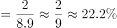

# 现期比重计算（先由'分项总量-分项女性'求男性部分，再除以全国总量）

考点：[[20-考点/资料分析/比重/现期比重计算（先由'分项总量-分项女性'求男性部分，再除以全国总量）|比重 / 现期比重计算（先由'分项总量-分项女性'求男性部分，再除以全国总量）]]
材料：[[15-材料/资料分析/309014 2016年《中国妇女发展纲要（201|309014 2016年《中国妇女发展纲要（201]]

**问法模型**：题干'2016年A类男性约占全国总人数的比重' → 现期比重=（城镇职工参保总数-城镇职工女性数）÷基本养老总人数，一句话即'部分先做减法、再除整体'

## 推理链
1. 第1步：定位材料末段，2016年全国参加基本养老保险8.9亿人，城镇职工基本养老保险3.8亿人，其中女性1.8亿人
2. 第2步：题干要求男性占比，需先换算部分量：城镇职工男性=城镇职工总数-城镇职工女性=3.8-1.8=2.0亿人
3. 第3步：现期比重公式：比重=部分÷整体=2.0亿÷8.9亿
4. 第4步：截位直除2.0÷8.9≈0.2247≈22.5%
5. 第5步：与选项对照，22.5%即C项；A项46.6%是城镇职工中女性占比，B、D量级均不符，故选C

**最快解法**：⚡ 截位直除+减法先行：先算3.8-1.8=2亿，再口算2÷8.9≈2/9弱一点≈22%，直选C（验证：8.9×22.5%≈2.0，吻合）

## 易错点
- ⚠ 直接选A的陷阱：材料明确给出'女性1.8亿人，占比为46.6%'，若不看清题干问的是'男性占全国'，会误把46.6%当答案
- ⚠ 分子错配：未做'3.8-1.8=2亿'的减法换算，误用女性1.8亿或分项总数3.8亿作分子
- ⚠ 分母错配：误用城镇职工总人数3.8亿作分母（得约52.6%），或与'其中女性3.5亿'的口径混淆——分母必须是全国基本养老保险总人数8.9亿

## 母题抽象
> 🧩 当题干出现'A类中另一性别/另一部分占全国总量的比重'特征时，先用'分项总量-分项已知部分'求出目标部分，再除以全国总量，用截位直除对照选项

**同类特征**：2016年（现期）、城镇职工基本养老保险的男性、占全国参加基本养老保险人数、约占……比重、现期比重、需先求部分量再求占比

## 相关题
- [[10-真题/资料分析/比重/4792819 现期比重计算（多部分比重依次求解）|4792819]]（新疆 2014，相关度1）
- [[10-真题/资料分析/比重/827355 现期比重比较（部分占比过半速判）|827355]]（政法干警 2014，相关度1）
- [[10-真题/资料分析/比重/2272297 现期比重比较|2272297]]（选调 2015，相关度1）
- [[10-真题/资料分析/比重/2032972 现期比重计算（多地区占比求和）|2032972]]（吉林 2015，相关度1）
- [[10-真题/资料分析/比重/2187857 现期比重计算（部分量需先由'总量−其中量'减法间接求得）|2187857]]（山东 2018，相关度1）

---

### 题干
2016年参加城镇职工基本养老保险的男性约占全国参加基本养老保险人数的：

### 选项
- A. 46.6%
- B. 38.3%
- C. 22.5%　✅
- D. 35%

### 官方解析

根据题干“2016年······占······”，结合材料时间为2016年，可判定本题为现期比重问题。定位文字材料最后一段可知：2016年，全国参加基本养老保险人数8.9亿人，其中女性3.5亿人；参加城镇职工基本养老保险人数3.8亿人，其中女性1.8亿人。则参加城镇职工基本养老保险的男性人数=3.8-1.8=2亿人，根据公式：比重，则2016年参加城镇职工基本养老保险的男性约占全国参加基本养老保险人数的比重，与C项最接近。

故正确答案为C。

### 给定材料

        据国家统计局测算，妇女就业规模继续扩大。2016年全国女性就业人员占全社会就业人员的比重为43.1%，超过《中国妇女发展纲要（2011-2020年）》规定的40%的目标。

        女职工的合法权益得到进一步维护，为减少和解决女职工在工作中因生理特点造成的特殊困难发挥了积极作用。2016年，执行《女职工劳动保护特别规定》的企业比重明显提高，达73%，比2010年提高18个百分点。

        农村贫困妇女人数大幅度减少，基本实现应保尽保。按照年人均收入2300元的农村贫困标准计算，2016年全国农村贫困人口为4335万人，比2010年减少1.2亿人，其中约一半为女性。2016年农村贫困妇女享受“低保”及农村特困人员人数占全国农村女性贫困人口的比重为38%，比2010年提高4.1个百分点。

        女性生育保障水平有明显提高。《女职工劳动保护特别规定》发布以来，女职工在产假、怀孕流产等各个特殊时期的保护有了明确的规定，女性参加生育保险的人数迅速增加。2016年，女性参加生育保险的人数达8020万人，比2010年增长49%。

        享有基本社会保障的女性人数增加。2016年，全国参加基本养老保险人数8.9亿人，其中女性3.5亿人；参加城镇职工基本养老保险人数3.8亿人，其中女性1.8亿人，占比为46.6%；2016年，参加城乡居民基本养老保险人数5.1亿人，其中女性超过1.7亿人。女性参加失业保险和工伤保险的人数增加，2016年，全国参加失业保险的人数超过1.8亿人，其中女性7551万人，分别比2010年增加4713万人和2402万人，增长35%和47%；参加工伤保险人数2.2亿人，其中女性8129万人，分别增长35%和43%。

