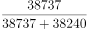
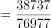
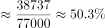

# 现期比重最值比较与计算（分量占总量比重的峰值定位）

考点：[[20-考点/资料分析/比重/现期比重最值比较与计算（分量占总量比重的峰值定位）|比重 / 现期比重最值比较与计算（分量占总量比重的峰值定位）]]
材料：[[15-材料/资料分析/309616 2012—2016年全国就业人员数量|309616 2012—2016年全国就业人员数量]]

**问法模型**：题干'2012—2016年……比重最高曾达到约'→ 先定性锁定比重最大的年份（城镇分项最大且乡村分项最小的年份），再按 现期比重=城镇/(城镇+乡村) 代入计算

## 推理链
1. 第1步：从柱内标签读取五年数据，城镇依次为37102、38737、37943、37041、36175万人，乡村依次为39602、38240、39310、40410、41428万人（上段深灰为乡村、下段浅灰为城镇）。
2. 第2步：比重=城镇÷全国，全国=城镇+乡村；因城镇+乡村=全国，故'城镇占比>50%'等价于'城镇>乡村'，五年中仅2013年（城镇38737＞乡村38240）满足，其余年份乡村＞城镇、比重均低于50%，故最高比重必在2013年。
3. 第3步：图中未直接给出全国总量，需自行加总：2013年全国就业人员=38737+38240=76977万人。
4. 第4步：代入计算38737/76977，以一半为基准：76977的一半为38488.5，38737比其多约248.5，248.5/76977≈0.3%，故比重≈50%+0.3%=50.3%。
5. 第5步：对照选项，C项50.3%与计算结果一致；B项48.4%恰为2012年比重（37102/76704≈48.4%）的干扰项，故正确答案为C。

**最快解法**：⚡ 定性筛选+以50%为基准的截位直除：利用'城镇占比>50%⟺城镇>乡村'，一眼锁定唯一超半的2013年，免算其余四年；再算38737/76977≈38737/77000，商首三位50.3，直接对应C项。

## 易错点
- ⚠ 柱内标签对应颠倒：上段（深灰）是乡村、下段（浅灰）是城镇，若拿反会变成求乡村比重最高（应在乡村占比最大的2016年），方向完全错误。
- ⚠ 未先加总全国总量：堆积柱状图未直接标注全国数据，直接用城镇/乡村作比会得到约101%的荒谬结果，必须先做38737+38240=76977。
- ⚠ 干扰项陷阱：B项48.4%恰为2012年比重37102/76704≈48.4%，若不做'城镇>乡村⟺比重>50%'的定性筛选、随手算某一年即可能误选B；另注意2013年是五年中唯一城镇>乡村的年份，方向与其余年份相反。

## 母题抽象
> 🧩 当题干出现'某分量占（两分项之和的）总量比重最高/最大'时，先用'该分量＞另一分项⟺比重＞50%'定性锁定唯一满足的年份，再对该年份以50%为基准做截位直除（超出部分=分项差/总量）验证选项。

**同类特征**：比重最高曾达到约、占全国（总量）的比重、堆积柱状图城镇/乡村两分项、多年区间内取最值、总量=分项之和需自行加总、选项集中在50%上下

## 相关题
（暂无）

---

### 题干
2012—2016年，城镇就业人员数量占全国就业人员数量比重最高曾达到约（    ）。

### 选项
- A. 47.8%
- B. 48.4%
- C. 50.3%　✅
- D. 51.6%

### 官方解析

根据题干“2012—2016年······占······比重······”，结合材料时间为2012—2016年，可判定本题为现期比重问题。定位统计图可得，2012—2016年全国乡村、城镇就业人员数量。城镇就业人员数量占全国就业人员数量比重最高，则城镇就业人员数量应尽量多，乡村就业人员数量尽量少。定位统计图可知，只有2013年城镇就业人员数量＞乡村就业人员数量，则该年所求比重最高，比重为。

故正确答案为C。

### 给定材料

