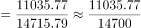
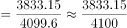
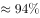

# 现期比重比较（比重差-方向判定，分子分母跨行取数）

考点：[[20-考点/资料分析/比重/现期比重比较（比重差-方向判定，分子分母跨行取数）|比重 / 现期比重比较（比重差/方向判定，分子分母跨行取数）]]
材料：[[15-材料/资料分析/309961 2017年不同行业实征税收与归宿税收|309961 2017年不同行业实征税收与归宿税收]]

**问法模型**：题干给'制造业与批发和零售业各自对所属产业实征国内增值税的比重'并问高低差 → 分别用行业实征增值税÷其所属产业合计行实征增值税求比重，再作差判方向（低约19个百分点）

## 推理链
1. 第1步：锁定表中'实征税收—国内增值税'一列（2017年现期值）：制造业11035.77亿元、其所属第二产业合计14715.79亿元；批发和零售业3833.15亿元、其所属第三产业合计4099.6亿元
2. 第2步：公式：比重=部分/总体，所求=制造业比重−批发和零售业比重
3. 第3步：代入计算：制造业比重=11035.77/14715.79≈75%（14715.79×3/4≈11036，几乎恰好等于分子）；批发和零售业比重=3833.15/4099.6≈93.5%（4099.6×90%≈3690，余数143.5/4099.6≈3.5%）
4. 第4步：作差定方向：75%−93.5%（官方截为94%）≈−18.5%（约−19个百分点），制造业比重低于批发和零售业约19个百分点，与选项D'低19%'吻合

**最快解法**：⚡ 截位直除+份数口算：11035.77/14715.79，看14715.79×75%=11036.8≈分子，秒判75%；3833.15/4099.6≈3833/4100，4099.6×90%=3690不足，补143.5/4100≈3.5%，得93.5%；75%−94%≈−19%，制造业低，直接选D

## 易错点
- ⚠ 分母跨行取错：制造业分母必须是第二产业合计行14715.79，批发和零售业分母必须是第三产业合计行4099.6，分子分母分处不同行，不能拿11035.77与3833.15两行业数直接相除，也不能除以全国总量
- ⚠ 列别串列：每行有实征/归宿×增值税/营业税四列，本题只锁'实征—国内增值税'，误取归宿增值税（制造业10357.21、批发零售2855.52）或营业税列则结果全错
- ⚠ 方向判定：75%<93.5%，制造业应'低'，先比大小再定高低，避免因方向反选C'高19%'；另注意选项'%'实指比重差的百分点表述，与相对降幅（(75−93.5)/93.5≈−20%）在本题均指向D，不受口径影响

## 母题抽象
> 🧩 当题干出现'某行业占其所属产业（总体）的比重，比较两个行业比重高低差'时，分子取该行业行数据、分母分别取其所属产业合计行数据，各自求比重后作差，先定方向再对数值

**同类特征**：对各自所属产业实征国内增值税的比重、制造业约比批发和零售业高/低、现期比重比较、跨行取分母（产业合计行）、比重差约19个百分点、2017年单一现期截面

## 相关题
- [[10-真题/资料分析/比重/10204607 现期比重比较（与1-3判定，分母需由累计值差分）|10204607]]（辽宁 2024，相关度1）
- [[10-真题/资料分析/比重/18643847 现期比值计算与百分点差值比较（资产负债率=总负债÷总资产）|18643847]]（四川 2026，相关度1）
- [[10-真题/资料分析/比重/19283749 现期比重比较（逐组求比重比大小）|19283749]]（国考 2025，相关度1）
- [[10-真题/资料分析/比重/2042810 现期比重比较（子口径占全口径比重，逐部计数判断）|2042810]]（江苏 2017，相关度1）
- [[10-真题/资料分析/比重/2052082 现期比重比较|2052082]]（吉林 2017，相关度1）

---

### 题干
若比较对各自所属产业实征国内增值税的比重，2017年，制造业约比批发和零售业 （    ）？

### 选项
- A. 高38％
- B. 低38％
- C. 高19％
- D. 低19％　✅

### 官方解析

根据题干“若比较······的比重，2017年······”，结合选项为高/低+%，可判定本题为现期比重问题。定位统计表可知：2017年第二产业实征国内增值税14715.79亿元，其中，制造业实征国内增值税11035.77亿元；第三产业实征国内增值税4099.6亿元，其中，批发和零售业实征国内增值税3833.15亿元。根据公式：比重，可知2017年制造业占第二产业实征国内增值税的比重，批发和零售业占第三产业实征国内增值税的比重，题目所求比重差=75%-94%=-19%，即约低19%。

故正确答案为D。

### 给定材料

