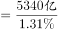
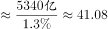

# 比重求总量（部分量÷比重=总量）+单位换算

考点：[[20-考点/资料分析/比重/比重求总量（部分量÷比重=总量）+单位换算|比重 / 比重求总量（部分量÷比重=总量）+单位换算]]
材料：[[15-材料/资料分析/309963 2015年全国环境与安全状况统计公报|309963 2015年全国环境与安全状况统计公报]]

**问法模型**：题干问'2015年国内生产总值约为…万亿'→现期比重求总量模型：总量=部分量÷比重（5340亿元÷1.31%），再做亿元→万亿元换算后与选项对照

## 推理链
1. 第1步：定位第4段：2015年全年各类自然灾害直接经济损失5340亿元，占国内生产总值的1.31%（5340为部分量，1.31%为比重）
2. 第2步：用比重公式变形：总量=部分量÷比重，即GDP=5340亿元÷1.31%
3. 第3步：截位直除：5340÷0.0131≈5340×76.3≈407633亿元，÷10000换算成约40.8万亿元
4. 第4步：与选项对照：40.8万亿元与C项41.6最接近（A 28.9、B 33.6、D 50.7均明显偏离），故选C

**最快解法**：⚡ 截位直除+量级速判：1.31%≈1.3%，5340÷1.3%≈5340×77≈41万亿量级（亿元下41万×10^8，即约41万亿元），四选项中唯C处于40万亿量级，直接锁定C；严谨计算5340÷1.31%≈40.8万亿元亦最近C

## 易错点
- ⚠ 量级/单位陷阱：算出407633亿元后，题目问的是'万亿'，必须÷10000换算成约40.8万亿元，忘记换算或量级判断错误会在选项间误判
- ⚠ 公式方向混淆：求总量用'部分÷比重'，若误用'部分×比重'（5340×1.31%≈70亿元）则量级完全错误
- ⚠ 取数干扰：第4段还有3505亿、757亿等其他损失数据，第5段还有'亿元GDP死亡0.201人'等含GDP口径指标，必须锁定'5340亿元占GDP 1.31%'这一对匹配数据，不可错配分项数据与其不对应的比重

## 母题抽象
> 🧩 当题干求某'总量/整体'且材料给出'部分量+其所占比重'时，用'部分÷比重=总量'模型，算完后先看题干单位与材料单位是否一致（亿元vs万亿元等），再做量级换算选最接近项

**同类特征**：2015年国内生产总值、约为…万亿、现期比重、部分量求总量、占GDP的1.31%、单位换算（亿元→万亿元）

## 相关题
- [[10-真题/资料分析/比重/4792819 现期比重计算（多部分比重依次求解）|4792819]]（新疆 2014，相关度1）
- [[10-真题/资料分析/比重/827355 现期比重比较（部分占比过半速判）|827355]]（政法干警 2014，相关度1）
- [[10-真题/资料分析/比重/2272297 现期比重比较|2272297]]（选调 2015，相关度1）
- [[10-真题/资料分析/比重/2032972 现期比重计算（多地区占比求和）|2032972]]（吉林 2015，相关度1）
- [[10-真题/资料分析/比重/2187857 现期比重计算（部分量需先由'总量−其中量'减法间接求得）|2187857]]（山东 2018，相关度1）

---

### 题干
2015年国内生产总值约为（    ）万亿？

### 选项
- A. 28.9
- B. 33.6
- C. 41.6　✅
- D. 50.7

### 官方解析

根据题干“2015年······约为······万亿”，结合材料给出了各类自然灾害造成直接经济损失及其占国内生产总值的比重，可判定本题为现期比重问题。定位文字材料第四段可知：2015年全年各类自然灾害造成直接经济损失5340亿元，占国内生产总值的1.31%。根据公式：总量，可知所求万亿，与C项最为接近。

故正确答案为C。

### 给定材料

        近岸海域298个海水水质监测点，在2015年监测中，达到国家一、二类海水水质标准的监测点占62.8%，比上年下降10.1个百分点；三类海水占14.1％，上升8.1个百分点；四类、劣四类海水占23.1％，上升2.1个百分点。

        在监测的330个城市中，有273个城市空气质量达到二级以上(含二级)标准，占监测城市数的82.7％；有53个城市为三级，占16.1％；有4个城市为劣三级，占1.2％。在监测的331个城市中，城市区域声环境质量好的城市占6.3％，较好的占67.4％，轻度污染的占25%，中度污染的占0.9％。

        2015年年末城市污水处理厂日处理能力达10262万立方米，比上年末增长13.4％；城市污水处理率达到76.9％，提高1.6个百分点。集中供热面积39.1亿平方米，增长3.0％。建成区绿地率达到34.5％，提高0.3个百分点。

        2015年全年各类自然灾害造成直接经济损失5340亿元，比上年增加1.1倍，占国内生产总值的1.31％。全年农作物受灾面积3743万公顷，减少20.7％。其中，绝收486万公顷，减少1.1％。全年因洪涝、滑坡和泥石流灾害造成直接经济损失3505亿元，增加4.4倍；死亡3101人。全年因旱灾造成直接经济损失757亿元，下降31.2％。全年因低温冷冻和雪灾造成直接经济损失318亿元，死亡51人。全年因海洋灾害造成直接经济损失149.4亿元，增加49.1％。全年累计发生赤潮面积10892平方公里，减少22.8％。全年大陆地区共发生5级以上地震17次，成灾10次，造成直接经济损失235.7亿元，死亡2705人。全年共发生森林火灾7723起，下降12.8％。

        2015年全年各类生产安全事故共死亡79552人，比上年下降4.4％。亿元国内生产总值生产安全事故死亡人数为0.201人，下降19.0％；工矿商贸企业就业人员10万人生产安全事故死亡人数为2.13人，下降11.3％；道路交通万车死亡人数为3.2人，下降11.1％；煤矿百万吨死亡人数为0.749人，下降16.0％。

