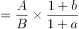
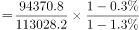
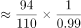
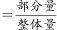
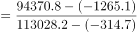
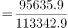
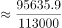
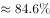

# 基期比重（部分量'非谷物'需整体减部分间接作差，两步基期还原连环）

考点：[[20-考点/资料分析/比重/基期比重（部分量'非谷物'需整体减部分间接作差，两步基期还原连环）|比重 / 基期比重（部分量'非谷物'需整体减部分间接作差，两步基期还原连环）]]
材料：[[15-材料/资料分析/310208 国家统计局发布的2016年全国粮食产|310208 国家统计局发布的2016年全国粮食产]]

**问法模型**：题干问'2015年……占……的比重约为'且材料只给2016现期值+比2015减少量 → 基期比重模型：先'现期+减少量'还原2015年粮食与谷物两个基期面积，作差得非谷物面积，再除以2015年总面积。

## 推理链
1. 第1步：从材料第二段提取：2016年粮食播种面积113028.2千公顷（比2015年减少314.7千公顷）、谷物播种面积94370.8千公顷（比2015年减少1265.1千公顷）；'非谷物'材料未直接给出，且谷物面积为粮食面积的内含部分
2. 第2步：规则①基期量=现期量+减少量（口径为'比2015年减少'，须加回）；规则②非谷物=粮食-谷物；比重=非谷物面积÷粮食总面积
3. 第3步：还原基期：2015粮食面积=113028.2+314.7=113342.9千公顷；2015谷物面积=94370.8+1265.1=95635.9千公顷
4. 第4步：作差求2015年非谷物面积=113342.9-95635.9=17707.0千公顷
5. 第5步：代入比重=17707.0÷113342.9≈15.6%
6. 第6步：与选项对照：15.6%≈16%，选B；A的8%约为折半干扰，C的84%恰为谷物基期占比（忘作差），D的92%≈谷物产量占粮食产量比重（56516.5÷61623.9≈91.7%，产量换面积），均排除

**最快解法**：⚡ 公式法+截位直除：先算基期谷物占比=(94370.8+1265.1)÷(113028.2+314.7)≈95636÷113343≈84%，非谷物占比=1-84%≈16%，秒选B（或直接17707÷113343≈15.6%）；亦可由现期谷物占比94370.8÷113028.2≈83.5%，因谷物降幅1.3%大于总体0.3%，基期谷物占比略升至约84%，非谷物≈16%。

## 易错点
- ⚠ 基期还原方向：材料是'比2015年减少'，2015基期=现期+减少量（113028.2+314.7、94370.8+1265.1），若误做'现期-减少量'则两步全错
- ⚠ '非谷物'须间接作差：先还原两个2015基期再相减；若不作差直接引用谷物占比，会误选其补数C（84%）
- ⚠ 指标与单位偷换：D项92%对应谷物产量占比而非面积占比，面积/产量混用即掉坑；千公顷与万亩双单位并列（减少量各给一套），同一算式须统一为千公顷，切勿将472.1万亩与314.7千公顷重复相加

## 母题抽象
> 🧩 当题干出现'基期年份+某部分占整体比重'、材料只给现期值与增减量、且该部分需'整体-已知部分'间接求得时，先逐项用'现期+减少量'还原基期，再作差、作商，并用选项的补数与量级验证方向。

**同类特征**：2015年（基期设问）、占全国的比重、非谷物（隐含整体减部分作差）、现期值+减少量型材料、双单位并列（千公顷/万亩）、选项含补数84%与产量指标干扰92%

## 相关题
- [[10-真题/资料分析/比重/13504527 现期比重计算（排序取前五求和后求占比）|13504527]]（贵州 2025，相关度1）

---

### 题干
2015年我国粮食非谷物播种面积占全国的比重约为：

### 选项
- A. 8%
- B. 16%　✅
- C. 84%
- D. 92%

### 官方解析

根据题干“2015年······占······的比重约为”，结合材料时间为2016年，可判定本题为基期比重问题。

方法一：定位文字材料第三段可得：2016年全国粮食播种面积113028.2千公顷（B），比2015年减少0.3%（b）；谷物播种面积94370.8千公顷（A），比2015年减少1.3%（a）。根据公式：基期比重，则2015年谷物播种面积占全国的比重，故2015年非谷物播种面积占比，与B项最接近。

方法二：定位文字材料第三段可得：2016年全国粮食播种面积113028.2千公顷，比2015年减少314.7千公顷；谷物播种面积94370.8千公顷，比2015年减少1265.1千公顷。根据公式：基期量=现期量-增长量，比重，则2015年谷物播种面积占全国的比重，故2015年非谷物播种面积占比，与B项最接近。

故正确答案为B。

### 给定材料

        2016年全国粮食情况如下：

        全国粮食总产量61623.9万吨（12324.8亿斤），比2015年减少520.1万吨（104.0亿斤），减少0.8%。其中谷物产量56516.5万吨（11303.3亿斤），比2015年减少711.5万吨（142.3亿斤），减少1.2%。

        全国粮食播种面积113028.2千公顷（169542.3万亩），比2015年减少314.7千公顷（472.1万亩），减少0.3%。其中谷物播种面积94370.8千公顷（141556.2万亩），比2015年减少1265.1千公顷（1897.7万亩），减少1.3%。

        对此，国家统计局解读称，2016年粮食产量下降同时受到播种面积减少和单产下降的影响。2016年，全国粮食播种面积比上年减少了472万亩，因播种面积减少而减产34亿斤，占粮食减产总量的33.2%；全国粮食产量因单产下降而减产70亿斤，占粮食减产总量的66.8%。

        粮食单产下降的主要原因：

        一是高产作物面积减少。按可食用的籽粒玉米统计，玉米播种面积5.51亿亩，比上年减少2039万亩，减少3.6%。低产作物大豆播种面积1.08亿亩，比上年增加1046万亩，增长10.7%。2016年，玉米平均亩产398.2公斤，是大豆的3.3倍，仅玉米改种大豆就可拉低粮食亩产约1.7公斤。

        二是全国农业气象灾害较上年偏重，部分地区受灾较重。夏粮、早稻因灾减产。秋粮生长前期，南方多地遭受强降水，湖北、安徽等地受灾较重，部分农田反复受淹，作物倒伏严重。7月下旬至8月中下旬，南方一些地区又遭受持续高温天气，导致水稻空壳率增加；东北、西北部分地区出现不同程度旱情，对玉米后期生产和灌浆不利。据民政部统计，今年1-10月份，全国农作物受灾面积3.97亿亩，比上年同期增加5410万亩；绝收面积6218万亩，增加1719万亩。

> [!warning] 疑点（官方解析可能有误，待人工复核）
> 官方解析两法均表述为'定位文字材料第三段'，但播种面积数据实际位于材料第二段（第三段为减产归因解读），属定位段落编号瑕疵，不影响计算与答案B；另用降幅0.3%/1.3%的公式法与用减少量精确计算结果（≈15.6%）一致，无实质矛盾。

<!-- CODEX-ANSWER-REVIEW:BEGIN -->
### 本次独立复核

**复核状态：** `confirmed`（独立复算确认答案）

**计分答案：** B（可计分）

**复核解析：**

2016年粮食总播种面积113028.2千公顷、比2015少314.7；谷物94370.8、少1265.1。回推2015年非谷物占比=1−(94370.8+1265.1)/(113028.2+314.7)≈15.6%，选B的16%。

**相关信息：**

基期整体和部分应使用相同年份与单位。

**题源依据：** [固定版本原题](https://github.com/Mentat-Uran/kaogongzhentizhengliu/blob/84ab93d4b64b61d897bece8a1c0a5bab06b4feb2/10-%E7%9C%9F%E9%A2%98/%E8%B5%84%E6%96%99%E5%88%86%E6%9E%90/%E6%AF%94%E9%87%8D/4713985%20%E5%9F%BA%E6%9C%9F%E6%AF%94%E9%87%8D%EF%BC%88%E9%83%A8%E5%88%86%E9%87%8F'%E9%9D%9E%E8%B0%B7%E7%89%A9'%E9%9C%80%E6%95%B4%E4%BD%93%E5%87%8F%E9%83%A8%E5%88%86%E9%97%B4%E6%8E%A5%E4%BD%9C%E5%B7%AE%EF%BC%8C%E4%B8%A4%E6%AD%A5%E5%9F%BA%E6%9C%9F%E8%BF%98%E5%8E%9F%E8%BF%9E%E7%8E%AF%EF%BC%89.md)；固定内容 commit `84ab93d4b64b61d897bece8a1c0a5bab06b4feb2`，Markdown blob `a534bed24bc206b85799e57f87fa7ca7fc4bb1e2`。
<!-- CODEX-ANSWER-REVIEW:END -->
