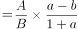
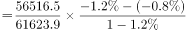
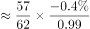

# 两期比重差（比重变化量）

考点：[[20-考点/资料分析/比重/两期比重差（比重变化量）|比重 / 两期比重差（比重变化量）]]
材料：[[15-材料/资料分析/310208 国家统计局发布的2016年全国粮食产|310208 国家统计局发布的2016年全国粮食产]]

**问法模型**：题干出现'A占B的比重比上年提高/降低X个百分点'→两期比重差模型：比重差=A/B×(a-b)/(1+a)，a为部分（谷物产量）增速，b为整体（粮食总产量）增速

## 推理链
1. 第1步：从材料提取数据——2016年谷物产量A=56516.5万吨，比2015年减少1.2%（即a=-1.2%）；粮食总产量B=61623.9万吨，比2015年减少0.8%（即b=-0.8%）
2. 第2步：判定题型——题干问'比重比上年提高/降低X个百分点'，套用两期比重差公式：比重差=A/B×(a-b)/(1+a)
3. 第3步：先算现期比重A/B=56516.5/61623.9≈91.7%（谷物占粮食超九成）
4. 第4步：算增速差与分母——a-b=(-1.2%)-(-0.8%)=-0.4%，1+a=1-1.2%=0.988，故(a-b)/(1+a)≈-0.405%
5. 第5步：代入计算——比重差≈91.7%×(-0.405%)≈-0.37个百分点，即比重比上年降低约0.37个百分点
6. 第6步：与选项对照——方向为'降低'排除A、B，幅度0.37排除D（2.08），锁定C

**最快解法**：⚡ 两期比重差'先定性后定量'：第一步看方向——部分增速a=-1.2%小于整体增速b=-0.8%，部分降得更快，比重必降，秒排A、B；第二步看幅度——|比重差|<|a-b|=0.4个百分点，D的2.08超出上限直接排除，锁定C；如需验证：56516.5/61623.9≈0.917，0.917×0.4%÷0.988≈0.37个百分点

## 易错点
- ⚠ 增速为负值：两项均'比2015年减少'，a-b=(-1.2%)-(-0.8%)=-0.4%；若把1.2%、0.8%当正增速代入，方向算反会误选A（提高）
- ⚠ 误取段落口径：材料第二段还给出播种面积增速（谷物面积降1.3%、粮食面积降0.3%），本题问'产量'，若错用面积数据（A/B≈83.5%、a-b=-1.0%）会得出约降0.85个百分点的错误结果
- ⚠ 幅度误判：两期比重差远小于|a-b|（本题为0.37对0.4），若直接把增速差0.4%或更大数值当答案易受干扰项误导，可用'|比重差|<|a-b|'快速排除D

## 母题抽象
> 🧩 当题干出现'某部分占整体的比重比上年提高/降低X个百分点'时，用两期比重差公式A/B×(a-b)/(1+a)：方向由a与b大小决定（a>b提高、a<b降低），幅度必小于|a-b|，先定性排除再定量验证

**同类特征**：占……的比重比上年、提高/降低X个百分点、谷物产量占粮食总产量、部分与整体增速均已给出、两期比重差、现期增速为负（减少）

## 相关题
- [[10-真题/资料分析/比重/4663219 两期比重差（比重变化方向与幅度）|4663219]]（山东 2022，相关度2）
- [[10-真题/资料分析/比重/5510314 两期比重差（比重变化量）|5510314]]（广东 2023，相关度2）
- [[10-真题/资料分析/比重/5510344 两期比重差（比重变化量）|5510344]]（山东 2023，相关度2）
- [[10-真题/资料分析/比重/15419181 两期比重变化（比重差计算与升降判断）|15419181]]（湖北 2025，相关度1）
- [[10-真题/资料分析/比重/2042846 两期比重差（比重差值计算）|2042846]]（江苏 2017，相关度1）

---

### 题干
2016年，我国谷物产量占粮食总产量的比重比上年约：

### 选项
- A. 提高0.37个百分点
- B. 提高2.08个百分点
- C. 降低0.37个百分点　✅
- D. 降低2.08个百分点

### 官方解析

根据题干“2016年，······占······的比重比上年约”，结合选项均为“提高/降低······个百分点”，可判定本题为两期比重问题。定位文字材料第二段可得：2016年全国粮食总产量61623.9万吨（B），比2015年减少0.8%（b）；谷物产量56516.5万吨（A），比2015年减少1.2%（a）。根据公式：两期比重差，则所求比重差，即约降低了0.37个百分点。

故正确答案为C。

### 给定材料

        2016年全国粮食情况如下：

        全国粮食总产量61623.9万吨（12324.8亿斤），比2015年减少520.1万吨（104.0亿斤），减少0.8%。其中谷物产量56516.5万吨（11303.3亿斤），比2015年减少711.5万吨（142.3亿斤），减少1.2%。

        全国粮食播种面积113028.2千公顷（169542.3万亩），比2015年减少314.7千公顷（472.1万亩），减少0.3%。其中谷物播种面积94370.8千公顷（141556.2万亩），比2015年减少1265.1千公顷（1897.7万亩），减少1.3%。

        对此，国家统计局解读称，2016年粮食产量下降同时受到播种面积减少和单产下降的影响。2016年，全国粮食播种面积比上年减少了472万亩，因播种面积减少而减产34亿斤，占粮食减产总量的33.2%；全国粮食产量因单产下降而减产70亿斤，占粮食减产总量的66.8%。

        粮食单产下降的主要原因：

        一是高产作物面积减少。按可食用的籽粒玉米统计，玉米播种面积5.51亿亩，比上年减少2039万亩，减少3.6%。低产作物大豆播种面积1.08亿亩，比上年增加1046万亩，增长10.7%。2016年，玉米平均亩产398.2公斤，是大豆的3.3倍，仅玉米改种大豆就可拉低粮食亩产约1.7公斤。

        二是全国农业气象灾害较上年偏重，部分地区受灾较重。夏粮、早稻因灾减产。秋粮生长前期，南方多地遭受强降水，湖北、安徽等地受灾较重，部分农田反复受淹，作物倒伏严重。7月下旬至8月中下旬，南方一些地区又遭受持续高温天气，导致水稻空壳率增加；东北、西北部分地区出现不同程度旱情，对玉米后期生产和灌浆不利。据民政部统计，今年1-10月份，全国农作物受灾面积3.97亿亩，比上年同期增加5410万亩；绝收面积6218万亩，增加1719万亩。

> [!warning] 疑点（官方解析可能有误，待人工复核）
> 官方解析称'定位文字材料第二段'，但产量数据实际在材料第一段（第二段为播种面积），属定位笔误；数据与计算无误，答案C成立

<!-- CODEX-ANSWER-REVIEW:BEGIN -->
### 本次独立复核

**复核状态：** `resolved`（答案与解析已核定）

**计分答案：** C（可计分）

**复核解析：**

2016谷物占粮食=56516.5/61623.9≈91.71%；按同比增速还原2015谷物及粮食基数，2015比重约92.08%；2016下降约0.37个百分点，C。

**相关信息：**

两期比重变化常用公式：现期比重×(部分增长率−整体增长率)/(1+部分增长率)；部分增速高于整体时比重上升。

**题源依据：** [固定版本原题](https://github.com/Mentat-Uran/kaogongzhentizhengliu/blob/84ab93d4b64b61d897bece8a1c0a5bab06b4feb2/10-%E7%9C%9F%E9%A2%98/%E8%B5%84%E6%96%99%E5%88%86%E6%9E%90/%E6%AF%94%E9%87%8D/4714000%20%E4%B8%A4%E6%9C%9F%E6%AF%94%E9%87%8D%E5%B7%AE%EF%BC%88%E6%AF%94%E9%87%8D%E5%8F%98%E5%8C%96%E9%87%8F%EF%BC%89.md)；固定内容 commit `84ab93d4b64b61d897bece8a1c0a5bab06b4feb2`，Markdown blob `b54e8a646f35d8ed8bab30a8c504b5183ba5a35e`。
<!-- CODEX-ANSWER-REVIEW:END -->
