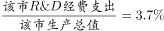
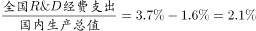
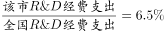
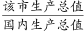
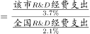
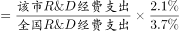
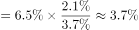

# 现期比重传递链（跨主体比重，需倒推隐藏比重）

考点：[[20-考点/资料分析/比重/现期比重传递链（跨主体比重，需倒推隐藏比重）|比重 / 现期比重传递链（跨主体比重，需倒推隐藏比重）]]
材料：[[15-材料/资料分析/310775 某市2015年科技创新发展情况（R&|310775 某市2015年科技创新发展情况（R&]]

**问法模型**：题干问'该市GDP占全国GDP的比重'并补充新条件'该市R&D占全国R&D的6.5%'→先由'高出1.6个百分点'倒推全国R&D占全国GDP比重，再按比重传递公式连乘约分：该市GDP/全国GDP=(该市R&D/3.7%)÷(该市R&D/6.5%/2.1%)

## 推理链
1. 第1步：从正文第1段提取：2015年该市R&D经费支出925亿元，占该市生产总值3.7%，且比全国水平高出1.6个百分点→隐含全国R&D占全国GDP比重=3.7%-1.6%=2.1%
2. 第2步：题干补充条件：该市R&D占全国R&D的6.5%，则全国R&D=925÷6.5%，全国GDP=全国R&D÷2.1%
3. 第3步：该市GDP=925÷3.7%，故所求比重=(925/3.7%)÷(925/6.5%/2.1%)
4. 第4步：分子分母同含925亿元直接约掉，化简为(6.5%×2.1%)÷3.7%=13.65%÷3.7%
5. 第5步：13.65÷3.7≈3.69%，落在3%-4%区间
6. 第6步：对照选项，B（3%-4%）正确

**最快解法**：⚡ 比重传递约分法（公式法）：所求=(该市R&D占全国R&D比重×全国R&D占全国GDP比重)÷该市R&D占该市GDP比重=6.5%×2.1%÷3.7%≈13.65%÷3.7%≈3.7%，口算量级即可锁定B，完全不必算925亿元对应的GDP具体值

## 易错点
- ⚠ 隐藏条件遗漏：全国R&D占GDP比重2.1%正文未直接给出，必须用'比全国水平高出1.6个百分点'倒推（3.7%-1.6%=2.1%），漏掉此步链条断裂
- ⚠ 百分点与百分比混淆：'高出1.6个百分点'是比重之差，只能相减，不能当作增长率或比例直接参与乘除
- ⚠ 主体层级混淆：不能把该市R&D占全国R&D的6.5%误当成该市GDP占全国GDP的比重；需再经'全国GDP=全国R&D÷2.1%'传递一层；另注意925亿元在分子分母可约掉，硬算两笔GDP数值既慢又易出错

## 母题抽象
> 🧩 当题干出现'A占B的x%、B占C的y%，求A占C比重'的比重传递特征且题干隐藏部分比重需用'高出/低x个百分点'倒推时，用连乘约分公式(A占C=x%×y%)或(A/占比1)÷(A/占比2/占比3)化简，同笔数值约掉后口算量级，验证落在哪个选项区间

**同类特征**：若该市R&D经费支出占全国同类经费支出的6.5%（题干补充新比重条件）、该市生产总值约占国内生产总值的（跨主体比重）、比全国水平高出1.6个百分点（隐藏条件需倒推）、现期比重、选项为区间形式、需跨句拼接正文隐藏数据

## 相关题
- [[10-真题/资料分析/比重/4792819 现期比重计算（多部分比重依次求解）|4792819]]（新疆 2014，相关度1）
- [[10-真题/资料分析/比重/827355 现期比重比较（部分占比过半速判）|827355]]（政法干警 2014，相关度1）
- [[10-真题/资料分析/比重/2272297 现期比重比较|2272297]]（选调 2015，相关度1）
- [[10-真题/资料分析/比重/2032972 现期比重计算（多地区占比求和）|2032972]]（吉林 2015，相关度1）
- [[10-真题/资料分析/比重/2187857 现期比重计算（部分量需先由'总量−其中量'减法间接求得）|2187857]]（山东 2018，相关度1）

---

### 题干
若该市R&D经费支出占全国同类经费支出的6.5%，则2015年该市生产总值约占国内生产总值的：

### 选项
- A. 1%-2%
- B. 3%-4%　✅
- C. 5%-6%
- D. 6%-7%

### 官方解析

根据题干“2015年······占······”，结合材料时间为2015年，可判定本题为现期比重问题。定位文字材料第一段可得：2015年该市R&amp;D经费支出在该市生产总值中占比为3.7%，比全国水平高出1.6个百分点。根据公式：比重，可得，，又由题干可知，则，在3%-4%之间。

故正确答案为B。

### 给定材料

        2015年某市全年用于研究与试验发展（R&amp;D）经费支出925亿元，与上年同期相比增长了11%，增速较全国高出1.8个百分点。该市R&amp;D经费支出在该市生产总值中占比为3.7%，比全国水平高出1.6个百分点。

        全年受理专利申请100006件，比上年增长22.5%，其中受理发明专利申请46976件，增长20%。全年专利授权量为60623件，增长20.1%，其中发明专利授权量为17601件，增长51.5%。至年末，全市有效发明专利达69982件。全市科技小巨人企业和小巨人培育企业共1427家，高新技术企业6071家，技术先进型服务企业253家。年内全市认定和复审高新技术企业2089家。年内认定高新技术成果转化项目613项，其中电子信息、生物医药、新材料等重点领域项目占83.4%。至年末，共认定高新技术成果转化项目10500项。全年经认定登记的各类技术交易合同2.25万件，比上年下降10.8%；合同成交金额707.99亿元，增长6.0%。

