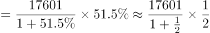
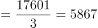
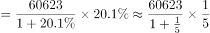
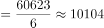
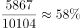

# 增长量占总体增长量的比重（增长量计算+现期比重两步连环）

考点：[[20-考点/资料分析/比重/增长量占总体增长量的比重（增长量计算+现期比重两步连环）|比重 / 增长量占总体增长量的比重（增长量计算+现期比重两步连环）]]
材料：[[15-材料/资料分析/310775 某市2015年科技创新发展情况（R&|310775 某市2015年科技创新发展情况（R&]]

**问法模型**：题干问'发明专利授权增长数量约占专利授权总增长量的'→ 先用公式 增长量=现期×r/(1+r) 分别求分子（发明授权增长量）与分母（授权总量增长量），再相除求现期比重

## 推理链
1. 第1步：定位第二段：2015年专利授权量60623件、增长20.1%；其中发明专利授权量17601件、增长51.5%（17601是60623的部分，二者各自配对增长率）
2. 第2步：增长量公式：增长量=现期值×r/(1+r)，即先还原基期再算增量
3. 第3步：分子：发明专利授权增长量=17601×51.5%/151.5%≈5983件（51.5%≈1/2，等价于17601/3≈5870件）
4. 第4步：分母：专利授权总增长量=60623×20.1%/120.1%≈10146件（20.1%≈1/5，等价于60623/6≈10104件）
5. 第5步：比重=5983/10146≈59%，落在60%档位
6. 第6步：对照选项：59%≈6成，选D

**最快解法**：⚡ 百化分速算：51.5%≈1/2→分子增长量≈17601/(2+1)≈5870件；20.1%≈1/5→分母增长量≈60623/(5+1)≈10100件；5870/10100≈58%≈6成，无需精算直接锁定D（可用截位直除验证：5983/10146首位商5次位8，约59%）

## 易错点
- ⚠ 把增长率当增长量用：直接算17601×51.5%÷(60623×20.1%)≈74.5%→误判7成，错在漏除以(1+r)，增长量必须用'现期×r/(1+r)'而非'现期×r'
- ⚠ 部分与总体的现期值/增长率交叉错配：60623配20.1%是总量、17601配51.5%是部分，分子分母不能互换或错配
- ⚠ '成'的换算与档位判断：结果约58%~59%虽不足整60%，但按'成'取近似即6成，勿因略低于60%而犹豫改选C（5成=50%差距太远）

## 母题抽象
> 🧩 当题干出现'A的增长量约占B增长总量的比重/几成'特征时，用增长量公式'现期×r/(1+r)'分别求A、B增长量再相除，用百化分（r≈1/n→增长量≈现期/(n+1)）速算并按选项档位（成数）就近取整验证

**同类特征**：增长数量约占、增长总量的比重、其中（部分与总体嵌套表述）、现期年数据直接可用、选项为成数（3成/4成/5成/6成）、需先算增长量再算比重

## 相关题
（暂无）

---

### 题干
2015年该市发明专利授权增长数量约占专利授权总增长量的：

### 选项
- A. 3成
- B. 4成
- C. 5成
- D. 6成　✅

### 官方解析

根据题干“2015年······占······”，结合材料时间为2015年，可判定本题为现期比重问题。定位文字材料第二段可得：2015年全年专利授权量为60623件，增长20.1%，其中发明专利授权量为17601件，增长51.5%。根据公式：，可得2015年该市发明专利授权增长数量件，专利授权总增长量件。根据公式：，可得2015年该市发明专利授权增长数量占专利授权总增长量的，即约占6成。

故正确答案为D。

### 给定材料

        2015年某市全年用于研究与试验发展（R&amp;D）经费支出925亿元，与上年同期相比增长了11%，增速较全国高出1.8个百分点。该市R&amp;D经费支出在该市生产总值中占比为3.7%，比全国水平高出1.6个百分点。

        全年受理专利申请100006件，比上年增长22.5%，其中受理发明专利申请46976件，增长20%。全年专利授权量为60623件，增长20.1%，其中发明专利授权量为17601件，增长51.5%。至年末，全市有效发明专利达69982件。全市科技小巨人企业和小巨人培育企业共1427家，高新技术企业6071家，技术先进型服务企业253家。年内全市认定和复审高新技术企业2089家。年内认定高新技术成果转化项目613项，其中电子信息、生物医药、新材料等重点领域项目占83.4%。至年末，共认定高新技术成果转化项目10500项。全年经认定登记的各类技术交易合同2.25万件，比上年下降10.8%；合同成交金额707.99亿元，增长6.0%。

