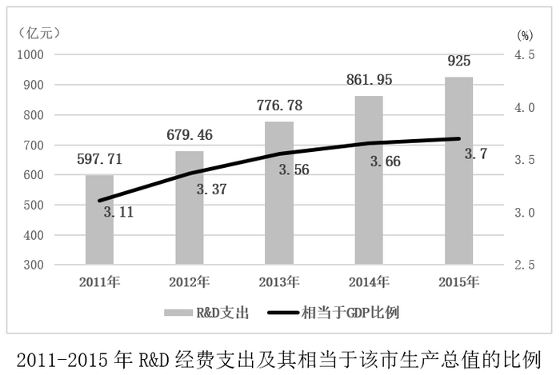

# 两期比重比较（比重上升⇔分子增速大于分母增速）

考点：[[20-考点/资料分析/比重/两期比重比较（比重上升⇔分子增速大于分母增速）|比重 / 两期比重比较（比重上升⇔分子增速大于分母增速）]]
材料：[[15-材料/资料分析/310775 某市2015年科技创新发展情况（R&|310775 某市2015年科技创新发展情况（R&]]

**问法模型**：题干问'R&D经费支出增速高于生产总值增速的有几年'→材料未给GDP增速，转化为'R&D占GDP比重（比值）逐年上升的年份数'，由两期比重比较结论判定a＞b的年份

## 推理链
1. 第1步：题干要求比较2011-2015年R&D经费支出增速a与该市生产总值增速b的高低，但材料全篇未给GDP数值或GDP增速，无法直接算b
2. 第2步：由两期比重比较结论，比值=部分/总体（此处为R&D支出相当于GDP比例），当a＞b时比重上升；反之比重上升的年份必有a＞b
3. 第3步：读统计图折线，比例依次为2011年3.11%、2012年3.37%、2013年3.56%、2014年3.66%、2015年3.7%，逐年上升
4. 第4步：比例上升的年份为2012、2013、2014、2015（2011年为基期，与2010年无可比数据），共4年满足a＞b
5. 第5步：对照选项，4年对应D，故正确答案为D

**最快解法**：⚡ 比重升降结论法（零计算）：直接看折线3.11→3.37→3.56→3.66→3.7是否上升，除基期2011外4年全升，比重升⇒R&D增速(a)＞GDP增速(b)，秒选D；切忌去逐项算GDP增速

## 易错点
- ⚠ 年份计数口径：2011年是图上首年，无2010年数据可比，'比例上升的年份'只能数2012-2015共4年；若误把2011也计入或数成柱状图5个年份会错选
- ⚠ 双轴图读数陷阱：柱状（亿元，左轴）与折线（%，右轴）量级不同，勿把柱状R&D支出增速与折线比例数值直接混比或看错轴
- ⚠ 方法陷阱：材料未给GDP总量或GDP增速，若不掌握'比重上升⇒a＞b'结论而硬算增速，会陷入无数据的死胡同

## 母题抽象
> 🧩 当题干出现'部分（分子）增速高于总体（分母）增速的有几年'且材料只给两者比值（比重/比例/平均数）的逐年数据时，直接数比值上升（或下降）的年份数，比重上升⇔a＞b，无需任何增速计算

**同类特征**：增速高于…的有（ ）年、部分与总体增速比较、相当于GDP的比例（折线）、两期比重比较、柱状+折线双轴图、年份计数型问法

## 相关题
- [[10-真题/资料分析/综合/10204448 综合分析-逐项判断（历史极值确认、两期比重比较、多期累计求和、基期比重）|10204448]]（广东 2024，相关度1）
- [[10-真题/资料分析/比重/17097813 两期比重比较（比重差计算）|17097813]]（山西 2024，相关度1）
- [[10-真题/资料分析/比重/1746802 两期比重变化比较（增速比较法，连续两年判断）|1746802]]（国考 2016，相关度1）
- [[10-真题/资料分析/比重/2136660 两期比重变化比较（比重上升判断）|2136660]]（河南 2017，相关度1）
- [[10-真题/资料分析/比重/2281002 两期比重比较（比重升降-高于上年判断）|2281002]]（四川 2018，相关度1）

---

### 题干
2011-2015年，该市R&D经费支出增速高于该市生产总值的有（    ）年。

### 选项
- A. 1
- B. 3
- C. 2
- D. 4　✅

### 官方解析
根据题干“2011-2015年······增速高于······的有（    ）年”，结合图形材料中给出2011-2015年R&D经费支出相当于该市生产总值的比例，可判定本题为两期比重比较问题。定位图形材料可知，2011-2015年，该市R&D经费支出相当于该市生产总值的比例依次为3.11%、3.37%、3.56%、3.66%、3.7%，即2012、2013、2014、2015年，R&D经费支出占该市生产总值的比重均高于上年，根据两期比重比较结论，当a＞b时，比重上升，可知若比重上升，则a＞b，因此这四年该市的R&D经费支出增速（a）＞生产总值增速（b）。
故正确答案为D。

### 给定材料

        2015年某市全年用于研究与试验发展（R&amp;D）经费支出925亿元，与上年同期相比增长了11%，增速较全国高出1.8个百分点。该市R&amp;D经费支出在该市生产总值中占比为3.7%，比全国水平高出1.6个百分点。

        全年受理专利申请100006件，比上年增长22.5%，其中受理发明专利申请46976件，增长20%。全年专利授权量为60623件，增长20.1%，其中发明专利授权量为17601件，增长51.5%。至年末，全市有效发明专利达69982件。全市科技小巨人企业和小巨人培育企业共1427家，高新技术企业6071家，技术先进型服务企业253家。年内全市认定和复审高新技术企业2089家。年内认定高新技术成果转化项目613项，其中电子信息、生物医药、新材料等重点领域项目占83.4%。至年末，共认定高新技术成果转化项目10500项。全年经认定登记的各类技术交易合同2.25万件，比上年下降10.8%；合同成交金额707.99亿元，增长6.0%。

