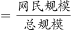
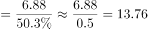

# 现期比重计算（由部分量与比重反推总体，再求'非网民'即1-比重对应部分）

考点：[[20-考点/资料分析/比重/现期比重计算（由部分量与比重反推总体，再求'非网民'即1-比重对应部分）|比重 / 现期比重计算（由部分量与比重反推总体，再求'非网民'即1-比重对应部分）]]
材料：[[15-材料/资料分析/311706 2011–2015年我国网民平均每周|311706 2011–2015年我国网民平均每周]]

**问法模型**：题干给出'网民规模6.88亿+互联网普及率50.3%'求'非网民规模'→用总人口=网民÷普及率，非网民=总人口-网民（或非网民=网民×(1-50.3%)/50.3%）的现期比重模型

## 推理链
1. 第1步：从文字材料提取：截至2015年12月网民规模6.88亿，互联网普及率50.3%（新增网民3951万人、提升2.4个百分点为本题干扰数据）
2. 第2步：普及率=网民÷总人口，故总人口=6.88÷50.3%≈13.68亿（若用普及率≈50%粗算得13.76亿）
3. 第3步：非网民=总人口-网民=13.68-6.88=6.80亿；等价算法：非网民=6.88×49.7%/50.3%，49.7/50.3≈0.988，即6.88×0.988≈6.80亿
4. 第4步：与选项对照：6.80与D项6.8最接近（A6.2/B6.4/C6.6均偏差0.4以上），故选D

**最快解法**：⚡ 比重转化口算法：非网民/网民=(1-50.3%)/50.3%=49.7/50.3≈0.99略小于1，故非网民略小于6.88亿、约6.80亿，一步口算直接锁定D，省去'先除普及率再作差'的截位直除

## 易错点
- ⚠ 漏除普及率：误把网民规模当总人口，算成6.88×(1-50.3%)≈3.42亿，掉入无对应选项的陷阱
- ⚠ 单位量级陷阱：材料中'新增网民3951万人'是万人口径，与'6.88亿'混合时需换算0.3951亿，但本题根本用不到该数据，属干扰项
- ⚠ '较2014年底提升2.4个百分点'是百分点差，不能当作增长率%代入计算

## 母题抽象
> 🧩 当题干出现'已知某部分量及其占比（比重），求剩余部分（非XX）规模'时，用'总体=部分÷比重，剩余=总体-部分'或更快的'剩余=部分×(1-r)/r'；若比重接近50%，可直接判断剩余部分与已知部分量级相当

**同类特征**：非网民规模、网民规模与互联网普及率同时给出、普及率约50%、求'1-比重'对应部分、现期比重计算、结果单位为亿

## 相关题
- [[10-真题/资料分析/比重/15527 现期比重计算（多子条件混合的加权平均）|15527]]（黑龙江 2010，相关度1）
- [[10-真题/资料分析/比重/2028300 现期比重计算+饼图扇区匹配|2028300]]（国考 2017，相关度1）
- [[10-真题/资料分析/比重/1752662 现期比重计算（表格空缺比率补值）|1752662]]（北京 2016，相关度1）
- [[10-真题/资料分析/比重/1758932 现期比重计算＋跨图表数值比对定位|1758932]]（上海 2016，相关度1）
- [[10-真题/资料分析/比重/2448500 现期比重计算（整体=部分÷比重，比重=部分÷整体）|2448500]]（国考 2020，相关度1）

---

### 题干
2015年底，我国非网民规模约为（    ）亿。

### 选项
- A. 6.2
- B. 6.4
- C. 6.6
- D. 6.8　✅

### 官方解析

根据题干“2015年底，我国非网民规模约为（    ）亿”，结合材料中给出了2015年底网民规模及互联网普及率，且互联网普及率，可判定本题为现期比重计算问题。定位文字材料可知：截至2015年12月，我国网民规模达6.88亿，互联网普及率为50.3%。则总规模亿，故2015年底，我国非网民规模约为13.76-6.88=6.88亿，与D项最接近。

故正确答案为D。

### 给定材料

        截至2015年12月，我国网民规模达6.88亿，全年共计新增网民3951万人。互联网普及率为50.3%，较2014年底提升了2.4个百分点。

> [!warning] 疑点（官方解析可能有误，待人工复核）
> 官方解析中'总规模13.76亿'系将普及率近似为50%所得（6.88÷0.5=13.76），精确值为6.88÷50.3%≈13.68亿，对应非网民13.68-6.88=6.80亿；解析所写'13.76-6.88=6.88'数值略糙（应为约6.80），但不影响选D的结论
