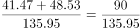
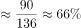

# 现期比重计算（总体层级辨析）

考点：[[20-考点/资料分析/比重/现期比重计算（总体层级辨析）|比重 / 现期比重计算（总体层级辨析）]]
材料：[[15-材料/资料分析/311710 某省人口流动与劳务回流：2010年人|311710 某省人口流动与劳务回流：2010年人]]

**问法模型**：题干为'…中，在二、三产业实现就业的人数占总体比重约为'→现期比重=部分量之和÷总体量，先判定'总体'指回流人数135.95万而非就业人数121.27万。

## 推理链
1. 第1步：定位文字段2，2015年截至第三季度：省外务工人员回流135.95万人，实现就业121.27万人，其中第二产业41.47万人、第三产业48.53万人。
2. 第2步：题干主语是'回流的省外务工人员'，故'总体'=回流人数135.95万；部分=二、三产业实现就业人数之和；比重=部分÷总体。
3. 第3步：部分=41.47+48.53=90万人；代入得比重=90÷135.95≈66.2%。
4. 第4步：若误把总体取为就业人数121.27万，则90÷121.27≈74.2%会误选'七成多'，验证总体必须取135.95万。
5. 第5步：66.2%落在60%~70%区间，对应'六成多'，与选项B一致，排除A/C/D。

**最快解法**：⚡ 凑整+特殊分数：41.47+48.53恰为90；90÷135.95，由于135×(2/3)=90，故90/135.95略小于2/3≈66.7%，即约66%，锁定'六成多'选B（截位直除即可）。

## 易错点
- ⚠ 总体层级选错：'回流135.95万'与'实现就业121.27万'是两个不同基数，本题总体取回流人数，误取121.27万得74.2%会误选C七成多。
- ⚠ 时间口径：2015年为截至第三季度累计值，非全年值，勿与2013/2014全年数据混用或年化。
- ⚠ 成数换算：66.2%对应'六成多'（六成=60%），勿与74%的'七成多'混淆或四舍五入到七成。

## 母题抽象
> 🧩 当题干出现'某总人数中，满足X条件的部分占总体比重'且材料为'总人数→实现就业→分产业细分'三层嵌套结构时，先按题干主语锁定'总体'取哪一层，再用部分之和÷总体直除，对照成数（五成/六成/七成/八成）区间选答案。

**同类特征**：2015年截至第三季度（年内累计口径）、回流的省外务工人员中、在二、三产业实现就业的人数、占总体比重约为、五成多/六成多/七成多/八成多的成数式选项、回流—就业—二三产三层结构需辨析基数

## 相关题
（暂无）

---

### 题干
2015年截至第三季度，该省回流的省外务工人员中，在二、三产业实现就业的人数占总体比重约为：

### 选项
- A. 五成多
- B. 六成多　✅
- C. 七成多
- D. 八成多

### 官方解析

根据题干“2015年截至第三季度······占总体比重约为”，可判定本题为现期比重计算问题。定位文字材料第二段可得：2015年截至第三季度，省外务工人员回流135.95万人，实现就业121.27万人，其中，第二产业41.47万人，第三产业48.53万人。根据比重，所求比重为，在B项范围之内。

故正确答案为B。

### 给定材料

        2010年人口普查，某省外出人口达2091.4万人，占全省人口总数约26%，其中，外出省内1040.8万人，外出省外1050.6万人，分别占外出人口总数的49.8%和50.2%。在省内外来人口中，有82.8%的人口由乡村到城镇，其中，由乡村进入大中城市、小城镇的人口分别占省内外来人口的48.8%、34%。在外出省外人口中，92.89%的人口来源于乡村、7.11%的人口来源于城镇。

        近年来，由于东部地区劳动力、土地等基本生产要素成本上升等因素影响。该省劳务输出出现人口回流。2013年省外务工人员回流166.4万人，实现就业133.38万人，其中，第二产业46.40万人，第三产业49.44万人。2014年省外务工人员回流152.47万人，实现就业123.39万人，其中，第二产业46.45万人，第三产业48.47万人。2015年截至第三季度，省外务工人员回流135.95万人，实现就业121.27万人，其中，第二产业41.47万人，第三产业48.53万人。

> [!warning] 疑点（官方解析可能有误，待人工复核）
> 官方解析中'所求比重为，在B项范围之内'处比重公式文本缺失（疑为公式图片未显示），但按(41.47+48.53)÷135.95≈66.2%计算确在B项范围，答案口径无矛盾。
