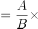
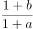
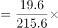
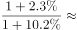
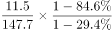
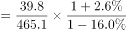
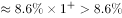
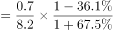
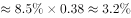
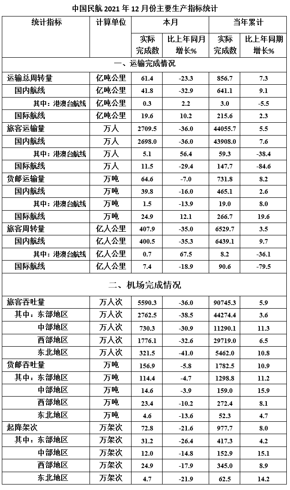

# 基期比重比较（2020年12月占2020年全年比例）

考点：[[20-考点/资料分析/比重/基期比重比较（2020年12月占2020年全年比例）|比重 / 基期比重比较（2020年12月占2020年全年比例）]]
材料：[[15-材料/资料分析/312723 中国民航2021年12月份主要生产指|312723 中国民航2021年12月份主要生产指]]

**问法模型**：问'2020年（基期）12月占全年比例最低' → 基期比重模型：所求=[A_12月÷(1+a_月)]÷[B_全年÷(1+b_年)]=(A/B)×(1+b)/(1+a)，四个项目分别计算后比大小

## 推理链
1. 第1步：定位表格四个选项的'本月'值及本月增速、'当年累计'值及累计增速：A运输总周转量国际航线19.6亿吨公里(+10.2%)/215.6(+2.3%)；B旅客运输量国际航线11.5万人(-29.4%)/147.7(-84.6%)；C货邮运输量国内航线39.8万吨(-16.0%)/465.1(+2.6%)；D旅客周转量港澳台航线0.7亿人公里(+67.5%)/8.2(-36.1%)
2. 第2步：2020年12月值=本月÷(1+本月增速)，2020年全年值=当年累计÷(1+累计增速)，两者相比整理为基期比重公式(A/B)×(1+b)/(1+a)，其中a为本月增速、b为累计增速
3. 第3步：A：(19.6/215.6)×(1.023/1.102)≈9.1%×0.93≈8.4%；B：(11.5/147.7)×(0.154/0.706)≈7.8%×0.22≈1.7%
4. 第4步：C：(39.8/465.1)×(1.026/0.840)≈8.6%×1.22≈10.5%；D：(0.7/8.2)×(0.639/1.675)≈8.5%×0.38≈3.3%
5. 第5步：排序B≈1.7%＜D≈3.3%＜A≈8.4%＜C≈10.5%，旅客运输量国际航线最低，与选项对照选B

**最快解法**：⚡ 基期比重公式法+双重最小排除：先心算四项现期比重A/B（约9.1%/7.8%/8.6%/8.5%，B已最小），再比修正系数(1+b)/(1+a)（A≈0.93、B=0.154/0.706≈0.22、C≈1.22、D≈0.38，B仍最小），两个因子同时最小的B无需精算直接锁定

## 易错点
- ⚠ 两列增速基期不同：'本月'增速的基期是2020年12月、'当年累计'增速的基期是2020年全年，分子分母必须各配各的增速，且'本月'与'当年累计'两列相邻极易串列取数
- ⚠ 负增长率换算方向：B项需除以(1-29.4%)和(1-84.6%)，其中0.154极小会使基期全年值显著放大；若误做成乘以(1+r)或把负增长当正增长，排序完全颠倒
- ⚠ 不能直接用2021年12月占2021年全年的现期比重代替基期比重：D项现期比重约8.5%与B约7.8%接近，但增速修正后D约3.3%远高于B约1.7%；另注意'港澳台'是国内航线子项，取行时勿与国际航线混同

## 母题抽象
> 🧩 当题干出现'基期年某月（12月）占该年全年比例最高/最低'特征时，用基期比重公式(A/B)×(1+b_年)/(1+a_月)：先粗比现期比重A/B，再比修正系数(1+b)/(1+a)，两项因子同时最小（或最大）者即为答案，可免精确计算。

**同类特征**：2020年12月占全年比例、基期比重比较、本月值与当年累计值双列配合、本月增速与累计增速分别修正、四个项目横向比较找最低、含大幅负增长航线条目

## 相关题
- [[10-真题/资料分析/比重/2616097 基期比重比较（两个部分基期占比差值：高-低多少个百分点）|2616097]]（云南 2020，相关度1）
- [[10-真题/资料分析/比重/5911257 基期比重（饼图占比判断）|5911257]]（浙江 2024，相关度1）

---

### 题干
以下哪个项目2020年12月占全年比例最低？

### 选项
- A. 运输总周转量国际航线
- B. 旅客运输量国际航线　✅
- C. 货邮运输量国内航线
- D. 旅客周转量港澳台航线

### 官方解析

根据题干“······2020年12月占全年比例最低”，结合材料时间为2021年，可判定本题为基期比重问题。定位表格材料可得各项目2021年12月和全年的运输值及增长率。根据公式：基期比重，可得2020年12月运输总周转量国际航线占全年比例；旅客运输量国际航线占全年比例；货邮运输量国内航线占全年比例；旅客周转量港澳台航线占全年比例。比较可得，2020年12月旅客运输量国际航线占全年比例最低。

故正确答案为B。

### 给定材料

