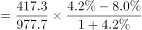
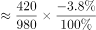
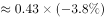
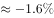

# 两期比重比较（两期比重差）

考点：[[20-考点/资料分析/比重/两期比重比较（两期比重差）|比重 / 两期比重比较（两期比重差）]]
材料：[[15-材料/资料分析/312723 中国民航2021年12月份主要生产指|312723 中国民航2021年12月份主要生产指]]

**问法模型**：题干问'某部分占整体的占比，2021年比2020年高/低几个点'→用两期比重差模型 A/B×(a−b)/(1+a)，先由a与b的大小定升降方向，再估差值量级

## 推理链
1. 第1步：从表格机场板块'当年累计'列提取：起降架次总计977.7万架次、同比增长8.0%（记b），东部地区417.3万架次、同比增长4.2%（记a）
2. 第2步：两期比重差公式：2021年占比−2020年占比=A/B×(a−b)/(1+a)，其中A=417.3、B=977.7；先看a=4.2%<b=8.0%，比重必下降，答案应为'低'，排除C、D
3. 第3步：代入计算：A/B=417.3/977.7≈42.7%，(a−b)/(1+a)=(4.2%−8.0%)/1.042≈−3.65%，比重差≈42.7%×(−3.65%)≈−1.56个百分点
4. 第4步：直接验证：2020年东部=(417.3/1.042)≈400.5万架次，2020年总计=(977.7/1.08)≈905.3万架次，2020年占比≈44.2%；42.7%−44.2%≈−1.5个点，介于1~2个点之间，对应'低1个多点'，选A

**最快解法**：⚡ 公式法（两期比重差）+方向排除：第一步只比增速，a=4.2%<b=8.0%→比重下降，锁定'低'（排除C、D）；第二步估量级：|a−b|=3.8个点，乘以占比约43%再除以1.042，实际差≈43%×3.8%≈1.6个点，远小于3.8，排除B，选A

## 易错点
- ⚠ 列串位陷阱：必须取'当年累计'列（977.7、417.3及对应增速8.0%、4.2%），误取相邻'本月'列（72.8、31.2，增速−21.6%、−26.4%）则基期变成2020年12月，结果完全错误
- ⚠ 升降方向误判：看到东部增速4.2%为正就误选'高'；两期比重升降只看a与b相对大小，a<b则占比下降
- ⚠ 量级误估：直接拿|a−b|=3.8个点当答案误选B'低3个多点'；比重差=占比×(a−b)/(1+a)，需再乘约43%的占比系数，实际仅约1.6个点
- ⚠ 本题a、b均为正增长，基期换算应除以(1+4.2%)、(1+8.0%)；若受全表大量负增长（如旅客运输量−36.0%）影响惯性去乘，会出错

## 母题抽象
> 🧩 当题干出现'某部分占整体的比重，现期比基期高/低几个点'特征时，用两期比重差公式 A/B×(a−b)/(1+a)：先由a与b大小定'高/低'排除一半选项，再以|a−b|×占比估算差值量级定答案，无需精确算出基期比重

**同类特征**：占比，2021年比2020年、低/高几个多点、起降架次、东部地区、当年累计、两期比重差

## 相关题
- [[10-真题/资料分析/比重/2042846 两期比重差（比重差值计算）|2042846]]（江苏 2017，相关度1）
- [[10-真题/资料分析/比重/2188159 两期比重差值计算（现期比重-基期比重）|2188159]]（陕西 2018，相关度1）
- [[10-真题/资料分析/比重/2377295 两期比重差值计算（基期比重由'较上年同期占比增加-减少的百分点'加减反推）|2377295]]（选调 2019，相关度1）
- [[10-真题/资料分析/比重/4678705 两期比重差比较（比重变化量最小）|4678705]]（选调 2020，相关度1）
- [[10-真题/资料分析/比重/5430293 现期比重假定套用（全国占比×区域总量）|5430293]]（浙江 2023，相关度1）

---

### 题干
起降架次当年累计数东部地区占比，2021年比2020年：

### 选项
- A. 低1个多点　✅
- B. 低3个多点
- C. 高1个多点
- D. 高3个多点

### 官方解析

根据题干“······占比，2021年比2020年”，结合选项“低/高几个多点”，判定本题为两期比重问题。定位表格材料可得：2021年累计中国民航起降架次为977.7万架次（B），同比增长8.0%（b），其中累计东部地区起降架次为417.3万架次（A），同比增长4.2%（a）。根据公式：两期比重差，则所求，即低1个多点。

故正确答案为A。

### 给定材料

