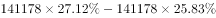

# 现期比重计算（比重差×总量求部分量之差）

考点：[[20-考点/资料分析/比重/现期比重计算（比重差×总量求部分量之差）|比重 / 现期比重计算（比重差×总量求部分量之差）]]
材料：[[15-材料/资料分析/312967 2020年第七次全国人口普查数据：全|312967 2020年第七次全国人口普查数据：全]]

**问法模型**：题干问'2020年A地区人口比B地区人口少多少'→ 不必分别求两地区人口，直接用部分量之差=整体总量×比重之差，即141178×(27.12%-25.83%)

## 推理链
1. 第1步：从材料第一段提取数据：2020年全国人口141178万人，中部地区占25.83%，西部地区占27.12%（本题只需现期比重，不用与2010年相比的变化量）
2. 第2步：依据公式'部分量=整体量×比重'，两地区人口之差=整体量×比重之差，比重差=27.12%-25.83%=1.29%
3. 第3步：代入计算：141178×1.29%≈1821.2万人（拆项速算：141178×1%=1411.78，141178×0.29%≈409.4，合计约1821.2）
4. 第4步：与选项对照：A.1721、B.1821、C.1921、D.2021，1821.2万与B项'约1821万人'最接近，故选B

**最快解法**：⚡ 总量×比重差一步法+拆项/百化分：先算比重差1.29%，再算141178×1.29%——按1.3%估为141178×1.3%≈1835，再减回0.01%×141178≈14，得约1821万，秒选B；选项间隔100万、精度要求低，粗估即可

## 易错点
- ⚠ 忘记乘总量：把比重差1.29（个百分点）直接当答案或只算比重不乘141178万，量级对不上选项
- ⚠ 取数口径陷阱：材料同段混有'与2010年相比'的比重变化量（中部-0.79、西部+0.22个百分点），本题问2020年现期人口差，只能用当期比重25.83%与27.12%，误用变化量则全错
- ⚠ 相减方向与单位：问'中部比西部少'应用西部-中部（27.12%-25.83%），反向得负值；同时注意单位为'万人'，结果约1821万即约1821.2万人

## 母题抽象
> 🧩 当题干出现'某年A部分比B部分多/少多少'且材料给出整体总量和A、B各自占比时，用'总量×比重差'一步求解，无需分别算出两个部分量；同步警惕同段混排的'比重变化量'不能代入现期计算

**同类特征**：现期年份（2020年）、'比……少'求两地区人口差、材料给地区占比（25.83%、27.12%）、整体总量141178万作公共乘数、选项以'万人'为单位、间隔100万

## 相关题
（暂无）

---

### 题干
2020年，中部地区人口比西部地区人口少：

### 选项
- A. 约1721万人
- B. 约1821万人　✅
- C. 约1921万人
- D. 约2021万人

### 官方解析

根据题干“2020年，中部地区人口比西部地区人口少”，结合材料中给出2020年中部地区和西部地区的人口占比，可判定本题为现期比重问题。定位材料第一段可得：2020年全国人口共141178万人······中部地区占25.83%，西部地区占27.12%。根据公式：部分量=整体量×比重，则2020年中部地区人口比西部地区人口少万人，与B项最接近。

故正确答案为B。

### 给定材料

        2020年全国人口共141178万人，比2010年增长了约5.38%。从地区分布上看，2020年东部地区人口占39.93%，中部地区占25.83%，西部地区占27.12%，东北地区占6.98%。与2010年相比，东部地区人口所占比重上升2.15个百分点，中部地区下降0.79个百分点，西部地区上升0.22个百分点，东北地区下降1.20个百分点。

        从性别构成上看，2020年男性人口为72334万人，女性人口为68844万人。从年龄构成上看，2020年0-14岁人口为25338万人，15-59岁人口为89438万人，60岁及以上人口为26402万人（其中，65岁及以上人口为19064万人）。从城乡分布上看，2020年居住在城镇的人口为90199万人，居住在乡村的人口为50979万人，与2010年相比，城镇人口增加23642万人，乡村人口减少16436万人。从民族构成上看，2020年汉族人口为128631万人，各少数民族人口为12547万人，与2010年相比，汉族人口增长4.93%，各少数民族人口增长10.26%，少数民族人口比重上升0.40个百分点。

> [!warning] 疑点（官方解析可能有误，待人工复核）
> 官方解析正文'比西部地区人口少万人'处排版缺失具体数值（应为约1821万），经复算141178×1.29%≈1821.2万与B项一致，结论无实质矛盾

<!-- CODEX-ANSWER-REVIEW:BEGIN -->
### 本次独立复核

**复核状态：** `resolved`（答案与解析已核定）

**计分答案：** B（可计分）

**复核解析：**

2020年全国人口141178万人；西部与中部占比相差27.12%−25.83%=1.29个百分点。人口差=141178×1.29%≈1821万人，选B。

**相关信息：**

人口差=全国人口×地区占比差。

**题源依据：** [固定版本原题](https://github.com/Mentat-Uran/kaogongzhentizhengliu/blob/84ab93d4b64b61d897bece8a1c0a5bab06b4feb2/10-%E7%9C%9F%E9%A2%98/%E8%B5%84%E6%96%99%E5%88%86%E6%9E%90/%E6%AF%94%E9%87%8D/4818013%20%E7%8E%B0%E6%9C%9F%E6%AF%94%E9%87%8D%E8%AE%A1%E7%AE%97%EF%BC%88%E6%AF%94%E9%87%8D%E5%B7%AE%C3%97%E6%80%BB%E9%87%8F%E6%B1%82%E9%83%A8%E5%88%86%E9%87%8F%E4%B9%8B%E5%B7%AE%EF%BC%89.md)；固定内容 commit `84ab93d4b64b61d897bece8a1c0a5bab06b4feb2`，Markdown blob `1ce0ae604ec98ed6ed382dd72c450d602a04cb23`。
<!-- CODEX-ANSWER-REVIEW:END -->
