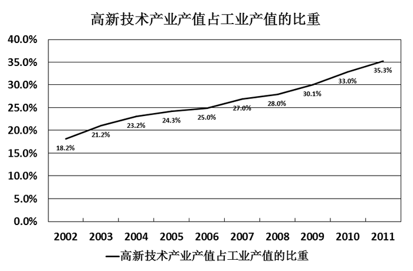

# 现期比重逆运用（已知部分量和比重求整体）

考点：[[20-考点/资料分析/比重/现期比重逆运用（已知部分量和比重求整体）|比重 / 现期比重逆运用（已知部分量和比重求整体）]]

**问法模型**：题干直接问某年某地整体量（工业产值）且材料给出对应部分量及占比 → 采用'整体 = 部分量 ÷ 比重'的现期比重逆运算模型

## 推理链
1. 第1步：题干求2006年江苏工业产值（整体量）；定位统计图一得2006年高新技术产业产值为10370亿元（部分量），定位统计图二得2006年高新技术产业产值占工业产值的比重为25.0%
2. 第2步：由现期比重公式'比重 = 部分量 ÷ 整体量'变形得'整体量 = 部分量 ÷ 比重'
3. 第3步：代入数据：2006年江苏工业产值 = 10370 ÷ 25.0% = 10370 × 4 = 41480亿元
4. 第4步：与选项对照，41480亿元对应B项，故正确答案为B

**最快解法**：⚡ 百化分速算：25.0% = 1/4，故整体 = 10370 ÷ 1/4 = 10370 × 4 = 41480亿元，直接锁定B项

## 易错点
- ⚠ 比重除法忘记转化为乘法：误按10370 ÷ 25 = 414.8计算，数量级出错对不上选项
- ⚠ 图一与图二的年份对应错位，误用其他年份的产值或比重数据
- ⚠ 单位口径：图一产值单位为亿元，需保持口径一致，勿看错数量级

## 母题抽象
> 🧩 当题干给出'某部分的具体数值 + 该部分占整体的比重'求整体量时，用'整体 = 部分量 ÷ 比重'，若比重为25%、20%等特殊分数则百化分转为乘法速算

**同类特征**：求整体量（某地某年工业产值）、材料给出现期部分量、材料给出现期比重、已知部分求整体、比重为特殊分数25%、双图联动定位数据

## 相关题
（暂无）

---

### 题干
2006年江苏工业产值是：

### 选项
- A. 39906亿元
- B. 41480亿元　✅
- C. 38266亿元
- D. 45321亿元

### 官方解析
根据题干“2006年江苏工业产值”，结合材料给出2006年高新技术产业产值占工业产值的比重和高新技术产业产值的数据，可判定本题为现期比重问题。定位统计图一可得：2006年高新技术产业产值为10370亿；定位统计图二可得：2006年高新技术产业产值占工业产值的比重为25.0%。故。
故正确答案为B。

### 给定材料

