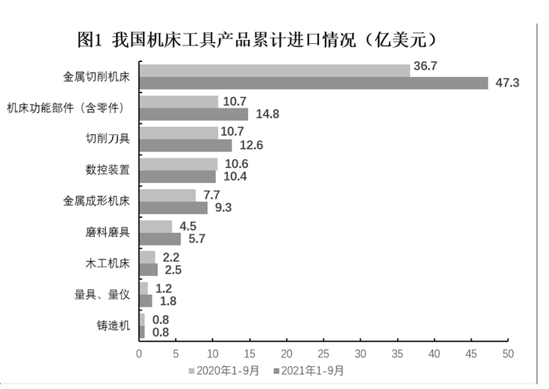

# 基期比重比较（超过10%的计数问题）

考点：[[20-考点/资料分析/比重/基期比重比较（超过10%的计数问题）|比重 / 基期比重比较（超过10%的计数问题）]]
材料：[[15-材料/资料分析/323432 2021年1～9月我国机床工具进出口|323432 2021年1～9月我国机床工具进出口]]

**问法模型**：题干问'基期(2020年1～9月)某类产品占整体比重超过10%的有几种'→转化为'基期部分量＞基期整体×10%'的阈值筛选计数模型，无需逐个计算比重

## 推理链
1. 第1步：题干时间为2020年1～9月（基期），定位文字段：2021年1～9月机床工具商品进口105.2亿美元，同比增长23.7%；定位图1浅色条读2020年各类产品进口额
2. 第2步：求基期整体——方法一还原：105.2/1.237≈85.0亿美元；方法二直接加总图1浅色条：36.7+10.7+10.7+10.6+7.7+4.5+2.2+1.2+0.8=85.1亿美元
3. 第3步：比重超过10% ⟺ 部分＞整体×10%，阈值=85.1×10%=8.51亿美元（用85.0则阈值约8.5）
4. 第4步：逐项比对图1浅色（2020年）数据：金属切削机床36.7✓、机床功能部件10.7✓、切削刀具10.7✓、数控装置10.6✓，金属成形机床7.7✗及以下均不达标
5. 第5步：达标产品共4种，与选项对照，对应D

**最快解法**：⚡ 阈值转化法：'比重>10%'等价于'部分>整体×10%'，省去逐个算比重。基期整体最稳做法是直接把图1九项2020年数据加总=85.1（免还原、免受23.7%增速干扰），阈值8.51；一眼扫浅色条，36.7、10.7、10.7、10.6四个＞8.51，直接数出4选D

## 易错点
- ⚠ 年份/颜色陷阱：图1上下两条，浅色=2020年（所求基期）、深色=2021年；若误用深色条（47.3、14.8、12.6、10.4…）并以2021年整体105.2×10%=10.52为阈值，只能数出3种而误选C
- ⚠ 分母口径陷阱：必须以基期(2020年)整体85.1为基准，不能拿现期整体105.2×10%=10.52当阈值去筛2020年数据，两期口径错位虽在本题碰巧同结果，但方法论错误、变式题即翻车
- ⚠ 图形维度陷阱：本题只用图1（进口），图2是出口且产品排列顺序不同，跨图看错行或把出口数据混入即全盘皆错

## 母题抽象
> 🧩 当题干出现'基期时间+某部分占整体比重超过(大于)x%+有几种'的特征时，用阈值转化法：先定基期整体（图形基期数据加总或现期÷(1+r)还原），求出整体×x%的阈值，再回图直接数达标项，全程不计算单个比重

**同类特征**：2020年1～9月（基期时间）、占机床工具进口额比重超过10%、有几种（计数型问法）、基期整体量需加总或还原（85.1或105.2/1.237）、数据取自图1进口维度、现期总量与增速在文字段（105.2、+23.7%）

## 相关题
（暂无）

---

### 题干
2020年1～9月，进口额占机床工具进口额比重超过10%的机床工具产品有几种？

### 选项
- A. 1
- B. 2
- C. 3
- D. 4　✅

### 官方解析
方法一：根据题干“2020年1～9月······占······比重超过10%的机床工具产品有几种”，结合材料时间为2021年1～9月，可判定本题为基期比重问题。定位文字材料第一段可得：2021年1～9月，机床工具商品进口105.2亿美元，同比增长23.7%。根据公式：基期量，则2020年1～9月机床工具商品进口额亿美元。根据公式：比重，若比重超过10%，则部分＞整体×10%，即各类机床工具产品进口额＞85×10%=8.5亿美元。定位图1可得，2020年1～9月满足条件的机床工具产品有金属切削机床（36.7亿美元）、机床功能部件（含零件）（10.7亿美元）、切削刀具（10.7亿美元）、数控装置（10.6亿美元），共4种。
方法二：根据题干“2020年1～9月······占······比重超过10%的机床工具产品有几种”，结合材料给出2020年1-9月各类型机床工具进口额，可判定本题为基期比重问题。定位图1可知2020年1-9月各类型机床工具进口额，则2020年1-9月机床工具进口额为36.7+10.7+10.7+10.6+7.7+4.5+2.2+1.2+0.8=85.1亿美元。根据公式：比重，若比重超过10%，则部分＞整体×10%，即各类机床工具产品进口额＞85.1×10%=8.51亿美元，满足条件的有金属切削机床（36.7亿美元）、机床功能部件（含零件）（10.7亿美元）、切削刀具（10.7亿美元）、数控装置（10.6亿美元），共4种。
故正确答案为D。

### 给定材料

        2021年1～9月，我国机床工具进出口总额242.6亿美元，同比增长32.8%。其中，机床工具商品进口105.2亿美元，同比增长23.7%；出口137.4亿美元，同比增长40.8%。

        从进口来源来看，2021年1～9月进口来源前三位分别是：日本34.5亿美元，同比增长37.8%；德国 22.2亿美元，同比增长11.0%；中国台湾14.3亿美元，同比增长36.1%。

        从出口去向来看，2021年1～9月出口去向前三位分别是：美国17.5亿美元，同比增长27.4%；越南10.5亿美元，同比增长35.4%；印度8.8亿美元，同比增长67.8%。

