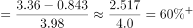

# 现期比重作差（两分量占同一总量的比重之差）

考点：[[20-考点/资料分析/比重/现期比重作差（两分量占同一总量的比重之差）|比重 / 现期比重作差（两分量占同一总量的比重之差）]]
材料：[[15-材料/资料分析/323435 2022年1月我国金融统计数据：人民|323435 2022年1月我国金融统计数据：人民]]

**问法模型**：题干为'A占B的比重比C所占比重高约多少个百分点'→ 统一单位后用（分量A−分量C）÷同一总量B求比重差

## 推理链
1. 第1步：从材料第1段提取：2022年1月人民币贷款增加3.98万亿元，住户贷款增加8430亿元，企（事）业单位贷款增加3.36万亿元
2. 第2步：单位统一：8430亿元=0.843万亿元（1万亿=10000亿）
3. 第3步：列比重差公式：(3.36−0.843)÷3.98=2.517÷3.98
4. 第4步：截位直除：2.517÷3.98≈2.5÷4≈0.625，精确约0.632，即约63个百分点
5. 第5步：与选项对照：63最接近60，故选D

**最快解法**：⚡ 截位直除：分子先减——3.36−0.843=2.517，截位为2.5；分母3.98截位为4；2.5÷4=0.625≈60多个百分点，直接锁定D（若先分算：3.36/3.98≈84%，0.843/3.98≈21%，差≈63个百分点）

## 易错点
- ⚠ 单位混排：同段内'3.98万亿元'与'8430亿元'并存，不把8430亿换成0.843万亿就直接相除会差一万倍
- ⚠ 口径陷阱：题干用的是当月'增加额'（增量）而非1月末'余额'，若错用余额196.65万亿作分母则完全错误
- ⚠ 结果理解：算出的0.632是比重差（约63个百分点），选项给的是近似整数档，须选最接近的60而非因63无对应项而纠结

## 母题抽象
> 🧩 当题干出现'两个分量占同一总量的比重相差多少个百分点'特征时，先统一单位，再用（分量1−分量2）÷总量一次性作差，最后与就近选项匹配

**同类特征**：占……的比重比……所占比重高/低多少个百分点、两个部门对比同一总量、用'增加额/增量'而非'余额'作分子分母、现期比重问题、万亿元与亿元单位混排需换算

## 相关题
- [[10-真题/资料分析/比重/4637154 现期比重（部分=整体×比重）|4637154]]（国考 2022，相关度1）
- [[10-真题/资料分析/比重/2137006 现期比重计算（跨图'总量×比重'求部分量后再求部分占部分比重）|2137006]]（北京 2018，相关度1）
- [[10-真题/资料分析/比重/10297332 比重还原（部分=整体×比重）后判断贸易顺逆差|10297332]]（浙江 2025，相关度1）
- [[10-真题/资料分析/比重/5919126 现期比重计算（现期占'基期+现期'两期合计的比重，需先由环比增速求基期量）|5919126]]（江苏 2024，相关度1）

---

### 题干
2022年1月份，我国企（事）业单位贷款增加额占人民币贷款增加额的比重比住户贷款所占比重高约多少个百分点？

### 选项
- A. 30
- B. 40
- C. 50
- D. 60　✅

### 官方解析

根据题干“2022年1月份······占······的比重比······所占比重高约多少个百分点”，结合材料时间是2022年1月，可判定本题为现期比重问题。定位文字材料可得：2022年1月份，我国人民币贷款增加3.98万亿元；分部门看，住户贷款增加8430亿元；企（事）业单位贷款增加3.36万亿元。根据公式：比重，8430亿元=0.843万亿元，则所求比重差，对应D项。

故正确答案为D。

### 给定材料

        2022年1月末，我国人民币贷款余额196.65万亿元，同比增长11.5%，增速分别比上月末和上年同期低0.1个和1.2个百分点。1月份我国人民币贷款增加3.98万亿元，同比多增3944亿元。分部门看，住户贷款增加8430亿元；企（事）业单位贷款增加3.36万亿元，其中，短期贷款增加1.01万亿元，中长期贷款增加2.1万亿元，票据融资增加1788亿元。2022年1月末，我国外币贷款余额9308亿美元，同比增长2%。1月份外币贷款增加181亿美元，同比少增269亿美元。

        2022年1月末，我国人民币存款余额236.07万亿元，同比增长9.2%，增速分别比上月末和上年同期低0.1个和1.2个百分点，1月份人民币存款增加3.83万亿元，同比多增2627亿元，其中，住户存款增加5.41万亿元，非金融企业存款减少1.4万亿元，财政性存款增加5849亿元。1月末，外币存款余额1.02万亿美元，同比增长9%。1月份外币存款增加272亿美元，同比少增228亿美元。

        2022年1月份，我国银行间人民币市场以拆借、现券和回购方式合计日均成交6.31万亿元，日均成交同比增长18%。其中，同业拆借日均成交同比增长9.3%，现券日均成交同比增长22.9%，质押式回购日均成交同比增长18.2%。

