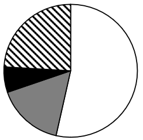

# 现期比重比较·饼图占比判断

考点：[[20-考点/资料分析/比重/现期比重比较·饼图占比判断|比重 / 现期比重比较·饼图占比判断]]
材料：[[15-材料/资料分析/335238 2019年A市城乡居民人均收入与消费|335238 2019年A市城乡居民人均收入与消费]]

**问法模型**：题干出现'最能准确反映…占可支配收入比重关系的是（饼图）'→ 计算四项收入各占28920元的现期比重，用扇形面积大小与倍数关系排除选项

## 推理链
1. 第1步：题干限定2019年、A市全市居民口径，从表1'全市居民'列提取四项收入：工资性15475元、经营净4697元、财产净1792元、转移净6956元
2. 第2步：现期比重模型，整体=四项之和=15475+4697+1792+6956=28920元（与文字段人均可支配收入28920元吻合，交叉校验通过）
3. 第3步：代入计算比重：工资15475/28920≈53.5%、经营4697/28920≈16.2%、财产1792/28920≈6.2%、转移6956/28920≈24.1%
4. 第4步：财产净收入1792元最小→黑色扇形面积应最小，排除A、B两项
5. 第5步：比较白色与斜线扇形：工资/转移=15475/6956≈2.2倍，白色扇形面积应为斜线扇形的2倍多，排除C项
6. 第6步：仅D项同时满足'黑色最小+白色约为斜线2倍多+白色略过半'，故选D

**最快解法**：⚡ 扇形倍数排除法（免精算比重）：第一步找最小值——财产净1792元最小，锁定黑色扇形最小即可排A、B；第二步比倍数——15475÷6956≈2.2（即工资约占53.5%过半、转移约占24%），白色须为斜线的2倍多，排C选D

## 易错点
- ⚠ 三口径错列：表1分全市/城镇/农村三列，本题只要'全市居民'列（15475/4697/1792/6956），错用城镇列（22119/4361/2724/8735）或农村列（5316/5210/367/4240）即全盘皆错
- ⚠ 收入与消费串行：文字段中城镇消费25785、农村消费13112与表1收入数据紧邻，本题整体基数应为收入28920元，误用消费20774元会使占比全部失真
- ⚠ 只排大小不验倍数：仅凭'黑色最小'只能排除A、B，C与D的区别在于白色（工资）与斜线（转移）的倍数关系（2.2倍 vs 不足2倍），跳过这一步无法锁定答案；同时注意图例颜色对应：白=工资性、灰=经营、黑=财产、斜线=转移

## 母题抽象
> 🧩 当题干出现'最能准确反映……占比关系的饼图'特征时，先算各部分占整体的比重（部分/整体，整体用四项之和与文字段锚点校验），再用'最小部分定位最小扇形+关键部分间倍数（如2倍、半圆）'两步排除法锁定唯一选项

**同类特征**：饼图占比关系判断、占可支配收入比重、现期比重、四项收入构成（工资/经营/财产/转移）、全市居民口径、最能准确反映

## 相关题
- [[10-真题/资料分析/比重/16593075 现期比重计算与饼图占比关系判断（排除法）|16593075]]（海南 2024，相关度2）
- [[10-真题/资料分析/比重/2393936 现期比重计算（三年数据占合计比重＋饼图匹配）|2393936]]（青海 2019，相关度2）
- [[10-真题/资料分析/比重/4792819 现期比重计算（多部分比重依次求解）|4792819]]（新疆 2014，相关度1）
- [[10-真题/资料分析/比重/827355 现期比重比较（部分占比过半速判）|827355]]（政法干警 2014，相关度1）
- [[10-真题/资料分析/比重/2272297 现期比重比较|2272297]]（选调 2015，相关度1）

---

### 题干
以下饼图中，最能准确反映2019年A市全市居民工资性收入（白色）、经营净收入（灰色）、财产净收入（黑色）和转移净收入（斜线）占可支配收入比重关系的是：

### 选项
- A. 

- B. 

- C. 

- D. 

　✅

### 官方解析
根据题干“······2019年······占······比重关系”，可判定本题为现期比重问题。定位表1可得：2019年，A市全市居民工资性收入为15475元，经营净收入为4697元，财产净收入为1792元，转移净收入为6956元。财产净收入最小，则黑色扇形面积最小，排除A、B两项。，则白色扇形面积应为斜线扇形面积的2倍多，排除C项。
故正确答案为D。

### 给定材料

        2019年，A市居民人均可支配收入28920元，比上年增长9.6%。按常住地分，城镇居民人均可支配收入37939元；农村居民人均可支配收入15133元。全市居民人均消费支出20774元，比上年增长7.9%。按常住地分，城镇居民人均消费支出25785元；农村居民人均消费支出13112元。全市居民恩格尔系数为32.1%，比上年下降0.2个百分点。其中城镇为31.2%，农村为34.9%。

