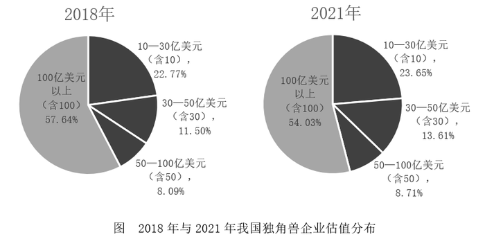

# 两期比重比较之'市场份额'概念辨析（数据充分性判断，答案为'条件不足'）

考点：[[20-考点/资料分析/比重/两期比重比较之'市场份额'概念辨析（数据充分性判断，答案为'条件不足'）|比重 / 两期比重比较之'市场份额'概念辨析（数据充分性判断，答案为'条件不足'）]]
材料：[[15-材料/资料分析/335858 我国独角兽企业2018年与2021年|335858 我国独角兽企业2018年与2021年]]

**问法模型**：题干先给出'行业集中度=前N家头部企业所占市场份额之和'的新定义，再问2021年与2018年集中度的变化 → 先做数据充分性核对：材料必须含有'市场份额（产值、产量、销售额、销售量、职工人数、资产总额等）'口径的数据，缺则直接判'条件不足'，不可用估值占比/家数占比替代

## 推理链
1. 第1步：从题干提取定义——行业集中度是前N家头部企业所占市场份额的总和，市场份额指产值、产量、销售额、销售量、职工人数、资产总额等口径，本题头部企业均选取13家
2. 第2步：清点材料口径——饼图给的是各估值区间的'估值金额占比'（2018年100亿美元以上档占57.64%，2021年占54.03%），表格给的是各区间'企业家数'（100亿以上档2018年13家、2021年15家），均不是任何企业的市场份额数据
3. 第3步：排陷阱——2018年100亿以上档恰为13家纯属巧合，2021年该档是15家，与'选13家'不匹配；且即使档内家数吻合，'估值金额占比'与'市场份额'是两个不同口径（估值≠产值/销售额），材料也未给出任何一家企业的个体市场份额
4. 第4步：结论——两年'前13家市场份额之和'均无法计算，集中度无从求出，更无法比较变化，故条件不足，无法判断，选D

**最快解法**：⚡ 概念对位法（数据充分性判断）：把题干定义所需的'市场份额（产值、销售额等）'逐一与材料字段对位——材料只有'估值金额占比'（饼图）和'企业家数'（表），无一对应 → 秒选D；全程不需任何计算，切忌用57.64%对54.03%去比

## 易错点
- ⚠ 最大坑：误把饼图的'估值金额占比'当作'市场份额'，用57.64%→54.03%下降而错选C（降低）——材料导读明确提示该饼图分母是总估值额，估值不等于产值/销售额等市场份额口径
- ⚠ 忽视'头部企业均选取13家'的限定条件：2018年100亿美元以上档恰13家，2021年是15家，无法在2021年取出'前13家'；材料只给区间汇总数据，无个体企业信息
- ⚠ 看到'两期比重'套路就套比重比较公式，跳过了'定义所需指标材料是否提供'的先行判断——新定义题的第一步永远是核对口径而非找数字

## 母题抽象
> 🧩 当题干先给出一个新定义（如'行业集中度=前N家头部企业市场份额之和'）再要求两期比较时，第一步先核对定义所需的'份额'口径材料是否提供；若材料只有估值/家数等相似但不同口径的数据，直接选'条件不足，无法判断'，勿用近似口径硬算

**同类特征**：题干先给新定义（行业集中度/CR_N）、前N家头部企业（本题选13家）、市场份额括号列举产值、销售额等口径、与基期相比现期如何变化、四个选项含'条件不足，无法判断'、材料只有估值占比与家数，无市场份额

## 相关题
（暂无）

---

### 题干
行业集中度，是指某行业的相关市场内前N家最大的企业（头部企业）所占市场份额（产值、产量、销售额、销售量、职工人数、资产总额等）的总和，是对整个行业的市场结构集中程度的测量指标，用来衡量企业的数目和相对规模的差异，是市场势力的重要量化指标。如果将独角兽企业视为一个行业，而头部企业均选取13家，与2018年相比，2021年的行业集中度        。

### 选项
- A. 提高
- B. 不变
- C. 降低
- D. 条件不足，无法判断　✅

### 官方解析
根据题干“与2018年相比，2021年的行业集中度······”，结合题干中对于行业集中度的诠释（头部企业占市场份额的总和），可判定本题为两期比重问题。材料并未给出市场份额相关数据，故无法比较2021年行业集中度相比于2018年的变化，即条件不足，无法判断。
故正确答案为D。

### 给定材料

        独角兽公司是投资界术语，一般指成立不超过10年，估值超过10亿美元，少部分估值超过100亿美元的企业，其不仅是优质和市场潜力无限的绩优股，而且商业模式很难被复制。

