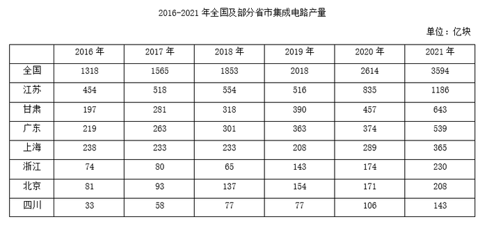

# 现期比重计算（部分÷整体）

考点：[[20-考点/资料分析/比重/现期比重计算（部分÷整体）|比重 / 现期比重计算（部分÷整体）]]
材料：[[15-材料/资料分析/338025 2016—2021年全国及7个省市（|338025 2016—2021年全国及7个省市（]]

**问法模型**：题干'2021年，表中所列省市产量约占全国总产量的…'→ 直接用同年7省市合计作分子、表中'全国'行作分母求现期比重，无需基期换算

## 推理链
1. 第1步：题干问2021年占比，为现期问题；从表中提取2021年数据：全国3594亿块，江苏1186、甘肃643、广东539、上海365、浙江230、北京208、四川143亿块
2. 第2步：现期比重公式：比重=部分量÷整体量=7省市2021年合计÷全国2021年产量
3. 第3步：逐项加总：1186+643=1829，+539=2368，+365=2733，+230=2963，+208=3171，+143=3314亿块；比重=3314÷3594≈0.922
4. 第4步：与选项对照：0.922≈92%；且3594×88%≈3163<3314，实际占比已超88%，排除A(80%)、B(84%)、C(88%)，锁定D(92%)

**最快解法**：⚡ 加总+截位直除：7省市2021年数据依次凑整相加得3314（1186+643+539+365+230+208+143），分子分母同截两位≈331÷359≈0.92，直接锁定D；亦可先用88%作分界线：3594×88%≈3163<3314，排除C后仅剩D

## 易错点
- ⚠ 分母错置：题干求'占全国总产量'比重，分母必须取表中'全国'行3594，不能把7省市以外的口径或错误行当分母，更不能把某省市当整体
- ⚠ 加总漏项：8行中除全国外恰好7个省市，若漏加四川143（合计变3171），得3171/3594≈88.2%会误选C，这是本题命题设置的陷阱项
- ⚠ 量级看错行：江苏1186与全国3594同为千级，甘肃643、广东539次之，加总时勿串行或漏位数

## 母题抽象
> 🧩 当题干出现'某年，表中所列部分约占整体（全国）的…'特征时，直接取同年数据：部分各行求和作分子、整体行作分母，截位直除或用选项百分比对分母放缩验证，验证分子落在哪个选项区间即可——题干无基期表述即为现期比重直算

**同类特征**：2021年（现期）、表中所列省市、约占全国总产量的、现期比重、7省市合计作分子、全国行作分母

## 相关题
- [[10-真题/资料分析/比重/2453202 现期比重计算（部分÷整体）|2453202]]（北京 2020，相关度3）
- [[10-真题/资料分析/比重/16593267 现期比重计算（部分÷整体）|16593267]]（广东 2024，相关度2）
- [[10-真题/资料分析/比重/2256374 现期比重计算（部分÷整体）|2256374]]（江西 2018，相关度2）
- [[10-真题/资料分析/比重/1746796 现期比重计算（部分÷整体）|1746796]]（国考 2016，相关度2）
- [[10-真题/资料分析/比重/4792819 现期比重计算（多部分比重依次求解）|4792819]]（新疆 2014，相关度1）

---

### 题干
2021年，表中所列省市集成电路产量约占全国总产量的：

### 选项
- A. 80%
- B. 84%
- C. 88%
- D. 92%　✅

### 官方解析
根据题干“2021年······占······”，可判定本题为现期比重问题。定位统计表可知2021年表中所列省市及全国集成电路产量。根据公式：比重，可知所求比重。
故正确答案为D。

### 给定材料

