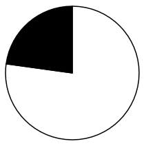
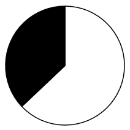

# 现期比重计算（饼图匹配）

考点：[[20-考点/资料分析/比重/现期比重计算（饼图匹配）|比重 / 现期比重计算（饼图匹配）]]
材料：[[15-材料/资料分析/338031 2021年H省电子商务发展情况：商品|338031 2021年H省电子商务发展情况：商品]]

**问法模型**：题干要求选'最能准确反映'两分类占总量比重的饼图 → 计算较小分量的现期比重（部分/总体），并与1/4圆（25%、90°）等特殊值比较后选图

## 推理链
1. 第1步：定位材料第1、2段：商品、服务类电子商务交易额合计11526.13亿元，其中商品类8896.60亿元、服务类2629.53亿元，两分项之和恰等于总量，口径自洽
2. 第2步：现期比重公式：比重=部分值/整体值，因黑色为服务类且数值较小，先算2629.53/11526.13
3. 第3步：截位直除：2629.53/11526.13≈2629/11526≈22.8%，即服务类（黑色）占比略小于25%，对应扇形角度约82°、略小于90°（四分之一圆）
4. 第4步：相应地商品类（白色）占比约77.2%，扇形角度约278°，占圆的三分之四左右
5. 第5步：与选项对照：只有B图中黑色部分略小于四分之一圆、白色部分约占其余四分之三，排除A、C、D，B项当选

**最快解法**：⚡ 特殊值对比法：总量11526.13的1/4约为2881，而服务类仅2629.53<2881，故黑色占比略小于25%（略小于90°扇形），无需精确计算，直接锁定黑色略小于四分之一圆的B项

## 易错点
- ⚠ 占比基数用错：基数是商品、服务类交易额合计11526.13亿元，不能误用跨境电商2018.3、网上零售额2948.2或平台交易金额5354.93等其他口径
- ⚠ 黑白对应弄反：题干规定商品类为白色（77.2%）、服务类为黑色（22.8%），若颜色与数值对调会误选其他选项
- ⚠ '略小于25%'的精度敏感度不足：22.8%与25%仅差约2.2个百分点（约8°扇形角），若凭'接近一半'或'恰为四分之一'粗略目测易排除正确图

## 母题抽象
> 🧩 当题干出现'选饼图反映A、B占总量比重'特征时，先验证分项之和等于总量，再算较小分量的比重并与25%、50%等特殊值比较扇形角度，即可秒选图形

**同类特征**：饼图、最能准确反映、占……比重关系、白色/黑色对应指定分类、现期比重图形匹配、文字材料两段拼数据

## 相关题
- [[10-真题/资料分析/比重/2571801 基期比重还原（百分点变化反推）+饼图匹配|2571801]]（山东 2020，相关度2）
- [[10-真题/资料分析/比重/10297452 现期比重结构与饼图匹配（部分占比比较-倍数排除）|10297452]]（四川 2025，相关度1）
- [[10-真题/资料分析/增长/16593068 增长量比较（多期同比增量趋势与柱状图匹配）|16593068]]（甘肃 2024，相关度1）
- [[10-真题/资料分析/比重/16593075 现期比重计算与饼图占比关系判断（排除法）|16593075]]（海南 2024，相关度1）
- [[10-真题/资料分析/比重/19181372 现期比重计算与饼图扇区识别|19181372]]（吉林 2024，相关度1）

---

### 题干
以下饼图中，最能准确反映2021年H省商品类（白色）和服务类（黑色）电子商务交易额占商品、服务类电子商务交易额比重关系的是：

### 选项
- A. 

- B. 

　✅
- C. 

- D. 

### 官方解析
根据题干“以下饼图中，最能准确反映2021年H省······占······比重关系的是”，可判定本题为现期比重问题。定位文字材料第一、二段可得：2021年H省商品、服务类电子商务交易额为11526.13亿元······商品类电子商务交易额为8896.60亿元，服务类电子商务交易额为2629.53亿元。服务类电子商务交易额占比为，占比略小于25%，即在饼图中黑色部分应略小于圆的，排除A、C、D三项，B项当选。
故正确答案为B。

### 给定材料

        2021年H省商品、服务类电子商务交易额为11526.13亿元，比上年同期增长21.8%，高于全国增速2.3个百分点。H省跨境电商进出口交易额为2018.3亿元，其中，出口1475.5亿元，同比增长15.7%；进口542.8亿元，同比增长16.0%。H省网上零售额为2948.2亿元，同比增长12.5%，其中，实物商品网上零售额为2426.4亿元，同比增长10.1%。

        从交易对象看，2021年H省商品类电子商务交易额为8896.60亿元，同比增长16.6%；服务类电子商务交易额为2629.53亿元，同比增长43.5%。从交易主体看，2021年H省对单位电子商务交易额为7254.75亿元，同比增长19.8%，占商品、服务类电子商务交易额比重为62.9%；对个人电子商务交易额为4271.38亿元，同比增长25.4%。

        2021年H省共有电子商务平台87个，在本省电商平台上实现交易金额为5354.93亿元，同比增长41.0%，收取的平台交易服务费为3.17亿元，同比增长49.5%。从地区分布来看，2021年本地电子商务平台拥有量最多的为Z市，有44个平台，实现交易金额4239.04亿元。

