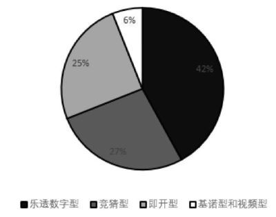
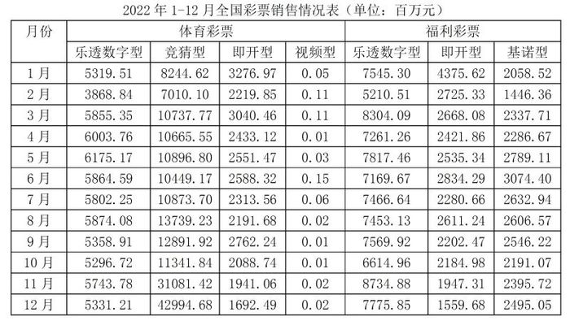
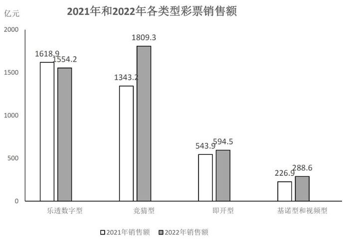

# 现期比重计算与饼图匹配（部分占当月总额比重的多月份比较）

考点：[[20-考点/资料分析/比重/现期比重计算与饼图匹配（部分占当月总额比重的多月份比较）|比重 / 现期比重计算与饼图匹配（部分占当月总额比重的多月份比较）]]
材料：[[15-材料/资料分析/340951 2022年全国彩票销售情况：按月、按|340951 2022年全国彩票销售情况：按月、按]]

**问法模型**：题干给出'饼图反映2022年某月五类型销售额比重'的问法特征 → 对各候选月份计算某一易识别部分（基诺型+视频型）占当月总销售额的现期比重，与饼图数值对照取最接近的月份

## 推理链
1. 第1步：从题干提取条件——饼图给出2022年某月乐透数字型、竞猜型、即开型、基诺型和视频型的比重关系，选项为1月、8月、11月、12月；从表格提取四个月的基诺型与视频型数据：1月2058.52+0.05、8月2606.57+0.02、11月2395.72+0.02、12月2495.05（百万元）
2. 第2步：所用公式——比重=部分（基诺型+视频型）÷整体（当月五类型总额）；整体需跨栏加总：体彩四列+福彩三列（同类型分散在两栏）
3. 第3步：1月整体=（5319.51+8244.62+3276.97+0.05）+（7545.30+4375.62+2058.52）=16841.15+13979.44=30820.59百万元，比重=2058.57÷30820.59≈6.7%
4. 第4步：8月整体=21805.01+12670.94=34475.95，比重=2606.59÷34475.95≈7.6%；11月整体=38766.28+13077.91=51844.19，比重=2395.74÷51844.19≈4.6%；12月整体=50018.40+11830.58=61848.98，比重=2495.07÷61848.98≈4.0%
5. 第5步：与饼图对照——饼图中'基诺型和视频型'占比约6%，四个候选月中仅1月的6.7%最接近6%（8月7.6%、11月4.6%、12月4.0%均偏离更远）
6. 第6步：结论——此饼图对应2022年1月，选A

**最快解法**：⚡ 截位直除+忽略极小量：视频型各月仅0.01—0.15百万元，直接忽略，只算基诺型占比。1月≈2058.5/30820≈6.7%，8月≈2606.6/34476≈7.6%，11月≈2395.7/51844≈4.6%，12月≈2495.1/61849≈4.0%（分母只需截前三位粗估即可区分）。与饼图6%最接近的是1月，秒选A；另可用量级直觉加速：11—12月竞猜型激增至3万—4.3万百万元使分母翻倍，比重必被稀释至5%以下，8月分母大且基诺略多约7.6%，只有1月落在6%—7%区间

## 易错点
- ⚠ 跨栏遗漏：同一类型分散在体彩、福彩两栏，当月总额必须体彩4列+福彩3列全加，只加单栏或只读福彩基诺一列会算错分母
- ⚠ 量级突变：11—12月竞猜型跳升至31081.42、42994.68百万元（其余月份约7000—14000），漏读突增会使11、12月的比重被高估而误选
- ⚠ 单位与极小值：表为百万元、图为亿元（差100倍），本题虽全程用表内数据，但交叉验证须×100；视频型0.01—0.15百万元易看错小数点，忽略不计不影响结论但读错量级会出错

## 母题抽象
> 🧩 当题干出现'饼图反映某月各部分比重、选项为多个候选月份'的特征时，选取饼图中占比独特且材料易定位的一个部分（如合并项'基诺型和视频型'），对各候选月套用比重=部分÷当月跨栏总额，与饼图数值对照取最接近者，且可先用分母突变量级做粗筛排除

**同类特征**：饼图反映某月比重关系、2022年某月、五个类型销售额占比、选项为具体月份需逐一验证、需跨栏加总当月总额、现期比重匹配

## 相关题
（暂无）

---

### 题干

下面饼图反映了2022年某月乐透数字型、竞猜型、即开型、基诺型和视频型彩票销售额的比重关系，此饼图对应的月份为（    ）。

### 选项
- A. 1月　✅
- B. 8月
- C. 11月
- D. 12月

### 官方解析

根据题干“下面饼图反映了2022年某月······比重关系······”，可判定本题为现期比重问题。定位表格材料可知1月、8月、11月、12月各类型彩票的销售数据。根据公式：比重，

则2022年1月基诺型和视频型彩票销售额的比重为；

8月基诺型和视频型彩票销售额的比重为；

11月基诺型和视频型彩票销售额的比重为；

12月基诺型和视频型彩票销售额的比重为。观察计算结果可知，1月基诺型和视频型彩票销售额的比重（6.7%）最接近题干所给比重（6%）。

故正确答案为A。

### 给定材料

