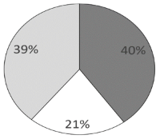
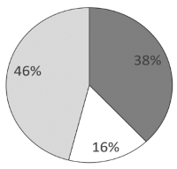
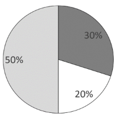
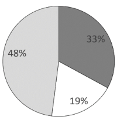

# 基期比重（基期结构占比，饼图选项）

考点：[[20-考点/资料分析/比重/基期比重（基期结构占比，饼图选项）|比重 / 基期比重（基期结构占比，饼图选项）]]
材料：[[15-材料/资料分析/340957 2021年前三季度全国6.4万家规模|340957 2021年前三季度全国6.4万家规模]]

**问法模型**：题干问'2020年前三季度（时间前移）……分产业类型……结构正确的是'（饼图选项）→ 基期结构模型：各部分现期值÷(1+各自同比增速)求基期量，再求占基期总量的比重（或直接用基期量倍数关系）对照饼图

## 推理链
1. 第1步：题干时间为2020年前三季度而材料为2021年前三季度，判定基期结构题；从第1段取整体锚点：营业收入84205亿元、同比+21.8%（不能用两年平均增速10.0%）
2. 第2步：从第4段取分产业类型三组数据：文化制造业30950亿元/+17.7%、文化批发和零售业13561亿元/+26.0%、文化服务业39693亿元/+23.7%
3. 第3步：用基期量公式：基期量=现期量÷(1+同比增速)
4. 第4步：截位直除：制造业30950÷1.177≈26295亿元；批零13561÷1.26≈10763亿元；服务业39693÷1.237≈32088亿元
5. 第5步：验算锚点：三者合计≈69146亿元，与总量基期84205÷1.218≈69135亿元基本一致（1亿元级尾差为舍入）
6. 第6步：求占比：服务业32088/69146≈46.4%、制造业26295/69146≈38.0%、批零10763/69146≈15.6%；且服务业≈2.98×批零（约3倍）、制造业≈2.4×批零
7. 第7步：对照饼图选项：只有B呈现'服务业约46%、制造业约38%、批零约16%，服务业约为批零3倍'的结构，故选B

**最快解法**：⚡ 倍数排除法+截位直除：不必算占比，先估三个基期量——39693/1.237≈3.2万、30950/1.177≈2.6万、13561/1.26≈1.1万，抓住'服务业≈批零的3倍、制造业居中'的倍数特征直接排除A/C/D锁定B；若选项占比区分度小，再补算占比46%/38%/16%确认

## 易错点
- ⚠ 基期/现期混淆：直接用2021年现期值比结构（47.1%/36.8%/16.1%），与真实基期占比（46.4%/38.0%/15.6%）相差约1个百分点，饼图选项区分度小时必错
- ⚠ 增速口径与配对错误：基期2020年只能用同比增速，误用两年平均增速10.0%或新业态的26.1%即错；且17.7%/26.0%/23.7%必须与制造业/批零/服务业正确配对，切勿串行
- ⚠ 分母与尾差：占比分母可用三者基期合计（≈69146亿元）或总量基期（84205/1.218≈69135亿元），两者差不足0.1%，勿因四舍五入尾差反复修正或质疑数据

## 母题抽象
> 🧩 当题干出现'上一年（基期）+多部分结构/占比（饼图选项）'特征时，用基期比重法：各部分现期值÷(1+各自同比增速)求基期量，利用'部分量大小与倍数关系=占比关系'直接排除选项，必要时补算占比验证

**同类特征**：2020年前三季度（时间前移一年）、结构正确的是（饼图/占比选项）、分产业类型（三类部分）、基期比重/基期结构、三个部分对应三个不同同比增速、整体锚点84205亿元、+21.8%

## 相关题
（暂无）

---

### 题干
2020年前三季度，分产业类型营业收入的结构正确的是：

### 选项
- A. 

- B. 

　✅
- C. 

- D. 

### 官方解析
根据题干“2020年前三季度······营业收入的结构······”，结合材料时间为2021年前三季度，可判定本题为基期比重问题。定位文字材料第一段可得，2021年前三季度，全国6.4万家规模以上文化及相关产业企业实现营业收入84205亿元，同比增长21.8%；定位文字材料第四段可得，分产业类型营业收入情况：文化制造业30950亿元，同比增长17.7％；文化批发和零售业13561亿元，同比增长26.0％；文化服务业39693亿元，同比增长23.7％。
方法一：根据公式：基期量，则2020年前三季度文化制造业营业收入为亿元；文化批发和零售业营业收入为亿元；文化服务业营业收入为亿元。由于总量一定，各部分所占比重大小关系应与部分量大小关系一致，其中文化服务业营业收入（32000亿元）约为文化批发和零售业营业收入（11000亿元）的3倍，只有B项符合。
方法二：根据公式：基期比重，则2020年前三季度文化制造业营业收入占全国6.4万家规模以上文化及相关产业企业实现营业收入的比重。
故正确答案为B。

### 给定材料

        据对全国6.4万家规模以上文化及相关产业企业调查，2021年前三季度，上述企业实现营业收入84205亿元，按可比口径计算，同比增长21.8%；两年平均增长10.0%。

        分业态营业收入情况：文化新业态特征较为明显的16个行业小类28322亿元，同比增长26.1%；两年平均增长24.0%，高于全部规模以上文化及相关产业企业14.0个百分点。

        分行业类别营业收入情况：新闻信息服务9847亿元，同比增长22.1%；内容创作生产17693亿元，同比增长18.6%；创意设计服务13787亿元，同比增长24.0%；文化传播渠道9309亿元，同比增长30.1%；文化投资运营359亿元，同比增长13.8％；文化娱乐休闲服务916亿元，同比增长35.3％；文化辅助生产和中介服务11441亿元，同比增长18.3％；文化装备生产4880亿元，同比增长17.8％；文化消费终端生产15974亿元，同比增长22.0％。

        分产业类型营业收入情况：文化制造业30950亿元，同比增长17.7％；文化批发和零售业13561亿元，同比增长26.0％；文化服务业39693亿元，同比增长23.7％。

        分领域营业收入情况：文化核心领域51911亿元，同比增长22.9％；文化相关领域32294亿元，同比增长20.0％。

        分区域营业收入情况：东部地区64715亿元，同比增长22.5％；中部地区11417亿元，同比增长19.7％；西部地区7329亿元，同比增长19.0％；东北地区744亿元，同比增长20.2％。

