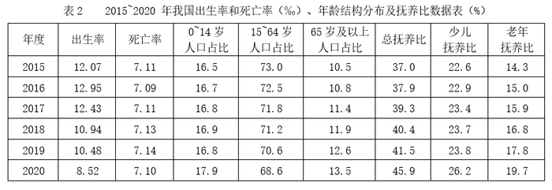

# 现期比重比较（城镇化率超临界值年份计数）

考点：[[20-考点/资料分析/比重/现期比重比较（城镇化率超临界值年份计数）|比重 / 现期比重比较（城镇化率超临界值年份计数）]]
材料：[[15-材料/资料分析/340958 2015—2021年我国国内生产总值|340958 2015—2021年我国国内生产总值]]

**问法模型**：题干为'某期间某率超过60%的年份共有几个'→ 采用现期比重模型（城镇人口÷年末总人口），逐年与60%临界值比较后计数

## 推理链
1. 第1步：题干限定'十三五'期间=2016—2020年（表1的2015年只是基期参考、2021年不在期内），所需数据为表1的城镇人口与年末总人口
2. 第2步：公式：人口城镇化率=城镇人口÷年末总人口，需逐年算出并与60%比较
3. 第3步：逐年计算：2016年81924/139232≈58.8%＜60%；2017年84343/140011≈60.2%；2018年86433/140541≈61.5%；2019年88426/141008≈62.7%；2020年90220/141212≈63.9%
4. 第4步：超过60%的年份为2017、2018、2019、2020，共4个年份
5. 第5步：与选项对照，4个对应C项，与官方答案C一致

**最快解法**：⚡ 转化比较法避免做除法：城镇化率＞60%等价于'城镇人口＞0.6×总人口'（或'乡村人口＜0.4×总人口'）。0.6×139232=83539＞81924（2016不达标）；0.6×140011=84007＜84343（2017达标，仅超约336万人，可用截位直除84343/140011≈60.2%复核）；此后城镇人口占比逐年上升，2018—2020显然均达标→共4年，选C

## 易错点
- ⚠ 时间口径错位：把2015年（基期参考）或2021年（不在十三五内，其城镇化率约64.7%且达标）计入判断范围，导致多数一年或排查浪费
- ⚠ 2017年为临界年份：60.2%仅略超60%，若粗算放缩过狠或只看首位商易误判为不超过60%
- ⚠ 跨表张冠李戴：城镇化率必须用表1'城镇人口÷年末总人口'，不能误用表2的年龄段占比或抚养比（同为%但分母不同）

## 母题抽象
> 🧩 当题干出现'某期间，某率（=部分÷整体）超过/低于某临界值的年份有几个'时，先按时间口径圈定年份，再把除法转化为'部分 与 临界值×整体 的大小比较'逐年代入，对贴近临界的年份用截位直除精确验证

**同类特征**：十三五期间（2016-2020年）、人口城镇化率、超过60%、年份共有几个、临界值计数型判断

## 相关题
- [[10-真题/资料分析/增长/5510116 年均增长量计算与逐年增长量比较|5510116]]（江西 2023，相关度1）

---

### 题干
“十三五”期间，人口城镇化率超过60%的年份共有：

### 选项
- A. 2个
- B. 3个
- C. 4个　✅
- D. 5个

### 官方解析

根据题干“‘十三五’期间，人口城镇化率超过60%······”，结合材料给出各年份相应数据，可判定本题为现期比重问题。定位表1可得：“十三五（2016-2020年）”各年份总人口和城镇人口，根据公式：人口城镇化率 ，可知2016-2020年的人口城镇化率分别为：2016年人口城镇化率，2017年人口城镇化率，2018年人口城镇化率，2019年人口城镇化率，2020年人口城镇化率。超过60%的有2017年、2018年、2019年和2020年，共4个年份。 

故正确答案为C。

### 给定材料

